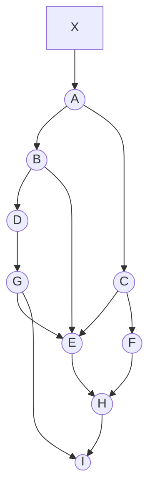

# Examinations 2019-2020

## PDF page 25

**L-3/T-1/CSE**  
**BANGLADESH UNIVERSITY OF ENGINEERING AND TECHNOLOGY, DHAKA**  
**L-3/T-1 B. Sc. Engineering Examinations (January 2021 Term)**  
**Sub: CSE 309 (Compiler)**  
**Date: 11/09/2021**  
**Full Marks: 210**  
**Section Marks: 105**  
**Time: 2 Hours 30 Minutes (Sections A + B)**

USE SEPARATE SCRIPTS FOR EACH SECTION  
The figures in the margin indicate full marks.

> **Transcription note:** Section A's heading says “January 2021 Term”; the corresponding Section B heading on PDF page 27 says “2019-2020”. Both original headings are preserved below.

## Section A

There are NINE questions in this section. Answer any SEVEN.

### 1

Explain the concept of “Line Control Directive” in compilation with necessary examples. **(15)**

### 2

Elaborate the role of a linker in compilation with reference to the relocatable machine code. **(15)**

### 3

Explain clearly, the relative merits and demerits of using: **(7+8)**

i. The same token with appropriate attributes for the comparison operators `<`, `≤`, `>`, `≥`, `≠`, and `==`.

ii. The same token with appropriate attributes for the arithmetic operators `+`, `-`, `×`, and `÷`.

### 4

**(a)** Elucidate how predictive parsers ensure that backtracking is avoided. **(10)**

**(b)** Write down the rule for using the “ε-productions” in predictive parsing. **(5)**

### 5

Eliminate left recursion from the following grammar: **(15)**

```text
X → XSb | Sa | b
S → Sb | Xa | a
```

You need to show the steps.

### 6

**(a)** Discuss the relative advantages and disadvantages of using single buffer instead of using buffer pairs in lexical analysis. **(6)**

**(b)** Consider the two grammars given below. **(9)**

**Grammar 1**

```text
A → aA | bd
B → aB | cc
```

**Grammar 2**

```text
A → aA | ad
B → bB | cc
```

Both of the above mentioned grammars have at least two bodies of the production rules beginning with an a. Explain in detail with proper justifications why one of the grammars is LL(1) while the other is not.

## PDF page 26

### 7

In carrying out nonrecursive predictive parsing for an input string w and a parsing table M, if X is the top stack symbol, a is the current input symbol, and `M[X, a] = X → Y1Y2...Yk`, the following actions are carried out, **(15)**

(i) output the production `X → Y1Y2...Yk`,

(ii) pop the stack,

(iii) push `Yk, Y(k-1), ..., Y2, Y1` onto the stack, with Y1 on top.

Explain with necessary figures and justifications, how the actions above correspond to top-down left-most derivation.

### 8

Define a “handle” in LR parsing. For the grammar, **(15)**

```text
S → aAcBe
A → Ab | b
B → d
```

and the input string `abbcde`, identify the handles and show how these are being pruned for a case of LR parsing. You need to construct a table with the columns Stack, Input, and Action as a part of your answer.

### 9

Augment the modified expression grammar given below and hence construct the initial set (often indicated as I0) of LR(1) items. **(15)**

```text
E → E + T | T
T → T * F | F
F → id
```

THE END [of the supplied Section A paper]

## PDF page 27

**L-3/T-1/CSE**  
**BANGLADESH UNIVERSITY OF ENGINEERING AND TECHNOLOGY, DHAKA**  
**L-3/T-1 B. Sc. Engineering Examinations 2019-2020**  
**Sub: CSE 309 (Compiler)**  
**Date: 11/09/2021**  
**Full Marks: 210**  
**Section Marks: 105**  
**Time: 2 Hours 30 Minutes (Sections A + B)**

USE SEPARATE SCRIPTS FOR EACH SECTION  
The figures in the margin indicate full marks.

## Section B

There are FOUR questions in this section. Answer any THREE.

Symbols have their usual meanings in the context of your text unless otherwise specified.

### 10

**(a)** Below is a grammar for variable declarations of the forms such as `int i, k[2], j[2][3];` Now write an SDT to save the type and width information of all the declared identifiers in the symbol table. Assume that (i) types are represented as type expressions and (ii) widths of an integer and a float are 4 and 8 bytes, respectively. Make other justified assumptions as required. **(12)**

```text
V → T D ;
T → int | float
D → D1 , id C | id C
C → [ num ] C1 | ε
```

**(b)** Below is an SDT for generating three-address code for array references. What will be the three-address code for the expression `a[b[i]][c[j]]` generated by the given SDT? Assume that the arrays a, b and c are declared as, `int a[5][5], b[3], c[3]` and types and widths of the arrays have correctly been saved in the symbol table. The attributes associated with the terminals and nonterminals have their usual meanings. Make other justified assumptions as required. **(11)**

```text
L → id [ E ]
    { L.array = top.get(id.lexeme);
      L.type = L.array.type.elem;
      L.addr = new Temp();
      gen(L.addr '=' E.addr '*' L.type.width); }

  | L1 [ E ]
    { L.array = L1.array;
      L.type = L1.type.elem;
      t = new Temp();
      L.addr = new Temp();
      gen(t '=' E.addr '*' L.type.width);
      gen(L.addr '=' L1.addr '+' t); }

E → id
    { E.addr = top.get(id.lexeme); }

  | L
    { E.addr = new Temp();
      gen(E.addr '=' L.array.base '[' L.addr ']'); }
```

## PDF page 28

**10(c)** The following SDT prints the prefix form of an expression, i.e., performs infix to prefix translation. Explain why it is not possible to implement the SDT during either top-down or bottom-up parsing. Describe, then, how such an SDT can be implemented. **(6+6)**

```text
L → E n
E → {print('+');} E1 + T
E → T
T → {print('*');} T1 * F
T → F
F → (E)
F → digit {print(digit.level);}
```

### 11

Consider the three-address code below and answer the following questions.

```text
 1  L1:  i = 0
 2  L3:  d = 4
 3  L4:  iffalse i < d goto L2
 4  L5:  j = i + 1
 5  L6:  iffalse j < d goto L7
 6  L8:  t1 = i * 16
 7       t2 = j * 4
 8       t3 = t1 + t2
 9       temp = a[t3]
10  L9:  t4 = i * 16
11       t5 = j * 4
12       t6 = t4 + t5
13       t7 = j * 16
14       t8 = i * 4
15       t9 = t7 + t8
16       t10 = a[t9]
17       a[t6] = t10
18  L10: t11 = j * 16
19       t12 = i * 4
20       t13 = t11 + t12
21       a[t13] = temp
22  L11: j = j + 1
23       goto L6
24  L7:  i = i + 1
25       goto L4
26  L2:
```

**(a)** Identify the basic blocks and construct the flow graph for the given code. **(17)**

**(b)** Optimize the code by using applicable transformations from the following list. (i) common subexpression elimination, (ii) copy propagation, (iii) dead code elimination, (iv) reduction in strength on induction variables, (v) elimination of induction variables. **(18)**

## PDF page 29

### 12

**(a)** What is backpatching? Write down a translation scheme (semantic actions) for generating code using backpatching for boolean expressions yielded by the following productions. You may add marker symbols in the productions as required. **(3+9)**

```text
B → B1 || B2
B → B1 && B2
B → E1 rel E2
```

**(b)** Based on the SDT in Question 12(a) above, draw the annotated parse tree for the expression: `x != y && x > 20 || x < 100`. Assume that the operators `||` and `&&` are left-associative and `&&` has higher precedence than `||`. Assume that the starting instruction number is 200. **(10)**

**(c)** Consider the network of objects below. Suppose at some point in time, the pointer `A → C` is deleted. Then we perform a mark-and-compact garbage collector on the network. Also, suppose that, **(13)**

i. Each object has size 50 bytes, and

ii. Initially, all the nine objects in the heap are arranged in alphabetical order, starting at byte 0 of the heap.

What is the address of each object after garbage collection? Draw the heap showing locations of the allocated objects before and after running garbage collection.

**Figure for Question 12(c) - directed object network before the specified deletion**



## PDF page 30

### 13

**(a)** Determine the liveness and next-use information for each statement in the following basic block. Also show the state of the symbol table at each of the steps of your algorithm. How does next-use information facilitate code optimization? Illustrate using the example of the given basic block. **(12+6)**

```text
t = a + b
u = c + d
t = d - b
v = a + c
d = t + v
```

**(b)** Translate the following basic block consisting of three-address statements into machine-code instructions for the simple machine model of your text. Assume that **two** registers are available. Make sure the registers are allocated and assigned efficiently to avoid unnecessary loads and stores. Show the register and address descriptors after each step. Assume p and q are temporary variables and the remaining variables are live on exit from the block. **(17)**

```text
p = a + b
q = c - p
c = d
d = q - c
exit
```
