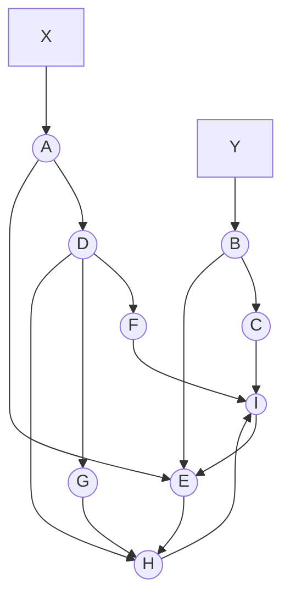

# Examinations 2020-2021

## PDF page 19

**L-3/T-1/CSE**  
**BANGLADESH UNIVERSITY OF ENGINEERING AND TECHNOLOGY, DHAKA**  
**L-3/T-1 B. Sc. Engineering Examinations 2020-2021**  
**Sub: CSE 309 (Compiler)**  
**Date: 25/10/2022**  
**Full Marks: 210**  
**Time: 3 Hours**

USE SEPARATE SCRIPTS FOR EACH SECTION  
The figures in the margin indicate full marks.

## Section A

There are FOUR questions in this section. Answer any THREE.

All the symbols have their usual meanings in the context of compilers unless explicitly mentioned.

### 1

The following grammar generates a list numbers of the form-

```text
{num1, num2, num3, ..., numn}
```

where the terminal **num** represents any constant integer number.

```text
L → '{' N '}'
N → N ',' num | num
```

**(a)** Design a syntax-directed definition (SDD) based on this grammar, which will compute and print for a given list of numbers - **(12)**

(i) the index of the maximum number and  
(ii) the count of numbers whose values are greater than their indices.

Assume the leftmost number has the index 0.

For examples, for the input `{3, 6, 1, 2, 5}`, (i) the index of the maximum number is 1, and (ii) the count of numbers whose values are greater than their indices is 3.

**(b)** For the SDD you have designed in the answer to Question 1(a), draw the annotated parse tree for the list- `{3, 6, 1, 2, 5}`. **(6)**

**(c)** Convert the SDD you have designed in the answer to Question 1(a) to an SDT. Can the SDT be implemented during top-down parsing? If not, transform the SDT such that it is implementable during top-down parsing. **(8)**

**(d)** Define Postfix SDT. Briefly describe how Postfix SDT's can be implemented during LR parsing. **(9)**

### 2

**(a)** What is an Intermediate Representation (IR)? What are the advantages of using an IR? Give two examples of IR. **(8)**

**(b)** Write syntax-directed definition (SDD) for the following flow-of-control statement corresponding to a for loop in 'C'. **(9)**

```text
S → for (S1; B; S2) S3
```

Assume S has an inherited attribute *next* that represents a label assigned to the next statement following S. The non-terminal B represents a Boolean expression.

## PDF page 20

**2(c)** Write down a translation scheme for generating code using backpatching for the flow-of-control statements yielded by the following productions. You may add marker symbols in the productions as required. Make other justified assumptions as required. **(12)**

```text
(i)  S → if (B) S1 else S2
(ii)   → while (B) S1
```

**2(d)** Translate the following if-else statement to three-address code avoiding redundant gotos. Assume `&&`, `||` are left associative and `&&` has higher precedence than `||`. **(6)**

```c
if ((x != y || x > 20) && x < 10) flag = 0; else flag = 1;
```

### 3

**(a)** The Baker's mark-and-sweep algorithm for garbage collection moves objects among four lists: *Free, Unreached, Unscanned,* and *Scanned*. Illustrate how Baker's mark-and-sweep algorithm garbage collector works using the example network below when the pointer `A → D` is deleted. Assume X and Y are members of the root set. What is the time and space complexity of the algorithm? **(15)**

**Figure for Question 3(a) - directed object network before the specified deletion**



**(b)** Explain why register allocation and assignment is a critical issue during code generation? While generating code for a basic block, a function is used to select registers for each memory location associated with a three-address instruction I. Assume the function is called `getReg(I)`. For an instruction of the form, `I: x = y + z`, what rules are used by the function `getReg(I)` while selecting registers for each of the variables, x, y, and z. **(5+15=20)**

### 4

**(a)** Consider the three-address code below and answer the following questions.

(i) Identify the basic blocks and construct the flow graph for the given code. Give each block an identifier and replace the label references in the statements with the corresponding identifiers. Also, find and list the loops in the flow graph. **(14)**

## PDF page 21

**4(a), continued**

(ii) Optimize the code by using all possible semantic preserving transformations. For each of the transformations used, specify the name of the transformation. **(14)**

```text
 1  L1:  i = 0
 2  L3:  t1 = n - 1
 3       iffalse i < t1 goto L2
 4  L4:  j = i + 1
 5  L5:  iffalse j < n goto L6
 6  L7:  t2 = i * 8
 7       t3 = a[t2]
 8       t4 = j * 8
 9       t5 = a[t4]
10       iffalse t3 > t5 goto L8
11  L9:  t6 = i * 8
12       p = a[t6]
13  L10: t7 = i * 8
14       t8 = j * 8
15       t9 = a[t8]
16       a[t7] = t9
17  L11: t10 = j * 8
18       a[t10] = p
19  L8:  j = j + 1
20       goto L5
21  L6:  i = i + 1
22       goto L3
23  L2:
```

**4(b)** Consider a 'C' code fragment and the corresponding assembly code generated by some 'gcc' compiler using `-O2` optimization switch. Now, identify the optimizations that have been performed by the compiler for the given 'C' code. Write an equivalent 'C' program for the optimized code. **(7)**

## PDF page 22

**4(b), continued**

**Program written in C**

```c
#include<stdio.h>
int fact(int n)
{
    if (n == 0) return 1;
    return n * fact(n-1);
}
int main() {
    int i = fact(5);
    printf("%d", i);
}
```

**Assembly code generated by gcc**

```asm
fact(int):
    mov eax, 1
    test edi, edi
    je .L1
.L2:
    imul eax, edi
    sub edi, 1
    jne .L2
.L1:
    ret
.LC0:
    .string "%d"
main:
    sub rsp, 8
    mov esi, 120
    mov edi, OFFSET FLAT:.LC0
    xor eax, eax
    call printf
    xor eax, eax
    add rsp, 8
    ret
```

## Section B

There are FOUR questions in this section. Answer any THREE.

### 5

**(a)** Describe the working principle of the language processor used by Java Programming Language? **(10)**

**(b)** Suppose you want to run a company that will produce compilers for different programming languages. If you need to build compilers for 10 programming languages, then which approach you will follow to build the front-end and back-end? Give a high-level overview of your design. **(15)**

[Your design must be efficient]

**(c)** In C programming language special keywords fall under the category of identifiers. Explain how lexical analyzer differentiates special keywords from identifiers. **(10)**

### 6

**(a)** Perform left factoring for the following grammar. **(5)**

```text
S → abA | abcS
A → aA | ε
```

## PDF page 23

**6(b)** Briefly describe the following questions. **(5+8+7=20)**

i. Is it possible to eliminate lexical analyzer step from compilation? (just write Yes or No)  
ii. Why lexical analyzer uses buffer pair instead of single buffer?  
iii. What does it mean by 'Panic Mode' in the context of lexical analyzer?

**6(c)** Does lexical analyzer will find errors from the following code snippet? If you think lexical analyzer will find some errors then explain them properly. **(10)**

```c
int arr[] = {1, 2, 3, 5};
int i = 0;
do {
    if (arr[i] % 2 == 0)
        print("EVEN\n");
    else
        print("ODD\n");
    i++;
} while (index < 4);
```

### 7

**(a)** Explain the difference among the following regular expressions in the context of Lex lexical analyzer generator. **(14)**

```text
i.   {mytoken}
ii.  [mytoken]
iii. mytoken
iv.  (mytoken)+
v.   mytoken +
vi.  (mytoken)*
vii. mytoken*
```

**(b)** Perform left recursion elimination from the following grammar. **(21)**

```text
S → Sa | Tb | Uc | a
T → Sc | Ta | Ub | b
U → Sb | Tc | Ua | c
```

### 8

**(a)** Compute FIRST and FOLLOW for the following grammar. **(5+10=15)**

```text
T → S$
S → DbE
D → VD | ε
V → cdE | acdE
E → c | ε
```

## PDF page 24

**8(b)** Consider the following grammar. **(20; right edge of the mark is clipped in the scan)**

```text
E  → TE'
E' → +TE' | ε
T  → FT'
T' → *FT' | ε
F  → (E) | id
```

On input `id + id * id`, construct a table by showing the moves that will be made by the non-recursive predictive parser algorithm.

---

