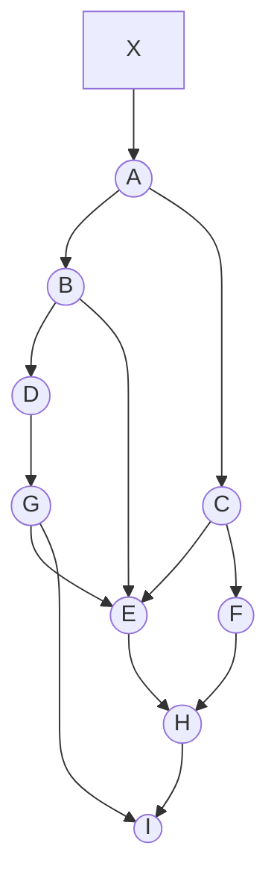
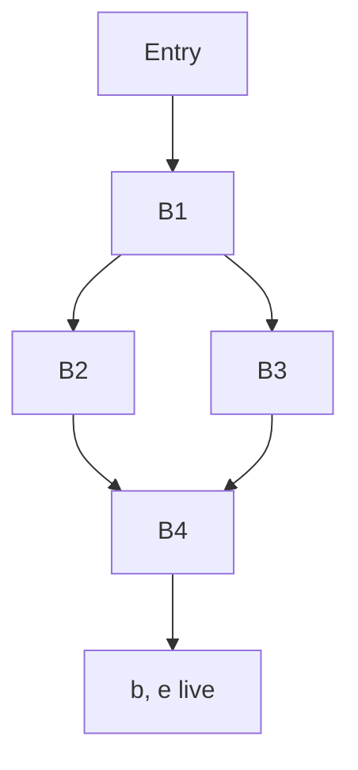

# Examinations 2021-2022

## PDF page 14

**L-3/T-1/CSE**  
**BANGLADESH UNIVERSITY OF ENGINEERING AND TECHNOLOGY, DHAKA**  
**L-3/T-1 B. Sc. Engineering Examinations 2021-2022**  
**Sub: CSE 309 (Compiler)**  
**Date: 30/03/2023**  
**Full Marks: 210**  
**Time: 3 Hours**

The figures in the margin indicate full marks.  
USE SEPARATE SCRIPTS FOR EACH SECTION

## Section A

There are FOUR questions in this section. Answer Q. No. 1 and any TWO from the rest. Question No. 1 is COMPULSORY.

### 1

**(a)** Consider the C code shown below contained in two separate files. Discuss in detail the issues faced by the linker and the loader when the program is compiled and then executed. How will these issues be resolved? Explain. **(13)**

**main.c**

```text
1  #include <stdio.h>
2  void main()
3  {
4      .......;
5      int i;
6      i = subfunction();
7      exit();
8  }
```

**subcode.c**

```c
void subfunction()
{
    int i, n = 0;
    for (i = 1; i <= 50; i++)
    {
        n = n + i;
    }
    return n;
}
```

**(b)** The partial contents of a buffer in lexical analyzer is `dhaka␣+++␣123.456␣`, where `␣` indicates a space. At the current moment, both the `lexemeBegin` and `forward` pointers are on d at left. From the perspective of the C programming language, describe clearly the pointer movements and recognition of tokens that will happen. **(10)**

## PDF page 15

**1(c)** Justify with proper reasons the acceptability (or unacceptability) of each of the following statements at any valid state in shift-reduce parsing. **(12)**

(i) Viable prefixes appear only at the bottom of the stack and not inside.  
(ii) Viable prefixes appear only at the top of the stack and not inside.  
(iii) The stack contains only a set of viable prefixes.  
(iv) Viable prefixes do not continue past the right end of the rightmost handle of that sentential form.

### 2

**(a)** Among the reasons why the analysis portion of the compiler is normally separated into lexical analysis and parsing (syntax analysis) phases, simplicity of design is the most important consideration - explain and justify. **(10)**

**(b)** In the LR-parsing algorithm, if `ACTION[sm, ai] = reduce A → β`, describe in detail how exactly this action is carried out. The symbols have got their meaning used in the class. What is the relationship of β with the stack content? **(10)**

**(c)** Enumerate and explain the classes that cover most or all of the tokens in the programming languages. **(7)**

**(d)** What is the one-liner rule to determine whether a token will require an attribute or not? Are all the token attributes single values? Explain. **(5)**

**(e)** Is input buffering essential in lexical analysis? Explain. **(3)**

### 3

**(a)** Explain clearly with examples, for a production rule like, `X → Y1Y2...Yk`, when ε is included in FIRST(X). **(8)**

**(b)** Describe what exactly happens during parsing when a cell of the predictive parsing table has an empty production rule like, `A → ε`. **(6)**

**(c)** What are the key decisions during top-down and bottom-up parsing? **(6)**

**(d)** Consider the following grammar: **(10)**

```text
A → kXYz
X → Xwr | w
Y → g
```

For the string `kwwrgz`, draw the parse tree and hence identify the handles for bottom-up parsing.

**(e)** In shift-reduce parsing, the handle will always eventually appear on top of the stack, never inside - justify this statement for the problem in (d). **(5)**

## PDF page 16

### 4

**(a)** Eliminate left recursion from the grammar: **(12)**

```text
S → SBr | a
B → Cs | b
C → St | c
```

**(b)** For the grammar shown below, find the LR(1) canonical items. **(10)**

```text
S → aAd | bBd | aBe | bAe
A → c
B → c
```

**(c)** From the LR(1) canonical items in Question 4(b) construct the CLR parsing table. **(8)**

**(d)** Comment on the similarity and dissimilarity between the sequences of shifts and reductions for the LR and LALR parsers. **(5)**

## Section B

There are FOUR questions in this section. Answer any THREE questions.

All the symbols have their usual meanings in the context of compilers unless explicitly mentioned.

### 5

**(a)** What is a dependency graph in the context of Syntax-Directed Definition (SSD)? How is a dependency graph constructed? What is the application of a dependency graph? **(4+4+3=11)**

**(b)** The following Syntax-Directed Translation Scheme (SDT) computes the value of a string of 0's and 1's interpreted as a positive, binary integer. **(10)**

```text
B → B1 0 {B.val = 2 × B1.val}
  | B1 1 {B.val = 2 × B1.val + 1}
  | 1    {B.val = 1}
```

Rewrite this SDT so that the underlying grammar is not left recursive, and yet the same value of B.val is computed for the entire input string.

**(c)** Give an example of an L-attributed SDD on an LR grammar. Is it possible to handle every LR grammar and L-attributed SDD bottom up? Give an intuitive argument in support of your answer. **(6+8=14)**

### 6

**(a)** Illustrate two distinctive aspects that distinguish Static Single-Assignment (SSA) from three-address code. How does SSA facilitate code optimization? Explain with an example. **(8+5=13)**

**(b)** Consider the following SDD for generating three-address codes using the fall-through technique. **(14)**

## PDF page 17

**6(b), continued**

**Production:** `S → if (B) S1`

**Semantic rules:**

```text
B.true = fall
B.false = S1.next = S.next
S.code = B.code || S1.code
```

**Production:** `B → B1 || B2`

**Semantic rules:**

```text
B1.true = if B.true ≠ fall then B.true else newLabel()
B1.false = fall
B2.true = B.true
B2.false = B.false
B.code = if B.true ≠ fall then B1.code || B2.code
         else B1.code || B2.code || label(B1.true)
```

Now add rules to the SDD above for the following two productions using the same fall-through technique.

```text
(i)  B → B1 && B2
(ii) B → E1 rel E2
```

Assume all the symbols, attributes, functions, labels, and notations have their usual meanings.

**6(c)** Write down a translation scheme for generating code using backpatching for the flow-of-control statement yielded by the following production. You may add marker symbols in the production as required; specify the semantic actions corresponding to the marker symbols. Make any other justified assumptions, as necessary. **(8)**

```text
S → for (S1; B; S2) S3
```

### 7

**(a)** Which condition must procedure calls or activations of procedure satisfy to enable stack allocation? Explain. Give an example of a programming language feature that violates the condition and thus cannot be implemented with purely a runtime stack. What are calling and return sequences in the context of procedure calls? **(6+6+5=17)**

**(b)** Consider the network of objects in the figure below. Assume, X denotes the root set. Suppose at some point in time, the pointer `A → C` is deleted. Then we execute Cheney's copying garbage collection algorithm on the network. Also, suppose that, **(18)**

(i) Each object has size 100 bytes,

(ii) The unscanned list is managed as a queue, and when an object has more than one pointer, the reached objects are added to the queue in alphabetical order,

(iii) The From semispace starts at location 0, and the To semispace starts at location 10,000, and

(iv) Initially, all the objects in the heap are arranged in alphabetical order starting at byte 0.

What is the value of `NewLoction(o)` for each object o that remains after garbage collection? Draw the heaps before and after running garbage collection, showing- (i) locations of the allocated objects, (ii) references running among the objects. What is the time complexity of the algorithm?

> **Transcription note:** The function name in this question is printed `NewLoction(o)`.

## PDF page 18

**Figure for Question 7(b) - directed object network before the specified deletion**

Root set: `X`. Objects: `A, B, C, D, E, F, G, H, I`.



### 8

**(a)** Optimize the following three-address code by eliminating common subexpressions, performing reduction in strength on induction variables, and eliminating all the induction variables as possible. **(10)**

```text
dp = 0
i = 0
L: t1 = i * 8
   t2 = A[t1]
   t3 = i * 8
   t4 = B[t3]
   t5 = t2 * t4
   dp = dp + t5
   i = i + 1
   if i < n goto L
```

**(b)** Given the flow graph of a program, formulate the problem of global register allocation as a graph coloring problem. Show detailed formulation steps using the flow graph in the figure below as an example. Subsequently, find a register allocation for the given program using Chaitin's algorithm. Assume that three physical registers are available. Illustrate all steps of the algorithm. **(13+12=25)**

**Figure for Question 8(b) - block contents**

```text
B1:
    a = b + c
    d = d - b
    e = a + f

B2:
    f = a - d

B3:
    b = d + f
    e = a - c

B4:
    b = d + c
```



**Directed flow edges:** `Entry → B1`, `B1 → B2`, `B1 → B3`, `B2 → B4`, `B3 → B4`, `B4 → Exit`.

At exit: **b, e live**.

---

