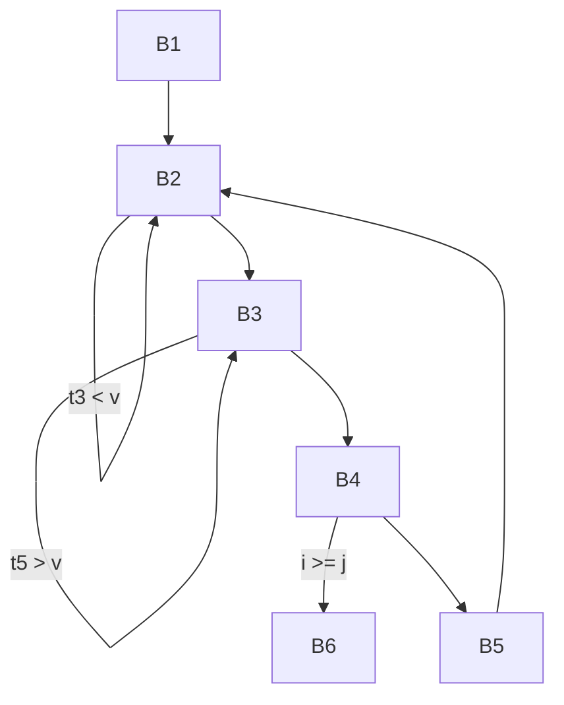
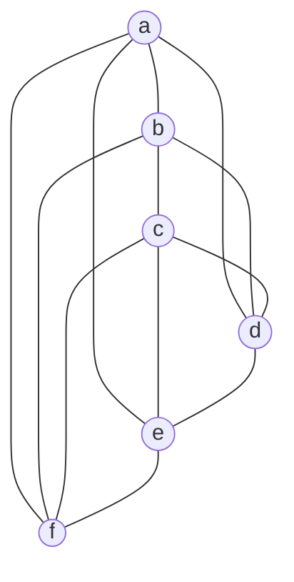

# Examinations 2023-2024

## PDF page 1

**L-3/T-1/CSE**  
**BANGLADESH UNIVERSITY OF ENGINEERING AND TECHNOLOGY, DHAKA**  
**L-3/T-1 B. Sc. Engineering Examinations 2023-2024**  
**Sub: CSE 309 (Compilers)**  
**Date: 24/08/2025**  
**Full Marks: 210**  
**Time: 3 Hours**

The figures in the margin indicate full marks.  
USE SEPARATE SCRIPTS FOR EACH SECTION

## Section A

There are FOUR questions in this section. Answer Question No. 1 and any TWO from the rest. Question No. 1 is COMPULSORY.

### 1

**(a)** Consider the following three files written in C programming language: **(10)**

**main.c**

```c
extern int foo(int x);  // Defined in libfoo
extern int bar(int x);  // Defined in libbar

int main() {
    return foo(5) + bar(3);
}
```

**libfoo.c**

```c
extern int baz(int x);  // Defined in libbar

int foo(int x) {
    return baz(x + 1);
}
```

**libbar.c**

```c
int baz(int x) {
    return x * 2;
}

int bar(int x) {
    return x + baz(x);
}
```

Assume these files are compiled into:

- `main.o` (relocatable object file for main),
- `libfoo.o` (shared library),
- `libbar.o` (shared library).

Explain the terms relocatable machine code, linker, and loader from the perspective of compilation and execution of the above program.

## PDF page 2

**1(b)** You are designing the lexical analyzer for a compiler. The language includes the arithmetic operators `+`, `-`, `*` and `/`. Consider the following options for defining tokens for these operators: **(12)**

1. **Distinct tokens:** Define completely different tokens for each operator:

   - `+ → TOK_PLUS`
   - `- → TOK_MINUS`
   - `* → TOK_MUL`
   - `/ → TOK_DIV`

2. **Grouped tokens:** Define one token for additive operators and another for multiplicative operators:

   - `+, - → TOK_ADD_OP`
   - `*, / → TOK_MUL_OP`

3. **Single token:** Define a single token for all arithmetic operators:

   - `+, -, *, / → TOK_ARITH_OP`

Which approach would you recommend and why? Justify your answer with specific trade-offs between implementation complexity and language design requirements.

**1(c)** Consider the grammar given below: **(13)**

```text
S → aB | bA
A → a
B → b
```

By carrying out rightmost derivations, find out whether the LR(1) items shown in the following table are valid for the corresponding viable prefixes shown in the same table.

| Viable Prefix | Item |
| --- | --- |
| a | [S → a · B, $] |
| b | [S → b · A, $] |
| b | [A → · a, $] |
| ab | [B → · b, b] |
| baa | [A → A · a, $] |
| ab | [B → b ·, $] |
| ba | [A → a ·, $] |
| a | [A → · a, a] |
| b | [S → b · A, a] |

> **Transcription note:** The `baa` row is printed as `[A → A · a, $]`, although `A → Aa` is not among the supplied productions. It is retained as printed.

## PDF page 3

### 2

**(a)** Elaborate on the advantages of separating lexical analysis from syntactic analysis, with a particular focus on how this separation contributes to the simplification and clarity of compiler design. **(6)**

**(b)** Is the use of intermediate representations strictly necessary in compiler design? Discuss in detail the potential benefits of incorporating intermediate representations within a compiler, supporting your explanation with relevant examples. **(9)**

**(c)** How does the buffer size of buffer pairs used in lexical analysis influence the characteristics and attributes of a programming language? Provide a detailed discussion. **(5)**

**(d)** Eliminate left-recursion for the following grammar: **(15)**

```text
S → Sa | Bb | c
B → Bd | Se | Cf | g
C → Ca | Bh | Sc | d
```

### 3

**(a)** Construct procedure based recursive-descent parsers, starting with each of the following grammars: **(10)**

```text
i.  S → S(S)S | ε
ii. S → 0S1 | 01
```

**(b)** Write down an LL(0) grammar containing at least three production rules. Justify why your answer is correct. **(6)**

**(c)** Consider grammar given below: **(14+5)**

```text
S → A - B)
A → B | a)
B → aB | a
```

i. Construct the LR(1) automata for the grammar.  
ii. Inspect the items carefully and comment on whether the grammar is SLR(1) or not.

> **Transcription note:** The minus sign and closing parentheses in this grammar are present in the printed source; an opening parenthesis has not been supplied editorially.

### 4

**(a)** Compare the automaton-based bottom-up parsers in terms of automaton used, number of states and parsing capability in a nicely formatted table. **(6)**

**(b)** When an LALR parser is constructed by merging states from a CLR parser, does it revert to being the same as an SLR parser? Explain clearly. **(9)**

**(c)** Argue carefully, with relevant examples, whether it is possible that when we replace all states having the same core of an LR(1) grammar with their union to build an LALR parser, is it possible that the resulting union will have a conflict. **(10)**

## PDF page 4

**4(d)** For the grammar: **(10)**

```text
1. S → SS+
2. S → SS*
3. S → a
```

Here is the SLR(1) parse table:

**Table for Question 4(d)**

| State | ACTION: a | ACTION: + | ACTION: * | ACTION: $ | GOTO: S | GOTO: A | GOTO: B |
| --- | --- | --- | --- | --- | --- | --- | --- |
| 0 | s2 | | | | 1 | | |
| 1 | | | | acc | | | |
| 2 | s4 | r3 | r3 | r3 | | | 3 |
| 3 | | | | r1 | | | |
| 4 | s4 | r3 | r3 | r3 | | | 5 |
| 5 | | s7 | s8 | | | 6 | |
| 6 | s4 | r3 | r3 | r3 | | | 9 |
| 7 | r4 | | | r4 | | | |
| 8 | r5 | | | r5 | | | |
| 9 | | r2 | r2 | r2 | | | |

Show the parsing steps in a table on the input `aa*a+`.

> **Transcription note:** The source table includes GOTO columns `A` and `B` and reductions `r4` and `r5`, although the displayed grammar only supplies three `S` productions. The table is transcribed as printed, without reconciliation.

## Section B

There are FOUR questions in this section. Answer Q. No. 5 and any TWO from the rest. Question No. 5 is COMPULSORY.

### 5

**(a)** Consider the flow graph below derived from some three-address code. Optimize the code by discovering all possible semantic preserving transformations. For each of the transformations used, specify the name of the transformation. **(16)**

**Figure for Question 5(a) - block contents**

```text
B1:
    i = m - 1
    j = n
    t1 = 4 * n

B2:
    v = a[t1]
    i = i + 1
    t2 = 4 * i
    t3 = a[t2]
    if t3 < v goto B2

B3:
    j = j - 1
    t4 = 4 * j
    t5 = a[t4]
    if t5 > v goto B3

B4:
    if i >= j goto B6

B5:
    t6 = 4 * i
    x = a[t6]
    t7 = 4 * i
    t8 = 4 * j
    t9 = a[t8]
    a[t7] = t9
    t10 = 4 * j
    a[t10] = x
    goto B2

B6:
    t11 = 4 * i
    x = a[t11]
    t12 = 4 * i
    t13 = 4 * n
    t14 = a[t13]
    a[t12] = t14
    t15 = 4 * n
    a[t15] = x
```

**Flow graph:**



**Directed flow edges:**

| From | To | Condition / path |
| --- | --- | --- |
| B1 | B2 | Fall-through |
| B2 | B2 | `t3 < v` |
| B2 | B3 | Fall-through |
| B3 | B3 | `t5 > v` |
| B3 | B4 | Fall-through |
| B4 | B6 | `i >= j` |
| B4 | B5 | Fall-through |
| B5 | B2 | `goto B2` |

## PDF page 5

**5(b)** Consider below a 'C' code fragment and the corresponding assembly code generated by some 'gcc' compiler using `-O2` optimization switch. Now, identify and explain the optimizations that have been performed by the compiler for the given 'C' code. Will the same optimization be performed if the array `arr[10]` is declared as a global variable? Justify your answer. **(9)**

**Program written in C**

```c
#include<stdio.h>
int main() {
    int arr[10];
    int n;
    scanf("%d", &n);
    for (int i=0; i<n-1; i++) {
        for (int j=0; j<n-i-1; j++) {
            if (arr[j] > arr[j+1]) {
                int temp = arr[j];
                arr[j] = arr[j+1];
                arr[j+1] = temp;
            }
        }
    }
    return 0;
}
```

**Assembly code generated by gcc**

```asm
.LC0:
    .string "%d"
"main":
    sub rsp, 24
    mov edi, OFFSET FLAT:.LC0
    xor eax, eax
    lea rsi, [rsp+12]
    call __isoc99_scanf
    xor eax, eax
    add rsp, 24
    ret
```

**5(c)** How can DAGs (Directed Acyclic Graph) be used to optimize basic blocks? Illustrate using the example basic block below. Assume d and f are not live on exit from the block. **(10)**

```text
d = b * c
e = a[i]
f = e + d
b = a[i]
a[j] = b
c = a[i]
```

### 6

**(a)** What is the difference between SDD (Syntax-Directed Definition) and SDT (Syntax-Directed Translation Scheme)? Which of the two is suitable for implementation? Explain. Name two classes of SDD that allow implementation during parsing. **(10)**

**(b)** The following SDT prints the prefix form of an expression, i.e., performs infix to prefix translation. Explain why it is not possible to implement the SDT during either top-down or bottom-up parsing. Describe, then, how such an SDT can be implemented. **(4+9)**

```text
L → E n
E → {print('+');} E1 + T
E → T
T → {print('*');} T1 + F
T → F
F → (E)
F → digit {print(digit.level);}
```

> **Transcription note:** The operator between `T1` and `F` is printed as `+`; a handwritten correction changes it to `*`. The terminal after `E` in the first production is printed as `n`. The attribute in the last production is printed as `digit.level`. These printed forms are retained.

## PDF page 6

**6(c)** What kinds of data are usually stored in an activation record? What are 'calling sequence' and 'return sequence' in the context of a procedure call? Describe some of the guiding principles while designing calling sequences and the layout of activation records. **(12)**

### 7

**(a)** Briefly describe two applications of types in a program. Consider the following grammar related to variable declarations. **(4+8)**

```text
P → D
D → T id; D | ε
```

Now, convert the above to an SDT (Syntax-Directed Translation Scheme) to save each declared variable in the symbol table along with its type and offset information. The symbol T in the above grammar represents type of id and it has two synthesized attributes *type* and *width*. Based on your SDT, what will be the offset of each of the variables in the below declarations.

```c
int a; int b; float f;
```

Assume that the size of int is 2 byte and size of float is 4 byte.

**(b)** Consider the following SDD for generating three-address codes using the fall-through technique. **(12)**

**Production:** `S → if (B) S1`

**Semantic rules:**

```text
B.true = fall
B.false = S1.next = S.next
S.code = B.code || S1.code
```

**Production:** `B → B1 || B2`

**Semantic rules:**

```text
B1.true = if B.true ≠ fall then B.true else newLabel()
B1.false = fall
B2.true = B.true
B2.false = B.false
B.code = if B.true ≠ fall then B1.code || B2.code
         else B1.code || B2.code || label(B1.true)
```

Now add rules to the SDD above for the following two productions using the same fall-through technique:

```text
(i)  B → B1 && B2
(ii) B → E1 rel E2
```

Assume all the symbols, attributes, functions, tables, and notations have their usual meanings.

**(c)** Based on the SDD in Question 7(b), draw the annotated parse tree for the statement below and find out the code generated by the SDD. Operators have their usual precedence and associativity. **(11)**

```c
if (x > 100 || x > 200 && x != y) x = 0;
```

## PDF page 7

### 8

**(a)** What are 'temporal locality' and 'spatial locality' in the context of a program execution? How does a garbage collector (GC) attempt to improve these two types of 'locality of reference'? Each garbage collection algorithm starts with a 'root set'. Which objects constitute the 'root set'? Consider below the pseudocode for Cheney's 'copying collector' from your text. Complete the code by defining the function 'LookupNewLocation'. **(15)**

```text
 1) CopyingCollector() {
 2)     for (all objects o in From space) NewLocation(o) = NULL;
 3)     unscanned = free = starting address of To space;
 4)     for (each reference r in the root set)
 5)         replace r with LookupNewLocation(r);
 6)     while (unscanned ≠ free) {
 7)         o = object at location unscanned;
 8)         for (each reference o.r within o)
 9)             o.r = LookupNewLocation(o.r);
10)         unscanned = unscanned + sizeof(o);
        }
    }
```

**(b)** Consider the following register interference graph (RIG) derived from the flow graph of some three address code. What do the vertices and edges denote in such a RIG? Using the RIG, explain how the problem of global register allocation can be formulated as a graph coloring problem. Subsequently, find register allocation for the given program using Chaitin's algorithm. Assume three physical registers are available. Describe how the algorithm works and illustrate all steps of the algorithm for the given RIG. Make any other justified assumptions as required. What is a 'spill' in the context of the algorithm? Explain briefly how spilled variables are handled. **(20)**

**Figure for Question 8(b) - undirected register interference graph**

Vertices: `a, b, c, d, e, f`.



Edges (each undirected edge listed once):

```text
a -- b
a -- d
a -- e
a -- f
b -- c
b -- d
b -- f
c -- d
c -- e
c -- f
d -- e
e -- f
```

---

