# CSE 309 - Complete Worked Solutions

127 worked answers covering all 45 main questions in five papers. Supporting references: Rumi Sir Merged (727 PDF pages) and KMS Merged (568 PDF pages). Page citations refer to merged PDF positions. These are derived solutions, not an official marking scheme.

---

# 2023-2024

## Section A

### 1(a) - Relocatable objects, linking and loading

Topics: Compiler pipeline; Linking and loading

#### Question

Consider the following three files written in C programming language: **(10)**

**main.c**

```c
extern int foo(int x);  // Defined in libfoo
extern int bar(int x);  // Defined in libbar

int main() {
    return foo(5) + bar(3);
}
```

**libfoo.c**

```c
extern int baz(int x);  // Defined in libbar

int foo(int x) {
    return baz(x + 1);
}
```

**libbar.c**

```c
int baz(int x) {
    return x * 2;
}

int bar(int x) {
    return x + baz(x);
}
```

Assume these files are compiled into:

- `main.o` (relocatable object file for main),
- `libfoo.o` (shared library),
- `libbar.o` (shared library).

Explain the terms relocatable machine code, linker, and loader from the perspective of compilation and execution of the above program.

> **Assumptions and source notes**
> - The problem labels .o files as shared libraries; the answer follows the stated shared-library assumption.

#### Solution

**Relocatable machine code** is machine code accompanied by symbol and relocation information so that its final addresses can be assigned later. `main.o` defines `main` and refers to unresolved external symbols `foo` and `bar`; the `foo` module defines `foo` and refers to `baz`; the `bar` module defines both `bar` and `baz`. Separate compilation checks each translation unit without needing the bodies in the others. A reference is recorded symbolically or via a relocation entry rather than assuming a permanent memory address.

**The linker** combines the necessary modules, lays out their sections, resolves symbol definitions and references, and performs the relocations that can be settled at link time. The dependencies are:

| Referencing module | Symbol | Defining module |
| --- | --- | --- |
| `main.o` | `foo` | `libfoo` |
| `main.o` | `bar` | `libbar` |
| `libfoo` | `baz` | `libbar` |

With shared libraries, the executable normally records dependencies on the libraries; their entire code need not be copied into it. Some symbol binding and address adjustment are deferred to the dynamic linker at loading or first use. Thus `libbar` is needed by both `main` and `libfoo`.

**The loader** maps the executable and its shared libraries into the process address space, arranges code/data mappings and the initial runtime environment, and transfers control to startup code, which eventually invokes `main`. The dynamic linking machinery resolves remaining dynamic symbols and relocations using the actual load addresses. Linking resolves relationships between modules; loading prepares the resulting program for execution, with dynamic linking potentially occurring during this stage.

Execution gives `foo(5)=baz(6)=12` and `bar(3)=3+baz(3)=9`, so `main` returns **21**.

The exam calls `libfoo.o` and `libbar.o` shared libraries. Conventionally `.o` denotes a relocatable object and `.so` a shared object; here their **stated role**, rather than their extension, determines the explanation.

**Reference basis:** Rumi PDF pp. 45, 46, 47, 48, 54, 56.

**Verification:**

- Traced all three external references and evaluated foo(5)+bar(3)=21.

### 1(b) - Choosing arithmetic operator tokens

Topics: Lexical analysis; LL parsing

#### Question

You are designing the lexical analyzer for a compiler. The language includes the arithmetic operators `+`, `-`, `*` and `/`. Consider the following options for defining tokens for these operators: **(12)**

1. **Distinct tokens:** Define completely different tokens for each operator:

   - `+ → TOK_PLUS`
   - `- → TOK_MINUS`
   - `* → TOK_MUL`
   - `/ → TOK_DIV`

2. **Grouped tokens:** Define one token for additive operators and another for multiplicative operators:

   - `+, - → TOK_ADD_OP`
   - `*, / → TOK_MUL_OP`

3. **Single token:** Define a single token for all arithmetic operators:

   - `+, -, *, / → TOK_ARITH_OP`

Which approach would you recommend and why? Justify your answer with specific trade-offs between implementation complexity and language design requirements.

#### Solution

For this fixed language, I recommend **distinct tokens**: `TOK_PLUS`, `TOK_MINUS`, `TOK_MUL`, `TOK_DIV`. Four one-character lexical rules are simple, and the parser directly sees the distinctions needed by the grammar. For example:

```text
E → E TOK_PLUS T | E TOK_MINUS T | T
T → T TOK_MUL F  | T TOK_DIV F   | F
```

This expresses precedence structurally and lets semantic actions select the exact operation. Unary minus can also have its own grammatical role while reusing `TOK_MINUS`.

| Choice | Benefit | Cost / limitation |
| --- | --- | --- |
| Four distinct tokens | Clear grammar, diagnostics and parser precedence declarations; no extra attribute needed to identify the operation | A few more token constants and grammar alternatives |
| `ADD_OP` and `MUL_OP` | Concise grammar: `E → E ADD_OP T | T`, `T → T MUL_OP F | F`; precedence classes remain visible | Each token must carry its actual operator, e.g. `⟨ADD_OP,MINUS⟩`; translation and some diagnostics inspect the attribute |
| One `ARITH_OP` | Small token vocabulary and convenient generic operator handling | Must retain the operator identity and recover precedence elsewhere; an ordinary CFG parser choosing by token name cannot distinguish `a+b*c` from `a*b+c` if all operators look identical |

**Grouped tokens are also a good choice** when the language intentionally gives every member of each class the same precedence and associativity. Their attribute preserves `+` versus `-`, or `*` versus `/`; grouping must never discard that identity. A single token can work with a Pratt or precedence-climbing parser that consults operator attributes, or a language giving all four operators equal precedence. Its smaller lexer vocabulary shifts work into the parser; it does not eliminate the need to represent language rules.

The decisive requirement is that token design preserve every distinction needed for parsing and translation. Lexer complexity is almost identical for these four symbols, so clarity of the parser is the stronger consideration.

**Reference basis:** Rumi PDF pp. 151, 152, 153, 191, 192.

**Verification:**

- Checked that grouped tokens retain exact operation as an attribute and that the two grammar levels preserve ordinary arithmetic precedence.

### 1(c) - Validity of LR(1) items for viable prefixes

Topics: LR parsing

#### Question

Consider the grammar given below: **(13)**

```text
S → aB | bA
A → a
B → b
```

By carrying out rightmost derivations, find out whether the LR(1) items shown in the following table are valid for the corresponding viable prefixes shown in the same table.

| Viable Prefix | Item |
| --- | --- |
| a | [S → a · B, $] |
| b | [S → b · A, $] |
| b | [A → · a, $] |
| ab | [B → · b, b] |
| baa | [A → A · a, $] |
| ab | [B → b ·, $] |
| ba | [A → a ·, $] |
| a | [A → · a, a] |
| b | [S → b · A, a] |

> **Transcription note:** The `baa` row is printed as `[A → A · a, $]`, although `A → Aa` is not among the supplied productions. It is retained as printed.

> **Assumptions and source notes**
> - The printed A→Aa item uses a production absent from the grammar; it is evaluated as invalid, not repaired.

#### Solution

An item `[A → β1 · β2, t]` is valid for viable prefix `αβ1` when there is a rightmost derivation

```text
S′ ⇒*rm α A w ⇒rm α β1 β2 w,
```

where `t` is the first terminal of `w`, or `$` if `w=ε`. The lookahead is the symbol **after the complete right-hand side**, not necessarily the next symbol after the dot.

Here the only complete rightmost derivations are

```text
S′ ⇒ S ⇒ aB ⇒ ab
S′ ⇒ S ⇒ bA ⇒ ba.
```

| Prefix | Item | Valid? | Reason |
| --- | --- | --- | --- |
| `a` | `[S → a · B, $]` | Yes | In `S ⇒ aB`, the recognized part of the RHS is `a`; `S` has empty following suffix. |
| `b` | `[S → b · A, $]` | Yes | In `S ⇒ bA`, the recognized part is `b`, followed after the production by end of input. |
| `b` | `[A → · a, $]` | Yes | `S ⇒ bA ⇒ ba`; before recognizing `a`, `α=b` and `β1=ε`. |
| `ab` | `[B → · b, b]` | No | The undotted `B` item is valid before its `b`, at prefix `a`; furthermore its only possible lookahead is `$`. |
| `baa` | `[A → A · a, $]` | No | `A → Aa` is not a production, so this is not even an item of the supplied grammar. Also `baa` is not a viable prefix. |
| `ab` | `[B → b ·, $]` | Yes | `S ⇒ aB ⇒ ab`; all of `B`'s RHS has been recognized. |
| `ba` | `[A → a ·, $]` | Yes | `S ⇒ bA ⇒ ba`; all of `A`'s RHS has been recognized. |
| `a` | `[A → · a, a]` | No | `A` is predicted after `b`, not after `a`, and its lookahead is `$`. |
| `b` | `[S → b · A, a]` | No | The core is appropriate, but `S` can be followed only by `$`, not `a`. |

The viable prefixes are `ε, a, b, aB, bA, ab, ba, S`; nothing in this grammar allows additional trailing `a` after `ba`.

**Reference basis:** Rumi PDF pp. 581, 582, 588, 589, 591, 575, 576.

**Verification:**

- Enumerated both rightmost derivations and checked production membership, dot position, prefix and lookahead separately for all nine rows.

### 2(a) - Why lexing and parsing are separate

Topics: Compiler pipeline; Lexical analysis

#### Question

Elaborate on the advantages of separating lexical analysis from syntactic analysis, with a particular focus on how this separation contributes to the simplification and clarity of compiler design. **(6)**

#### Solution

The lexer converts characters into tokens; the parser checks how those tokens form phrases. This separation simplifies both tasks.

1. **A smaller, clearer syntax grammar.** Whitespace and comments can be removed once by the lexer. Identifier spelling and numeric literal formats are described by lexical patterns rather than repeated inside expression, statement and declaration productions. For `total = x + 12;`, the parser sees `ID ASSIGN ID PLUS NUM SEMI`, with identifier/value attributes attached.
2. **Suitable algorithms for each problem.** Regular-expression/finite-automaton techniques efficiently recognize tokens. Context-free parsing techniques handle nesting, such as parentheses and blocks. Each component can be designed, tested and reasoned about independently.
3. **Efficient input processing.** The lexer can use block buffering, sentinels and character-level lookahead without complicating the parser. The parser requests the next token through a simple interface.
4. **Portability and maintenance.** Encoding and input-device details remain in the lexer. Changes to comments, identifier rules or literal notation usually do not affect the phrase grammar. Parser errors can still use source positions supplied with tokens.

The boundary must follow the language specification: for example, indentation-sensitive languages may have the lexer produce `INDENT`/`DEDENT` tokens rather than discard meaningful whitespace.

**Reference basis:** Rumi PDF pp. 130, 131, 133, 134, 136, 137, 142, 143, 144.

**Verification:**

- Applied the character/token interface to an assignment example and distinguished removable whitespace from significant indentation.

### 2(b) - Why compilers use intermediate representations

Topics: Compiler pipeline; Intermediate code

#### Question

Is the use of intermediate representations strictly necessary in compiler design? Discuss in detail the potential benefits of incorporating intermediate representations within a compiler, supporting your explanation with relevant examples. **(9)**

#### Solution

A separate, explicit IR phase is **not logically mandatory**. A simple compiler may emit target instructions directly while parsing or traversing its source representation. A syntax tree is itself an IR, however, so saying that a compiler has “no IR” often means it has no additional machine-like IR.

An IR is useful because it gives later phases an explicit representation of the computation:

- **Modularity:** the front end handles source syntax, names and types; the back end handles machine instructions and registers. Their shared IR is a stable interface.
- **Retargeting and reuse:** for `n` languages and `m` machines, a shared IR ideally needs `n` front ends plus `m` back ends, rather than `n×m` separate compiler implementations. Target-specific details still require appropriate lowering and configuration.
- **Optimization:** common-subexpression elimination, constant propagation, dead-code elimination and control/data-flow analysis can run on explicit operations and dependencies, independent of the original surface syntax.
- **Explicit evaluation and conversions:** IR records evaluation order, temporaries, branches and coercions, making correctness easier to inspect.
- **Several abstraction levels:** a high-level AST retains language structure; lower-level three-address or SSA code exposes operations for optimization and code generation. The compiler can choose the level best suited to each transformation.

For example, `position = initial + rate * 60` with floating-point variables may become:

```text
t1 = inttofloat(60)
t2 = rate * t1
t3 = initial + t2
position = t3
```

Constant folding can replace `t1` with the floating-point constant `60.0`. The same three-address computation can then be translated to different instruction sets. For `(a+b)*(a+b)`, a DAG/IR can represent `a+b` once and reuse it, provided the operand values are unchanged.

IR construction costs compilation time and memory, so a tiny one-target compiler may choose direct emission. For a portable optimizing compiler, the engineering and optimization benefits usually outweigh that cost.

**Reference basis:** Rumi PDF pp. 93, 94, 95, 96, 97, 98; KMS PDF pp. 85, 86, 87, 91, 93, 101, 116.

**Verification:**

- Checked the n+m versus n×m organization and preserved multiplication-before-addition plus the explicit integer-to-float conversion.

### 2(c) - Buffer size, lexeme limits and language design

Topics: Lexical analysis

#### Question

How does the buffer size of buffer pairs used in lexical analysis influence the characteristics and attributes of a programming language? Provide a detailed discussion. **(5)**

> **Assumptions and source notes**
> - The question’s premise is interpreted carefully: buffer size can constrain a naive implementation, but does not itself define language syntax or token limits.

#### Solution

**Buffer size is an implementation choice, not an inherent property of a programming language.** Increasing or decreasing it must not change the tokens accepted by a correctly implemented lexer for the same language.

In the textbook two-buffer scheme, both halves have capacity `N`; `lexemeBegin` marks the start of the current lexeme, and `forward` scans ahead. Refilling alternates between halves. In the simple scheme with no extra preservation mechanism, the slide's safety condition is

```text
length of current lexeme + required lookahead distance ≤ N.
```

Otherwise refilling can overwrite characters still needed for recognizing or copying the lexeme. This is a sufficient condition for that particular implementation, not a universal law that a token can never exceed `N` characters.

| Buffer choice | Effect |
| --- | --- |
| Larger `N` | Fewer input calls, support for longer in-buffer lexemes/lookahead; more memory and potentially unnecessary input read-ahead |
| Smaller `N` | Smaller memory footprint; more boundary crossings/refills and greater need to preserve long lexemes |
| Dynamic growth / spill area / incremental recognition | Allows arbitrary-length identifiers, strings and comments without imposing a fixed language limit |

A language **may explicitly specify** a maximum identifier or literal length. The implementation must honor that limit, choosing adequate buffering or checking the limit with a clear diagnostic. It must not silently truncate a long name and accidentally equate two different identifiers. For languages allowing long strings or comments, copying the accumulated lexeme to a separate area, growing a buffer, or scanning incrementally avoids tying the language to a disk-block size. The lecture's typical `N=4096` illustrates efficient block I/O; it does not make 4096 a language limit.

**Reference basis:** Rumi PDF pp. 166, 167, 168, 169, 170, 171, 172, 173, 174, 179, 180.

**Verification:**

- Used the exact lexeme-length-plus-lookahead condition stated on PDF p174.

### 2(d) - Eliminating direct and indirect left recursion

Topics: LL parsing

#### Question

Eliminate left-recursion for the following grammar: **(15)**

```text
S → Sa | Bb | c
B → Bd | Se | Cf | g
C → Ca | Bh | Sc | d
```

#### Solution

Use the nonterminal order **S, B, C**. Substitute already processed nonterminals before eliminating each immediate left recursion. New symbols are `S′, B′, C′`.

First remove `S → Sa`:

```text
S  → B b S′ | c S′
S′ → a S′ | ε
```

For `B`, substitute these alternatives into `B → Se`:

```text
B → B d | B b S′ e | c S′ e | C f | g
```

The left-recursive suffixes are `d` and `bS′e`, so:

```text
B  → c S′ e B′ | C f B′ | g B′
B′ → d B′ | b S′ e B′ | ε
```

For `C`, substitute `S` in `Sc`, then substitute `B` in both `Bh` and `BbS′c`:

```text
C → C a
  | c S′ e B′ h | C f B′ h | g B′ h
  | c S′ e B′ b S′ c | C f B′ b S′ c | g B′ b S′ c
  | c S′ c | d
```

Its immediate left-recursive suffixes are `a`, `fB′h`, `fB′bS′c`. A complete equivalent grammar without left recursion is therefore:

```text
S  → B b S′ | c S′
S′ → a S′ | ε

B  → c S′ e B′ | C f B′ | g B′
B′ → d B′ | b S′ e B′ | ε

C  → c S′ e B′ h C′
   | g B′ h C′
   | c S′ e B′ b S′ c C′
   | g B′ b S′ c C′
   | c S′ c C′
   | d C′
C′ → a C′ | f B′ h C′ | f B′ b S′ c C′ | ε
```

Every `C` alternative now starts with a terminal. Although `S` can start with `B` and `B` with `C`, this leading-nonterminal chain terminates at a terminal; it cannot return to `S` or `B`. Each new primed nonempty alternative also starts with a terminal. Thus both direct and indirect left recursion are eliminated.

**Reference basis:** Rumi PDF pp. 367, 368, 370, 371, 372.

**Verification:**

- Applied substitutions in order S,B,C and checked the nullable-prefix dependency graph for cycles.
- Compared generated terminal languages of the original and transformed grammars through length 5.

### 3(a) - Recursive-descent parsers for parentheses and 0ⁿ1ⁿ

Topics: LL parsing

#### Question

Construct procedure based recursive-descent parsers, starting with each of the following grammars: **(10)**

```text
i.  S → S(S)S | ε
ii. S → 0S1 | 01
```

#### Solution

Use `lookahead`, `advance()`, and `match(t)`, where `match` consumes `t` or reports an error. The driver calls the start procedure and then requires end of input `$`.

**(i) `S → S(S)S | ε`.** Direct recursive descent loops on the leading `S`. The language is exactly the balanced-parenthesis language: `S(S)S` joins balanced strings, and any nonempty balanced string decomposes as `(u)v` with balanced `u,v`. Use the equivalent unambiguous grammar:

```text
S → ( S ) S | ε
```

```text
procedure S():
    if lookahead == '(':
        match('(')
        S()
        match(')')
        S()
    else if lookahead == ')' or lookahead == '$':
        return                 // S → ε
    else:
        error()

procedure parse():
    S()
    match('$')
```

The empty alternative is selected only on `FOLLOW(S)={')','$'}`. A top-level stray `)` is rejected by the final end-marker check. This parser recognizes the same strings, while choosing a particular parse structure because the original grammar is ambiguous.

**(ii) `S → 0S1 | 01`.** Left-factor the common `0`:

```text
S → 0 R
R → S 1 | 1
```

`FIRST(S1)={0}` and `FIRST(1)={1}`, so one symbol after the leading `0` chooses the alternative.

```text
procedure S():
    match('0')
    if lookahead == '0':
        S()                    // use 0 S 1
    else if lookahead != '1':
        error()
    match('1')                 // closes either alternative

procedure parse():
    S()
    match('$')
```

It accepts exactly `0ⁿ1ⁿ` for `n≥1`: `01`, `0011`, `000111`, etc.; it rejects `ε`, `001` and `0101`. All recursive calls consume a `0` first, so no left-recursive call can loop without consuming input.

**Reference basis:** Rumi PDF pp. 305, 310, 319, 325, 326, 332, 334, 368.

**Verification:**

- Exhaustively compared the parenthesis parser with balance checking and the binary parser with the language 0ⁿ1ⁿ on all inputs through length 12.

### 3(b) - A genuine LL(0) grammar

Topics: LL parsing

#### Question

Write down an LL(0) grammar containing at least three production rules. Justify why your answer is correct. **(6)**

#### Solution

One example with three production rules is:

```text
S → a A
A → b B
B → c
```

It generates exactly `{abc}`. At each nonterminal there is **only one possible production**, so a predictive parser needs **zero input symbols to choose a production**. It expands `S`, then `A`, then `B` without inspecting any lookahead to resolve alternatives. Terminal matching still reads the input to check that it is exactly `abc`; “zero lookahead” does not mean that input is never read or checked.

In the formal LL(0) condition, a conflict requires two different productions for the same nonterminal to be possible in the same leftmost context with indistinguishable zero-length lookahead. There are no such pairs in this grammar, so the condition holds vacuously. Its unique derivation is `S ⇒ aA ⇒ abB ⇒ abc`.

An example such as `S → aS | ε` would **not** work: deciding whether to continue or stop requires seeing whether another `a` remains. A grammar being easy to parse, LL(1), or LR(0) does not by itself make it LL(0).

**Reference basis:** Rumi PDF pp. 305, 319, 325, 326, 575, 576.

**Verification:**

- Checked the zero-lookahead production-choice condition, rather than confusing terminal matching with predictive lookahead.

### 3(c) - Canonical LR(1) automaton for the literal printed grammar

Topics: LR parsing; FIRST and FOLLOW

#### Question

Consider grammar given below: **(14+5)**

```text
S → A - B)
A → B | a)
B → aB | a
```

i. Construct the LR(1) automata for the grammar.  
ii. Inspect the items carefully and comment on whether the grammar is SLR(1) or not.

> **Transcription note:** The minus sign and closing parentheses in this grammar are present in the printed source; an opening parenthesis has not been supplied editorially.

> **Assumptions and source notes**
> - Solved the literal grammar with terminals minus and closing parenthesis; no opening parenthesis was silently added.
> - Canonical LR(1) states and classification are independently derived; the supplied Rumi excerpt supplies LR(0)/SLR construction principles.

#### Solution

Treat the printed `-` and `)` as **literal terminal symbols**. A context-free grammar need not have balanced punctuation in its productions. No missing `(` is inserted.

Number the augmented productions:

```text
0. S′ → S
1. S  → A - B )
2. A  → B
3. A  → a )
4. B  → a B
5. B  → a
```

**(i) Canonical LR(1) states.** Closure adds `[Y→·γ,t]` for every `t∈FIRST(βu)` when `[X→α·Yβ,u]` is present. In the notation below `{t}` is the item's lookahead set; all items are listed, including closure items.

```text
I0:
  [S′ → · S, $]
  [S  → · A - B ), $]
  [A  → · B, -]
  [A  → · a ), -]
  [B  → · a B, -]
  [B  → · a, -]

I1:
  [S → A · - B ), $]

I2:
  [A → B ·, -]

I3:
  [S′ → S ·, $]

I4:
  [A → a · ), -]
  [B → a · B, -]
  [B → a ·, -]
  [B → · a B, -]
  [B → · a, -]

I5:
  [S → A - · B ), $]
  [B → · a B, )]
  [B → · a, )]

I6:
  [A → a ) ·, -]

I7:
  [B → a B ·, -]

I8:
  [B → a · B, -]
  [B → a ·, -]
  [B → · a B, -]
  [B → · a, -]

I9:
  [S → A - B · ), $]

I10:
  [B → a · B, )]
  [B → a ·, )]
  [B → · a B, )]
  [B → · a, )]

I11:
  [S → A - B ) ·, $]

I12:
  [B → a B ·, )]
```

The complete transition function is:

| State | `a` | `-` | `)` | `S` | `A` | `B` |
| --- | --- | --- | --- | --- | --- | --- |
| I0 | I4 | — | — | I3 | I1 | I2 |
| I1 | — | I5 | — | — | — | — |
| I4 | I8 | — | I6 | — | — | I7 |
| I5 | I10 | — | — | — | — | I9 |
| I8 | I8 | — | — | — | — | I7 |
| I9 | — | — | I11 | — | — | — |
| I10 | I10 | — | — | — | — | I12 |

States absent from the transition table have no outgoing transitions. The nonempty parsing actions are:

| State | `a` | `-` | `)` | `$` |
| --- | --- | --- | --- | --- |
| 0 | s4 | — | — | — |
| 1 | — | s5 | — | — |
| 2 | — | r2 | — | — |
| 3 | — | — | — | accept |
| 4 | s8 | r5 | s6 | — |
| 5 | s10 | — | — | — |
| 6 | — | r3 | — | — |
| 7 | — | r4 | — | — |
| 8 | s8 | r5 | — | — |
| 9 | — | — | s11 | — |
| 10 | s10 | — | r5 | — |
| 11 | — | — | — | r1 |
| 12 | — | — | r4 | — |

No cell conflicts, so the literal grammar is **LR(1)**.

**(ii) It is not SLR(1).**

```text
FOLLOW(S) = {$}
FOLLOW(A) = {-}
FOLLOW(B) = {-, )}
```

The LR(0) state reached after the initial `a` contains both `A→a·)` and `B→a·`. The former shifts `)`. SLR uses the whole `FOLLOW(B)` for the latter, and therefore also reduces `B→a` on `)`: a **shift/reduce conflict**. Canonical LR(1) I4 instead gives that completed B item only lookahead `-`, so it correctly shifts `)` there. The same B production has lookahead `)` in the distinct right-hand-B context I10.

This identifies the actual weakness of SLR: it loses the context in which the B item occurs. The canonical automaton has **13 states**, while the LR(0) automaton has **11**.

**Reference basis:** Rumi PDF pp. 581, 582, 588, 589, 591, 699, 700, 720, 723, 724.

**Verification:**

- Computed closure and GOTO to a fixed point: 13 CLR states, 11 LR(0) states, no CLR conflicts, one SLR conflict on ) after initial a.

### 4(a) - Comparing LR parser constructions

Topics: LR parsing

#### Question

Compare the automaton-based bottom-up parsers in terms of automaton used, number of states and parsing capability in a nicely formatted table. **(6)**

#### Solution

Let `N0` be the number of reachable states of the augmented grammar's LR(0) item automaton, and `N1` the number in its canonical LR(1) automaton.

| Parser | Item automaton / reduction rule | Number of states | Parsing capability |
| --- | --- | --- | --- |
| LR(0) | DFA of LR(0) item sets; completed items reduce without lookahead restriction | `N0` | Least powerful of these four; only LR(0) grammars |
| SLR(1) | The same LR(0) DFA; reduce `A→α` only on `FOLLOW(A)` | `N0` | Strictly more grammars than LR(0), but global FOLLOW sets can cause false conflicts |
| LALR(1) | Merge canonical LR(1) states with equal LR(0) cores; union each item's lookaheads | `N0` in the standard reachable construction | Strictly more grammars than SLR(1); compact states with more contextual reduction lookaheads |
| CLR(1), canonical LR(1) | DFA of full LR(1) item sets, including each item's lookahead | `N1 ≥ N0`; often substantially larger | Most powerful of these four; all LR(1) grammars |

The strict grammar-class inclusions are

```text
LR(0) ⊊ SLR(1) ⊊ LALR(1) ⊊ LR(1).
```

SLR, LALR and CLR all use one input token of lookahead, but use different amounts of **state context** to decide where reductions are legal. The DFA controls the parser together with a stack; a finite automaton by itself does not parse arbitrary context-free languages. State numbering is construction-dependent, so an absolute state count cannot be given without a particular grammar.

**Reference basis:** Rumi PDF pp. 575, 576, 581, 588, 616, 652, 696, 699, 700.

**Verification:**

- Compared reduction criteria as well as automaton state counts; distinguished the control DFA from the full stack-based parser.

### 4(b) - Why LALR does not collapse to SLR

Topics: LR parsing; FIRST and FOLLOW

#### Question

When an LALR parser is constructed by merging states from a CLR parser, does it revert to being the same as an SLR parser? Explain clearly. **(9)**

#### Solution

**No.** LALR and SLR normally have the same LR(0) cores and the same number of states, but they attach reductions to different terminal sets.

- **SLR:** every state containing `A→α·` reduces on all of `FOLLOW(A)`, regardless of which path reached the state.
- **LALR:** that item reduces only on the union of the lookaheads attached to it in canonical LR(1) states with that core. The union retains more context than the global FOLLOW set.

An item's LALR lookahead is contained in `FOLLOW(A)`; it can be a strict subset. For example:

```text
S → L = R | R
L → * R | id
R → L
```

The LR(0) state containing `S→L·=R` and `R→L·` causes an SLR conflict: `=` can be shifted, while `=∈FOLLOW(R)` also permits reduction `R→L`.

In the canonical LR(1) state reached by the initial `L`, the items are

```text
[S → L · = R, $]
[R → L ·, $]
```

That completed R item reduces only on `$`, while `=` shifts. Merging equal cores does not add `=` to this item's lookahead in this state, so the grammar is **LALR(1), but not SLR(1)**.

Thus compactness does not imply identical parsing tables. Equal numbers of control states can carry different, more precise reduction permissions.

**Reference basis:** Rumi PDF pp. 720, 721, 722, 723, 724, 725, 726, 727.

**Verification:**

- Checked the textbook assignment grammar’s conflict: SLR shifts and reduces on =, whereas the LALR completed R item reduces only on $.

### 4(c) - Conflicts introduced by merging LR(1) states

Topics: LR parsing

#### Question

Argue carefully, with relevant examples, whether it is possible that when we replace all states having the same core of an LR(1) grammar with their union to build an LALR parser, is it possible that the resulting union will have a conflict. **(10)**

#### Solution

**A new reduce/reduce conflict can arise; a new shift/reduce conflict cannot arise when the original canonical LR(1) table is conflict-free.**

Consider the LR(1) grammar:

```text
S → a A d | b A e | a B e | b B d
A → c
B → c
```

Two canonical LR(1) states have the same LR(0) core:

| Context | Completed items |
| --- | --- |
| After `ac` | `[A→c·, d]`, `[B→c·, e]` |
| After `bc` | `[A→c·, e]`, `[B→c·, d]` |

Each state is conflict-free: `d` and `e` select different reductions. Merging them gives

```text
[A → c ·, {d,e}]
[B → c ·, {d,e}]
```

Both reductions are now offered on `d`, and both on `e`. The LALR table has **reduce/reduce conflicts**, although the CLR table has none. The lost information is whether the preceding context was `a` or `b`.

For the shift/reduce claim, suppose a merged state offered a shift on `t` and reduction `A→α` on `t`. A shift requires a core item `X→β·tγ`; all states being merged have that same core item. The reduction's lookahead `t` must have come from at least one original state. That original state therefore already contained both the shift item and the reducing item with lookahead `t`, contradicting the assumption that the canonical table was conflict-free.

Consequently every LR(1) grammar need not be LALR(1); the possible **new** conflict from equal-core merging is reduce/reduce. Conflicts that already existed in a non-LR(1) source automaton are a separate matter.

**Reference basis:** Rumi PDF pp. 581, 582, 588, 700, 704, 724.

**Verification:**

- Independently constructed the example’s CLR automaton, grouped equal cores, and checked that merging introduces reduce/reduce conflicts on d/e only.

### 4(d) - Parsing aa*a+ despite a mismatched printed table

Topics: LR parsing; FIRST and FOLLOW

#### Question

For the grammar: **(10)**

```text
1. S → SS+
2. S → SS*
3. S → a
```

Here is the SLR(1) parse table:

**Table for Question 4(d)**

| State | ACTION: a | ACTION: + | ACTION: * | ACTION: $ | GOTO: S | GOTO: A | GOTO: B |
| --- | --- | --- | --- | --- | --- | --- | --- |
| 0 | s2 | | | | 1 | | |
| 1 | | | | acc | | | |
| 2 | s4 | r3 | r3 | r3 | | | 3 |
| 3 | | | | r1 | | | |
| 4 | s4 | r3 | r3 | r3 | | | 5 |
| 5 | | s7 | s8 | | | 6 | |
| 6 | s4 | r3 | r3 | r3 | | | 9 |
| 7 | r4 | | | r4 | | | |
| 8 | r5 | | | r5 | | | |
| 9 | | r2 | r2 | r2 | | | |

Show the parsing steps in a table on the input `aa*a+`.

> **Transcription note:** The source table includes GOTO columns `A` and `B` and reductions `r4` and `r5`, although the displayed grammar only supplies three `S` productions. The table is transcribed as printed, without reconciliation.

> **Assumptions and source notes**
> - The printed table fails; a separate correct table for the displayed grammar is explicitly constructed rather than silently substituting entries.

#### Solution

**The supplied table cannot be used consistently with the supplied three-production grammar.** Keep that discrepancy visible before deriving a correct table.

Using the printed table literally gives:

| Step | Stack | Remaining input | Printed action / result |
| --- | --- | --- | --- |
| 0 | `0` | `aa*a+$` | `s2` |
| 1 | `0 a 2` | `a*a+$` | `s4` |
| 2 | `0 a 2 a 4` | `*a+$` | `r3`, i.e. `S→a` |
| 3 | `0 a 2` | `*a+$` | Must push `S` and `GOTO(2,S)`, but that entry is blank: failure |

The table also has GOTO columns A/B and reductions r4/r5, none defined by the displayed grammar. It must belong to another grammar or contain printing errors; its intended missing productions cannot be uniquely inferred.

**A valid solution for the displayed grammar** uses the unchanged productions `1:S→SS+`, `2:S→SS*`, `3:S→a`, augmented by `S′→S`. A fresh LR(0) collection is:

```text
I0: S′→·S, S→·SS+, S→·SS*, S→·a
I1: S′→S·, S→S·S+, S→S·S*, S→·SS+, S→·SS*, S→·a
I2: S→a·
I3: S→SS·+, S→SS·*, S→S·S+, S→S·S*, S→·SS+, S→·SS*, S→·a
I4: S→SS*·
I5: S→SS+·
```

`FOLLOW(S)={a,+,*,$}`. The resulting conflict-free SLR table is:

| State | `a` | `+` | `*` | `$` | GOTO S |
| --- | --- | --- | --- | --- | --- |
| 0 | s2 | — | — | — | 1 |
| 1 | s2 | — | — | accept | 3 |
| 2 | r3 | r3 | r3 | r3 | — |
| 3 | s2 | s5 | s4 | — | 3 |
| 4 | r2 | r2 | r2 | r2 | — |
| 5 | r1 | r1 | r1 | r1 | — |

With these **newly derived state numbers**, the successful trace is:

| Step | Stack | Remaining input | Action |
| --- | --- | --- | --- |
| 0 | `0` | `aa*a+$` | s2 |
| 1 | `0 a 2` | `a*a+$` | r3: S→a |
| 2 | `0 S 1` | `a*a+$` | s2 |
| 3 | `0 S 1 a 2` | `*a+$` | r3: S→a |
| 4 | `0 S 1 S 3` | `*a+$` | s4 |
| 5 | `0 S 1 S 3 * 4` | `a+$` | r2: S→SS* |
| 6 | `0 S 1` | `a+$` | s2 |
| 7 | `0 S 1 a 2` | `+$` | r3: S→a |
| 8 | `0 S 1 S 3` | `+$` | s5 |
| 9 | `0 S 1 S 3 + 5` | `$` | r1: S→SS+ |
| 10 | `0 S 1` | `$` | accept |

It represents the postfix expression `(a*a)+a`; the bottom-up reductions build the two operands of `*`, then combine that result with the last `a` using `+`.

**Reference basis:** Rumi PDF pp. 649, 652, 698, 699, 700, 701, 702, 703, 704.

**Verification:**

- Simulated the literal table through its undefined GOTO(2,S).
- Constructed all six LR(0) states, computed FOLLOW(S), checked for conflicts and simulated the complete accepting trace.

## Section B

### 5(a) - Optimizing the partition flow graph

Topics: Code optimization; Liveness analysis

#### Question

Consider the flow graph below derived from some three-address code. Optimize the code by discovering all possible semantic preserving transformations. For each of the transformations used, specify the name of the transformation. **(16)**

**Figure for Question 5(a) - block contents**

```text
B1:
    i = m - 1
    j = n
    t1 = 4 * n

B2:
    v = a[t1]
    i = i + 1
    t2 = 4 * i
    t3 = a[t2]
    if t3 < v goto B2

B3:
    j = j - 1
    t4 = 4 * j
    t5 = a[t4]
    if t5 > v goto B3

B4:
    if i >= j goto B6

B5:
    t6 = 4 * i
    x = a[t6]
    t7 = 4 * i
    t8 = 4 * j
    t9 = a[t8]
    a[t7] = t9
    t10 = 4 * j
    a[t10] = x
    goto B2

B6:
    t11 = 4 * i
    x = a[t11]
    t12 = 4 * i
    t13 = 4 * n
    t14 = a[t13]
    a[t12] = t14
    t15 = 4 * n
    a[t15] = x
```

**Flow graph:**

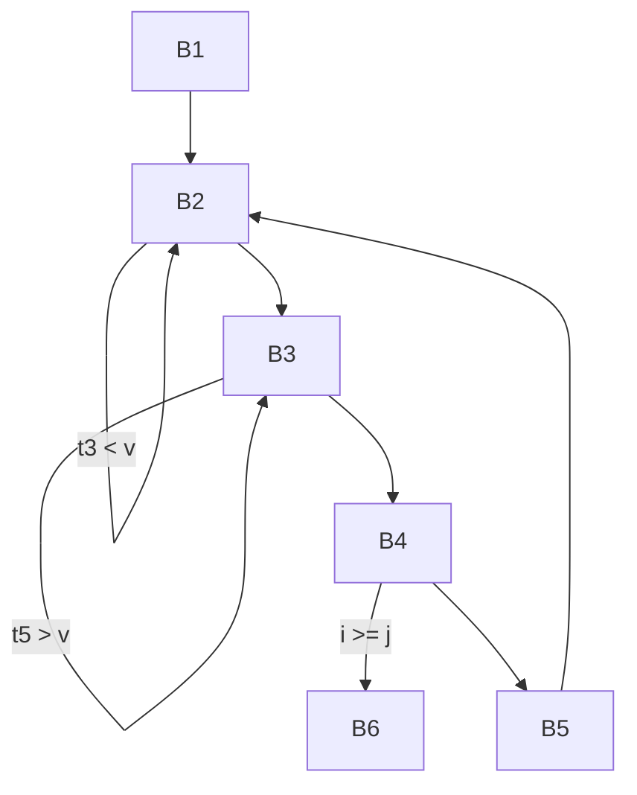

**Directed flow edges:**

| From | To | Condition / path |
| --- | --- | --- |
| B1 | B2 | Fall-through |
| B2 | B2 | `t3 < v` |
| B2 | B3 | Fall-through |
| B3 | B3 | `t5 > v` |
| B3 | B4 | Fall-through |
| B4 | B6 | `i >= j` |
| B4 | B5 | Fall-through |
| B5 | B2 | `goto B2` |

> **Assumptions and source notes**
> - Optimizations assume nonvolatile ordinary array accesses, no hidden scalar/array aliases, valid indices and no arithmetic overflow.
> - Deleting i, j or x is conditional on their liveness; the main optimized listing retains them.

#### Solution

Assume ordinary nonvolatile array elements, no hidden aliases modifying the array or scalar indices, valid accessed addresses, and arithmetic without overflow. `t1,…,t15` are compiler temporaries. Keep `i`, `j`, `v` and `x` to avoid assuming they are dead on exit.

**1. Local common-subexpression elimination.** In B5, all `4*i` computations are equal and all `4*j` computations are equal. Likewise B6 repeats `4*i` and `4*n`. Replace their repeated results by one representative and propagate copies.

**2. Global common-subexpression elimination.** On entry to B5 or B6, `t2=4*i` is still available from B2 and `t4=4*j` is available from B3. Neither index changes between its computation and these blocks. Hence B5/B6 can use `t2,t4,t1` directly. No intervening store occurs between B2's `t3=a[t2]`, B3's `t5=a[t4]`, and the first store in B5/B6. Thus B5's `x` can use `t3`, its `t9` can use `t5`, and B6's `x` can use `t3`.

**3. Loop-invariant code motion.** Move `v=a[t1]` from B2 into B1. This needs a proof about the array, not merely the fact that `t1` is unchanged: before each B5, B3 has decremented `j` from its initial `n`, so `j<n`; B5 is reached only when `i<j`. Therefore neither B5 store writes index `n`. B6 is an exit and never goes back to B2. Consequently `a[4*n]` remains the same pivot throughout the loop, so the hoist is safe. B6's later `t14=a[t1]` can also reuse `v` before its stores.

**4. Copy propagation and dead-code elimination.** Replace redundant temporaries by the available values above; delete their now-unused assignments. This removes the address recomputations and unnecessary loads in B5/B6.

**5. Strength reduction using induction variables.** Initialize `t2=4*i` and `t4=4*j` in B1. Whenever `i` increases by one, update `t2` by four; whenever `j` decreases by one, update `t4` by minus four. This replaces repeated loop multiplications with additions/subtractions.

A complete resulting flow graph has the same edges and these block contents:

```text
B1:
    i = m - 1
    j = n
    t1 = 4 * n
    v = a[t1]
    t2 = 4 * i
    t4 = t1

B2:
    i = i + 1
    t2 = t2 + 4
    t3 = a[t2]
    if t3 < v goto B2

B3:
    j = j - 1
    t4 = t4 - 4
    t5 = a[t4]
    if t5 > v goto B3

B4:
    if i >= j goto B6

B5:
    x = t3
    a[t2] = t5
    a[t4] = x
    goto B2

B6:
    x = t3
    a[t2] = v
    a[t1] = x
```

**Optional induction-variable elimination:** if `i` and `j` are not live after the fragment, change B4 to `if t2 >= t4 goto B6`, then delete the loop updates of `i` and `j`. Scaling by positive four preserves their order under the stated no-overflow assumption. Their initial values can be used only to initialize `t2,t4`; alternatively initialize `t2=4*(m-1)`, `t4=4*n`. If `x` is also dead on exit, propagate `t3` into both stores and remove `x=t3`.

The original swap loads must not be replaced by a load **after** one of the stores; using the saved `t3,t5` preserves the old element values. If the pivot-invariance or no-alias proof is unavailable, retain B2's pivot reload instead of hoisting it. There is no standalone constant-only expression here requiring constant folding.

**Reference basis:** KMS PDF pp. 539, 540, 541, 542, 543, 544, 547, 548, 552, 555, 558, 559, 560, 561, 563, 565.

**Verification:**

- Checked availability of each reused index/load and proved B5 cannot modify the pivot at index n.
- Differentially simulated original and optimized blocks on randomized valid partition inputs, comparing final array, i, j, v and x.

### 5(b) - Dead sorting loops, observable effects and global arrays

Topics: Code optimization; Liveness analysis

#### Question

Consider below a 'C' code fragment and the corresponding assembly code generated by some 'gcc' compiler using `-O2` optimization switch. Now, identify and explain the optimizations that have been performed by the compiler for the given 'C' code. Will the same optimization be performed if the array `arr[10]` is declared as a global variable? Justify your answer. **(9)**

**Program written in C**

```c
#include<stdio.h>
int main() {
    int arr[10];
    int n;
    scanf("%d", &n);
    for (int i=0; i<n-1; i++) {
        for (int j=0; j<n-i-1; j++) {
            if (arr[j] > arr[j+1]) {
                int temp = arr[j];
                arr[j] = arr[j+1];
                arr[j+1] = temp;
            }
        }
    }
    return 0;
}
```

**Assembly code generated by gcc**

```asm
.LC0:
    .string "%d"
"main":
    sub rsp, 24
    mov edi, OFFSET FLAT:.LC0
    xor eax, eax
    lea rsi, [rsp+12]
    call __isoc99_scanf
    xor eax, eax
    add rsp, 24
    ret
```

> **Assumptions and source notes**
> - The provided C has indeterminate reads, unchecked scanf, possible out-of-bounds accesses and signed overflow; no portable sorting result is asserted.
> - Exact code generation is compiler/configuration dependent, especially for a zero-initialized global array.

#### Solution

The assembly retains only the input operation and `return 0`. Its key optimization is **dead-store elimination followed by dead-code / dead-loop elimination**:

1. The automatic array `arr` is private to `main`; its address does not escape.
2. No value from the array is printed, returned or used after sorting. Its final contents are dead.
3. Once stores to that unused array are removed, comparisons, swaps, index arithmetic and the finite sorting loops have no needed observable result and can disappear too.

`scanf` remains because it performs observable input and may have other specified input effects. Stack space remains for `n`, whose address is passed to `scanf`. `xor eax,eax` is an efficient way to set a register to zero: before the variadic call it also satisfies the relevant x86-64 calling convention's vector-argument-count requirement; before return it supplies the return value zero. These machine idioms should not be mistaken for loop optimizations.

**The C fragment itself has correctness defects.** `arr` is never initialized; a loop iteration reads indeterminate automatic `int` values, so it is not a portable defined sorting program. Failed `scanf` can leave `n` indeterminate; excessive `n` can cause out-of-bounds access, and unrestricted arithmetic can overflow. Undefined executions impose no requirement to preserve the apparent sorting behavior. Still, removal of unused private array work is a valid optimization principle even for a properly initialized, bounds-checked version with the same unused result.

**If `arr[10]` is global:** the simple local-array argument no longer automatically applies. An externally linked global has program-wide identity and may be observed or modified by other code; an ordinary separate-compilation optimizer must account for that. Sorting may therefore be retained. In an actual check with GCC 13.3 at `-O2`, the local version lost the loops while the externally linked global version retained them.

However, “a global array can never be optimized away” is too strong. A global array without an explicit initializer is zero-initialized. If whole-program or visibility analysis proves it remains all zero, or proves that no relevant observer can ever use its final contents, the sorting work can also be removed. Conversely, an externally reachable/escaping global or a later observable use can prevent removal. Thus the exact global assembly depends on linkage, available proofs and compiler configuration; the blanket local dead-store proof is unavailable, not a universal prohibition on global optimization.

**Reference basis:** KMS PDF pp. 536, 540, 555.

**Verification:**

- Compiled the local and externally linked global variants with installed GCC 13.3.0 -O2: local sorting loops were eliminated; global sorting loops remained.
- Inspected remaining scanf call, stack argument and zero return in the generated assembly.

### 5(c) - DAG optimization with an intervening array store

Topics: Code optimization; Liveness analysis

#### Question

How can DAGs (Directed Acyclic Graph) be used to optimize basic blocks? Illustrate using the example basic block below. Assume d and f are not live on exit from the block. **(10)**

```text
d = b * c
e = a[i]
f = e + d
b = a[i]
a[j] = b
c = a[i]
```

> **Assumptions and source notes**
> - Ordinary DAG array-kill analysis retains the last load; the separately labeled stronger optimization uses the exact stored value and nonvolatile, nonaliased scalar/array assumptions.

#### Solution

A basic-block DAG has leaves for incoming values, operation nodes for computations, and variable labels for the latest definitions. Identical operations with identical operand-value nodes can share a node. Nodes with no live result and no needed side effects can be deleted, recursively. Array stores require memory-dependence handling.

Let incoming scalar nodes be `a₀,b₀,c₀,i₀,j₀`. Build:

| Node | Operation / children | Labels or effect |
| --- | --- | --- |
| N1 | `*(b₀,c₀)` | `d` |
| N2 | load `a₀[i₀]` from initial memory | `e`, later also `b` |
| N3 | `+(N2,N1)` | `f` |
| N4 | store `a₀[j₀] = N2` | Required memory side effect |
| N5 | load `a₀[i₀]` after N4 | `c` in the conservative memory DAG |

The second `a[i]` load, assigned to `b`, shares N2: there is no intervening store. The assignment to `b` changes b's current label but does not change the already captured incoming leaf `b₀` in N1.

Since `f` is not live on exit, N3 is dead. Its removal makes N1 dead because `d` is also not live. The store must remain. The standard conservative DAG **kills reusable loads from `a` at the store** because `i` and `j` may alias; thus the final load is ordinarily represented as a separate node N5. A conventional optimized block is:

```text
e = a[i]
b = e
a[j] = b
c = a[i]
```

This performs common-subexpression elimination, copy propagation, and dead-code elimination. It preserves live `e,b,c` and the array update.

**A stronger, value-aware refinement is possible in this particular block.** Immediately before the store, `b=e=old a[i]`. If `j≠i`, the store does not change `a[i]`; if `j=i`, it writes back that same old value. Therefore the store leaves `a[i]` unchanged in either case. Under ordinary nonvolatile element accesses and stable, nonaliased scalar indices, N5's value equals N2, giving:

```text
e = a[i]
b = e
a[j] = e
c = e
```

The conservative DAG alone need not discover this store-value fact. It is incorrect to reuse loads across arbitrary possible aliasing stores without such a proof; it is also unnecessary here to assume `i≠j`. If the array is volatile, loads have side effects and this ordinary DAG optimization does not apply.

**Reference basis:** KMS PDF pp. 336, 339, 342, 343, 344, 345.

**Verification:**

- Checked both alias cases i=j and i≠j and verified final a, b, c, e values; confirmed dead d/f computations have no surviving users.

### 6(a) - SDD versus SDT and parsing-time evaluation

Topics: Syntax-directed translation

#### Question

What is the difference between SDD (Syntax-Directed Definition) and SDT (Syntax-Directed Translation Scheme)? Which of the two is suitable for implementation? Explain. Name two classes of SDD that allow implementation during parsing. **(10)**

#### Solution

| Aspect | SDD: syntax-directed definition | SDT: syntax-directed translation scheme |
| --- | --- | --- |
| Specification | A CFG plus attributes of grammar symbols and semantic rules for computing them | A CFG with executable semantic actions embedded at specified positions inside production bodies |
| Evaluation order | Describes dependencies; an allowable order must respect them | The action positions specify when actions execute during a traversal or suitable parse |
| Typical use | Clear declarative description of types, values, code and dependencies | Direct implementation of the translation |

For instance, an SDD may attach `E.val=E1.val+T.val` to `E→E1+T`. A corresponding postfix SDT is

```text
E → E1 + T { E.val = E1.val + T.val; }
```

In a bottom-up parser, the action executes at reduction, when both children's values are available. Thus **SDT is the more directly implementable notation**, although an SDD is also implementable by choosing a valid evaluation strategy; arbitrary embedded actions are not automatically executable during deterministic parsing.

Two well-behaved SDD classes are:

1. **S-attributed SDDs:** all attributes are synthesized from children. For an LR-parsable grammar they can be implemented by postfix actions during bottom-up reductions, using attributes on the parser stack.
2. **L-attributed SDDs:** inherited attributes of a child depend on the parent's inherited attributes and attributes of siblings to its left, with permitted noncircular same-node dependencies. They admit a left-to-right depth-first evaluation. For an appropriate LL-parsable grammar, inherited values can be computed before the recursive call and synthesized values after it returns.

The grammar's parsing suitability matters as well as the attribute class. An L-attributed SDD over an unsuitable left-recursive grammar does not, by that fact alone, give a predictive parser.

**Reference basis:** KMS PDF pp. 9, 12, 13, 30, 31, 32, 33, 34, 35, 48, 49, 50, 54, 55, 56, 70.

**Verification:**

- Placed synthesized calculation after its operands and stated the parsing-grammar preconditions for both implementation classes.

### 6(b) - Implementing a prefix-printing SDT through its parse tree

Topics: Syntax-directed translation; LL parsing; LR parsing

#### Question

The following SDT prints the prefix form of an expression, i.e., performs infix to prefix translation. Explain why it is not possible to implement the SDT during either top-down or bottom-up parsing. Describe, then, how such an SDT can be implemented. **(4+9)**

```text
L → E n
E → {print('+');} E1 + T
E → T
T → {print('*');} T1 + F
T → F
F → (E)
F → digit {print(digit.level);}
```

> **Transcription note:** The operator between `T1` and `F` is printed as `+`; a handwritten correction changes it to `*`. The terminal after `E` in the first production is printed as `n`. The attribute in the last production is printed as `digit.level`. These printed forms are retained.

> **Assumptions and source notes**
> - The printed T production uses + where the handwritten correction uses *; literal grammar/output behavior is separated from the intended translator.
> - n and digit.level are interpreted as an intended line marker and digit lexical value only for the corrected example.

#### Solution

**First distinguish the literal printed SDT from its intended expression translator.** The printed `T→{print('*')}T1+F` uses a `+` terminal but prints `*`. Together with `E→{print('+')}E1+T`, it even permits two different derivations of `digit+digit`, with different output. It therefore does not consistently translate ordinary infix arithmetic to its prefix form. The handwritten correction `T1 * F` restores the intended multiplication production. Treat `n` as the intended newline/end-of-line marker and `digit.level` as the intended lexical value attribute, usually `digit.lexval`; otherwise those printed names need separate definitions.

For the intended scheme, the difficulty is that an operator must be printed **before** the entire operand text. In

```text
E → {print('+');} E1 + T
```

the action precedes even E1, although the `+` identifying this production occurs after E1. A deterministic top-down parser cannot predict the left-recursive alternative from the required finite initial lookahead; naive recursive descent also loops on E. A bottom-up parser knows the correct production when it reduces `E1+T`, which is too late to print `+` before the already printed E1. Moving the print action to the end would produce a different order. The analogous problem occurs for multiplication. Conventional one-pass execution of these action positions during either parse order is therefore unavailable.

**Implement it after parsing:**

1. Parse the input while ignoring the actions and build its parse tree, or build an AST with operator nodes.
2. For the parse-tree method, insert a leaf for each action at exactly its position in the production body.
3. Traverse the augmented tree depth-first, left to right, executing an action when its leaf is visited. Actions at the start of an operator production execute before its operand subtrees.

Equivalently, preorder an AST: print its operator, then recursively print its left operand and right operand; a digit leaf prints its value. For the corrected input `3*5+4`, the AST is `+( *(3,5), 4 )`; preorder emits

```text
+ * 3 5 4
```

A second implementation can synthesize prefix **strings** during reductions and print only at the end, e.g. `E.pre="+ " || E1.pre || " " || T.pre`. This buffers the output instead of performing the original irreversible print actions early. It changes the implementation strategy while preserving the intended final translation.

**Reference basis:** KMS PDF pp. 54, 58, 59, 60, 61.

**Verification:**

- Traced preorder of +( *(3,5),4) to + * 3 5 4 and checked the literal digit+digit ambiguity.

### 6(c) - Activation records and procedure call sequences

Topics: Runtime environments

#### Question

What kinds of data are usually stored in an activation record? What are 'calling sequence' and 'return sequence' in the context of a procedure call? Describe some of the guiding principles while designing calling sequences and the layout of activation records. **(12)**

#### Solution

An **activation record** stores the information for one invocation of a procedure. Its exact fields depend on the language and calling convention, but commonly include:

| Field | Purpose |
| --- | --- |
| Actual parameters / argument area | Values or references passed by the caller |
| Return value area | Result communicated back, if not returned solely in registers |
| Control or dynamic link | Identifies the caller's activation record; supports return/unwinding |
| Access or static link | Finds lexically enclosing activations for nonlocal variable access |
| Saved machine status | Return address, saved registers, old frame/stack pointers, other required state |
| Local data | Variables belonging to this invocation |
| Temporaries | Intermediate expression results and other compiler-generated values |

A control link follows the **dynamic call chain**; an access link follows **lexical nesting**. They need not point to the same activation.

A **calling sequence** is the caller/callee code that evaluates and passes arguments, establishes the new activation record, saves necessary state and transfers control. A **return sequence** saves/communicates the result, restores the caller's required state, removes or releases the callee frame as prescribed, and transfers control to the saved return address.

Guiding principles from the lecture are:

1. Put shared interface fields, such as arguments and the result, near the caller/callee boundary. The caller can lay out arguments without knowing the callee's entire local frame. This also supports variable argument lists when their description is available.
2. Put fixed-size links/status fields in a standard middle region. Fixed offsets simplify generated access and allow debuggers and unwinders to interpret frames consistently.
3. Put items with runtime-dependent sizes toward the end. Keep a stable frame reference near the fixed-size region so fixed fields have compile-time offsets and variable-sized areas can use runtime offsets.
4. Divide work according to knowledge and code size. The caller knows actual arguments; the callee knows its locals and required saved state. A callee-side sequence is emitted once, whereas caller-side work is repeated at every call site, so common work that the callee can perform is often placed there.
5. Respect the target ABI, register preservation rules, alignment and language requirements; there is no single universal layout.

For a typical stack implementation, the caller evaluates arguments and stores a return address plus old frame reference. The callee saves its required registers, establishes locals and executes. On return it places the result, restores saved state and frame/stack references, and branches to the return address. A concrete machine ABI may pass some arguments/results in registers instead of frame slots.

**Reference basis:** KMS PDF pp. 218, 220, 221, 222, 223, 224, 225, 226, 227, 228.

**Verification:**

- Distinguished access/static and control/dynamic links and checked that call and return steps restore the caller’s continuation.

### 7(a) - Declaring variables with types and storage offsets

Topics: Syntax-directed translation; Types and arrays

#### Question

Briefly describe two applications of types in a program. Consider the following grammar related to variable declarations. **(4+8)**

```text
P → D
D → T id; D | ε
```

Now, convert the above to an SDT (Syntax-Directed Translation Scheme) to save each declared variable in the symbol table along with its type and offset information. The symbol T in the above grammar represents type of id and it has two synthesized attributes *type* and *width*. Based on your SDT, what will be the offset of each of the variables in the below declarations.

```c
int a; int b; float f;
```

Assume that the size of int is 2 byte and size of float is 4 byte.

> **Assumptions and source notes**
> - Uses the question’s explicit int=2 and float=4 byte widths; lecture numeric examples use other widths and PDF p130 contains swapped base-type entries in its displayed table.

#### Solution

Two principal uses of types are **type checking** and **translation/storage layout**. Type checking rejects inappropriate operand combinations, such as a nonboolean operand to a boolean-only operator. For translation, types determine object widths, array address calculations, required conversions and the appropriate integer/floating-point operation.

Use a running byte offset initialized at the start of the declaration list. `T.type` and `T.width` are available when T has been recognized, so the insertion action goes after `id;` and before the recursive D:

```text
P → { offset = 0; } D

D → T id ; {
        top.put(id.lexeme, T.type, offset);
        offset = offset + T.width;
    } D1
D → ε
```

Here D1 is the occurrence of D on the right, and `top.put` inserts the declared name's type and relative address into the current symbol table. The semantic actions execute in source declaration order. For the stated base types, one can use `T→int {T.type=int; T.width=2}` and `T→float {T.type=float; T.width=4}`.

The declarations produce:

| Declaration | Type | Width (bytes) | Stored offset | Offset after insertion |
| --- | --- | --- | --- | --- |
| `int a;` | int | 2 | **0** | 2 |
| `int b;` | int | 2 | **2** | 4 |
| `float f;` | float | 4 | **4** | 8 |

Thus `a` occupies relative bytes 0–1, `b` 2–3, and `f` 4–7; total width is **8 bytes**. The calculation uses consecutive allocation as requested. A real ABI could add alignment constraints; these offsets already align a four-byte float at offset 4.

**Reference basis:** KMS PDF pp. 118, 123, 124, 129, 130.

**Verification:**

- Executed the offset recurrence 0→2→4→8 and checked occupied byte ranges do not overlap.

### 7(b) - Fall-through rules for conjunction and relations

Topics: Syntax-directed translation; Control flow and backpatching

#### Question

Consider the following SDD for generating three-address codes using the fall-through technique. **(12)**

**Production:** `S → if (B) S1`

**Semantic rules:**

```text
B.true = fall
B.false = S1.next = S.next
S.code = B.code || S1.code
```

**Production:** `B → B1 || B2`

**Semantic rules:**

```text
B1.true = if B.true ≠ fall then B.true else newLabel()
B1.false = fall
B2.true = B.true
B2.false = B.false
B.code = if B.true ≠ fall then B1.code || B2.code
         else B1.code || B2.code || label(B1.true)
```

Now add rules to the SDD above for the following two productions using the same fall-through technique:

```text
(i)  B → B1 && B2
(ii) B → E1 rel E2
```

Assume all the symbols, attributes, functions, tables, and notations have their usual meanings.

> **Assumptions and source notes**
> - The displayed inverse-relation table assumes ordered scalar comparisons; unordered floating-point comparisons require a true logical-negation branch.

#### Solution

`fall` means that control reaches the next physical instruction without a jump. Write `label(L)` for a label definition, `gen(...)` for one emitted instruction, and `||` for code concatenation.

**(i) `B → B1 && B2`.** A true B1 falls directly into B2. A false B1 must skip B2; if B's false destination is itself fall-through, create a label after B2 for this skip.

```text
B1.true  = fall
B1.false = if B.false ≠ fall then B.false else newLabel()
B2.true  = B.true
B2.false = B.false

B.code = if B.false ≠ fall
         then B1.code || B2.code
         else B1.code || B2.code || label(B1.false)
```

This is the dual of the supplied OR rule: OR needs a skip label for a true left operand when true is fall-through; AND needs one for a false left operand when false is fall-through.

**(ii) `B → E1 rel E2`.** Start with `E1.code || E2.code`, so operand values are computed in the required order. Append the following branch code, using the operands' addresses:

| B.true | B.false | Code appended |
| --- | --- | --- |
| Explicit `Lt` | Explicit `Lf` | `if E1.addr rel E2.addr goto Lt`; `goto Lf` |
| Explicit `Lt` | `fall` | `if E1.addr rel E2.addr goto Lt` |
| `fall` | Explicit `Lf` | `if E1.addr inv(rel) E2.addr goto Lf` |
| `fall` | `fall` | No branch; both outcomes continue at the same successor |

For the usual ordered scalar relations:

| rel | inv(rel) |
| --- | --- |
| `<` | `>=` |
| `<=` | `>` |
| `>` | `<=` |
| `>=` | `<` |
| `==` | `!=` |
| `!=` | `==` |

For example, true-fall/false-Lexit for `x>100` emits `if x<=100 goto Lexit`. If the operand type has unordered floating-point values, the branch must implement the **logical negation** of the comparison; blindly replacing `>` by `<=` is not equivalent in the presence of NaNs. Alternatively write `ifFalse E1.addr rel E2.addr goto Lf`, whose semantics preserve the original comparison's false outcome.

**Reference basis:** KMS PDF pp. 155, 165, 166, 167, 168, 169, 171, 174, 178, 179, 180.

**Verification:**

- Checked all four true/false destination combinations and short-circuit behavior of the AND rule.

### 7(c) - Annotated fall-through translation of a short-circuit if

Topics: Syntax-directed translation; Control flow and backpatching

#### Question

Based on the SDD in Question 7(b), draw the annotated parse tree for the statement below and find out the code generated by the SDD. Operators have their usual precedence and associativity. **(11)**

```c
if (x > 100 || x > 200 && x != y) x = 0;
```

> **Assumptions and source notes**
> - The exam uses x>100, whereas the similar lecture example on PDF p159 uses x<100; this answer follows the exam.
> - ifFalse notation keeps the logical-negation semantics exact without assuming an operand type; ordinary integer inverse branches are shown separately.

#### Solution

Precedence gives `x>100 || ((x>200) && (x!=y))`. Let `Lnext` be the label after the entire if statement. The outer if sets `B.true=fall` and `B.false=S1.next=S.next=Lnext`.

The OR rule therefore creates `Lthen` as the true destination of its left operand, so that a true `x>100` skips the right operand. The right conjunction inherits true fall-through and false `Lnext`.

An annotated parse tree, omitting expression/terminal detail below each relation, is:

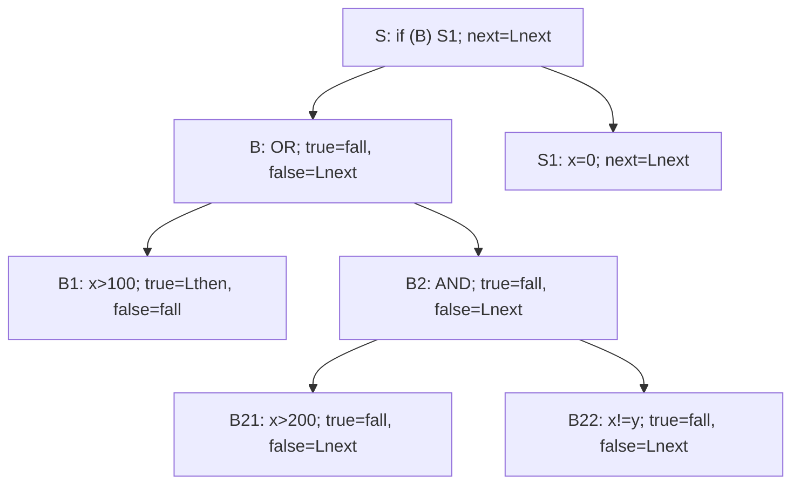

The inherited destinations and resulting leaf code are:

| Node | true | false | Code |
| --- | --- | --- | --- |
| Entire OR | fall | Lnext | Concatenate its children, then define Lthen |
| `x>100` | Lthen | fall | `if x > 100 goto Lthen` |
| Right-hand AND | fall | Lnext | Concatenate its two children |
| `x>200` | fall | Lnext | `ifFalse x > 200 goto Lnext` |
| `x!=y` | fall | Lnext | `ifFalse x != y goto Lnext` |

The generated code is:

```text
    if x > 100 goto Lthen
    ifFalse x > 200 goto Lnext
    ifFalse x != y goto Lnext
Lthen:
    x = 0
Lnext:
```

For ordinary ordered integers this can equivalently be written:

```text
    if x > 100 goto Lthen
    if x <= 200 goto Lnext
    if x == y goto Lnext
Lthen:
    x = 0
Lnext:
```

The first true branch bypasses both remaining tests; a false `x>200` bypasses `x!=y`; the final true outcome falls directly into `x=0`. There is no unconditional goto because false paths jump to `Lnext` and the assignment is physically next on the true path.

Logically, for ordered numeric values the condition simplifies to `x>100`, since `x>200` already implies `x>100`. That further algebraic simplification is optional optimization; the code above is the requested direct SDD translation and deliberately retains the stated parse tree.

**Reference basis:** KMS PDF pp. 158, 159, 161, 166, 167, 168, 169, 171, 176, 177, 178, 179, 180.

**Verification:**

- Evaluated generated control flow against the original expression for representative values around 100/200 and equal/unequal y; verified short-circuit test order.

### 8(a) - Locality, GC roots and Cheney forwarding

Topics: Garbage collection; Runtime environments

#### Question

What are 'temporal locality' and 'spatial locality' in the context of a program execution? How does a garbage collector (GC) attempt to improve these two types of 'locality of reference'? Each garbage collection algorithm starts with a 'root set'. Which objects constitute the 'root set'? Consider below the pseudocode for Cheney's 'copying collector' from your text. Complete the code by defining the function 'LookupNewLocation'. **(15)**

```text
 1) CopyingCollector() {
 2)     for (all objects o in From space) NewLocation(o) = NULL;
 3)     unscanned = free = starting address of To space;
 4)     for (each reference r in the root set)
 5)         replace r with LookupNewLocation(r);
 6)     while (unscanned ≠ free) {
 7)         o = object at location unscanned;
 8)         for (each reference o.r within o)
 9)             o.r = LookupNewLocation(o.r);
10)         unscanned = unscanned + sizeof(o);
        }
    }
```

> **Assumptions and source notes**
> - The supplied pseudocode has an all-object forwarding-table initialization; its cost is distinguished from the reachable-object copying phase.
> - Lecture p291 says To-space holds all allocated objects; the collector actually retains reachable allocated objects.

#### Solution

**Temporal locality** means a location recently accessed is likely to be accessed again soon. **Spatial locality** means locations near one recently accessed are likely to be accessed soon. A GC can improve temporal locality by reclaiming and reusing storage, keeping the active working set in recently used memory. A relocating/compacting collector can improve spatial locality by placing objects used together close together, reducing cache-line and page traffic. These are possible improvements, not guarantees: a breadth-first copying order need not match every future access pattern.

The **root set** contains directly accessible reference-bearing state from which tracing begins: references in active stack frames (locals/arguments/temporaries), machine registers, static/global fields and runtime-maintained handles or equivalent entry points. Only the reference-bearing portions are traced. Heap objects reached by following those references are then visited transitively; they are not all initial roots merely because they are allocated. The lecture's Java examples are static fields and stack variables.

The missing forwarding routine can be written as follows, treating `NewLocation` as a side table for From-space objects and `sizeof` as including any required allocation alignment:

```text
LookupNewLocation(r) {
    if (r == NULL)
        return NULL;

    if (r does not point into From space)
        return r;                 // optional guard for nonmoving objects

    o = object referenced by r;
    if (NewLocation(o) == NULL) {
        p = free;
        free = free + sizeof(o);
        copy the complete object o to address p;
        NewLocation(o) = p;       // forwarding address of original object
    }
    return NewLocation(o);
}
```

On the first encounter, the object is copied once into the unscanned region. Repeated references return the same destination, preserving sharing. The forwarding address is installed before this copied object is scanned, so self-links and cycles terminate correctly. While `unscanned != free`, the main collector rewrites every reference field using this routine and advances `unscanned` by that object's size. Thus `[start,unscanned)` is scanned, `[unscanned,free)` is copied but unscanned, and the remaining To-space is free. On completion the semispace roles are exchanged; only reachable objects survive.

The initialization in the question sets `NewLocation` for **all** From-space objects. Taken literally, that initialization does touch metadata of unreachable objects, although the copying/tracing phase does not visit their bodies. The lecture's “does not touch unreachable objects” advantage describes the tracing/copying work (or implementations with suitable forwarding initialization), not an excuse to ignore the given initialization loop. Likewise its output phrase “all allocated objects” should mean all **reachable** allocated objects, not garbage.

**Reference basis:** KMS PDF pp. 236, 253, 254, 279, 285, 289, 290, 291, 292.

**Verification:**

- Rendered and inspected KMS PDF p291 to verify the missing LookupNewLocation body.
- Simulated forwarding with sharing and a cycle; each reachable object is copied exactly once and repeated references agree.

### 8(b) - Chaitin coloring of the six-variable interference graph

Topics: Register allocation; Liveness analysis

#### Question

Consider the following register interference graph (RIG) derived from the flow graph of some three address code. What do the vertices and edges denote in such a RIG? Using the RIG, explain how the problem of global register allocation can be formulated as a graph coloring problem. Subsequently, find register allocation for the given program using Chaitin's algorithm. Assume three physical registers are available. Describe how the algorithm works and illustrate all steps of the algorithm for the given RIG. Make any other justified assumptions as required. What is a 'spill' in the context of the algorithm? Explain briefly how spilled variables are handled. **(20)**

**Figure for Question 8(b) - undirected register interference graph**

Vertices: `a, b, c, d, e, f`.

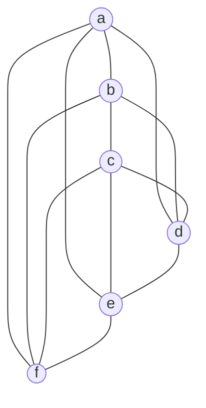

Edges (each undirected edge listed once):

```text
a -- b
a -- d
a -- e
a -- f
b -- c
b -- d
b -- f
c -- d
c -- e
c -- f
d -- e
e -- f
```

> **Assumptions and source notes**
> - Register names are interchangeable; the trace assumes three general-purpose colors, no precolored vertices and equal candidate costs.
> - Troublesome removals are potential spills; the lecture’s optimistic reinsertion rule permits the final spill-free coloring.

#### Solution

A vertex denotes a variable's live range (or a merged group of noninterfering occurrences). An undirected edge joins live ranges that must hold different values at the same program point and therefore cannot use the same physical register. With three interchangeable registers and no precolored nodes, allocate registers by finding a proper **3-coloring**: adjacent vertices must receive different colors; nonadjacent vertices may share one.

Here every vertex initially has degree four:

| Vertex | Neighbors |
| --- | --- |
| a | b,d,e,f |
| b | a,c,d,f |
| c | b,d,e,f |
| d | a,b,c,e |
| e | a,c,d,f |
| f | a,b,c,e |

**Simplify/select algorithm.** Repeatedly remove and push a vertex with current degree `<k`, because at reinsertion at most `k−1` neighbor colors will be forbidden. If none exists, choose a heuristic “troublesome” or potential-spill vertex, remove/push it and continue. On reverse insertion, assign an available color. Only if no color is available does it require an actual spill. Follow the lecture's optimistic treatment of troublesome nodes; assume equal spill costs and choose ties as below. An asterisk marks a troublesome removal, not a committed spill.

| Removal | Vertex | Current degree | Why permitted | Remaining degrees |
| --- | --- | --- | --- | --- |
| 1 | a* | 4 | No vertex has degree <3; choose a candidate | b3,c4,d3,e3,f3 |
| 2 | b* | 3 | Still no vertex has degree <3; choose b | c3,d2,e3,f2 |
| 3 | d | 2 | Degree <3 | c2,e2,f2 |
| 4 | c | 2 | Degree <3 | e1,f1 |
| 5 | e | 1 | Degree <3 | f0 |
| 6 | f | 0 | Degree <3 | empty |

The stack bottom-to-top is `a*, b*, d, c, e, f`. Reinsert in reverse order and select the lowest available register:

| Reinserted vertex | Already colored neighbors | Register |
| --- | --- | --- |
| f | None | R1 |
| e | f:R1 | R2 |
| c | e:R2, f:R1 | R3 |
| d | c:R3, e:R2 | R1 |
| b | c:R3, d:R1, f:R1 | R2 |
| a | b:R2, d:R1, e:R2, f:R1 | R3 |

The final allocation is **R1={d,f}, R2={b,e}, R3={a,c}**, with **no actual spill**. Every original edge joins different registers. The only missing pairs in the graph are `a–c`, `b–e`, `d–f`, so the graph is exactly the complete tripartite graph `K₂,₂,₂`. Those three pairs directly exhibit a valid coloring. A triangle, such as a,b,d, proves that fewer than three colors cannot suffice. Initial degree four alone does not imply that spilling is necessary.

A **spill** assigns a live range to a memory slot instead of keeping it permanently in a register. The compiler inserts loads before uses and stores after definitions as needed, often with short-lived temporaries; it then recomputes liveness/interference and allocates again. Good spill heuristics weigh expected dynamic use counts, loop depth and rewriting cost. This graph needs none, so inserting memory traffic merely because the first simplification step was blocked would be unnecessary.

**Reference basis:** KMS PDF pp. 437, 438, 440, 471, 529, 530.

**Verification:**

- Checked all 12 original edges against the final coloring and verified graph=K₂,₂,₂ with nonedges ac, be, df.
- Computed every current degree in the simplify trace and verified each reverse selection has an available color.

---

# 2022-2023

## Section A

### 1(a) - Bytecode and native machine code

Topics: Compiler pipeline

#### Question

Appraise the differences between bytecode and machine language. (3 marks)

#### Solution

Bytecode is an instruction language for an **abstract or virtual machine**. Machine language is an instruction language for a **particular physical processor architecture**.

| Property | Bytecode | Machine language |
| --- | --- | --- |
| Target | A VM, such as the Java Virtual Machine | A concrete ISA, such as x86-64 or ARM |
| Execution | Interpreted by the VM, or translated to native code by a JIT/AOT compiler | Executed by the processor, with the required operating-system/runtime support |
| Portability | The same bytecode can run wherever a compatible VM exists | Generally requires recompilation/translation for another ISA and usually another platform ABI |
| Abstraction | Often retains higher-level operations, type information, or symbolic references | Encodes native instructions, registers, and addressing modes |
| Performance | Interpretation adds overhead; JIT compilation can produce fast native code | Already native; speed still depends on the quality of the generated code |

For example, Java source can first compile to `.class` bytecode. A JVM on each platform interprets or compiles that bytecode to that platform's native instructions. Bytecode is usually binary data too: “bytecode” does not mean human-readable text.

**Reference basis:** Rumi PDF pp. 15, 16, 17, 18, 23, 27.

**Verification:**

- Verified the lecture description of bytecodes and virtual-machine execution on AMR PDF page 23.

### 1(b) - A complete two-pointer lexical scan

Topics: Lexical analysis

#### Question

The partial contents of a lexical-analyzer buffer are `cse123--++12.45==␣1␣`, where `␣` is a space. Both `lexemeBegin` and `forward` initially point to `c` at position 0. From the perspective of C, tabulate pointer positions while the string is scanned and identify tokens when recognized. The printed answer template has blank rows for `lexemeBegin`, `forward`, and `Token`, with possibly more columns than necessary. (6 marks)

> **Assumptions and source notes**
> - The exam does not specify whether forward denotes the last inspected or next unread character; an explicit next-unread convention is used.
> - The buffer contents are partial; position 20 is the next unknown position, not an asserted EOF.

#### Solution

The token sequence is **identifier `cse123`, `--`, `++`, floating constant `12.45`, `==`, integer constant `1`**. Spaces separate tokens and produce no token.

| Offset | 0 | 1 | 2 | 3 | 4 | 5 | 6 | 7 | 8 | 9 | 10 | 11 | 12 | 13 | 14 | 15 | 16 | 17 | 18 | 19 |
| --- | --- | --- | --- | --- | --- | --- | --- | --- | --- | --- | --- | --- | --- | --- | --- | --- | --- | --- | --- | --- |
| Character | c | s | e | 1 | 2 | 3 | - | - | + | + | 1 | 2 | . | 4 | 5 | = | = | ␣ | 1 | ␣ |

**Pointer convention used:** `forward` points to the next character to inspect. Reading a character advances it by one. An over-read delimiter is retracted before the token is returned. A scanner using a “last character inspected” convention will show different intermediate numbers; the lexeme boundaries below are invariant.

| Event | lexemeBegin | forward | Token returned |
| --- | --- | --- | --- |
| Initial state | 0 | 0 | — |
| Read `c` | 0 | 1 | — |
| Read `s` | 0 | 2 | — |
| Read `e` | 0 | 3 | — |
| Read `1` | 0 | 4 | — |
| Read `2` | 0 | 5 | — |
| Read `3` | 0 | 6 | — |
| Read `-` as identifier lookahead | 0 | 7 | — |
| Retract delimiter | 0 | 6 | `ID(cse123)` |
| Start next lexeme | 6 | 6 | — |
| Read first `-` | 6 | 7 | — |
| Read second `-` | 6 | 8 | `DEC_OP(--)` |
| Start next lexeme | 8 | 8 | — |
| Read first `+` | 8 | 9 | — |
| Read second `+` | 8 | 10 | `INC_OP(++)` |
| Start next lexeme | 10 | 10 | — |
| Read `1` | 10 | 11 | — |
| Read `2` | 10 | 12 | — |
| Read `.` | 10 | 13 | — |
| Read `4` | 10 | 14 | — |
| Read `5` | 10 | 15 | — |
| Read `=` as number lookahead | 10 | 16 | — |
| Retract delimiter | 10 | 15 | `FLOAT_CONST(12.45)` |
| Start next lexeme | 15 | 15 | — |
| Read first `=` | 15 | 16 | — |
| Read second `=` | 15 | 17 | `EQ_OP(==)` |
| Skip space at 17 | 18 | 18 | — |
| Read `1` | 18 | 19 | — |
| Read space as number lookahead | 18 | 20 | — |
| Retract delimiter | 18 | 19 | `INT_CONST(1)` |
| Skip space at 19 | 20 | 20 | — |

At each token return the token's starting pointer is shown; immediately afterward `lexemeBegin` moves to `forward`. Maximal munch makes `--` and `++` single tokens, and digits may continue an identifier. The unsuffixed floating constant has C type `double`. Lexically valid tokens do not imply that the entire fragment is a valid C expression.

**Reference basis:** Rumi PDF pp. 146, 148, 151, 167, 171, 172.

**Verification:**

- Enumerated all 20 character offsets and verified token spans 0–5, 6–7, 8–9, 10–14, 15–16, and 18.

### 1(c) - Classifying linker and loader responsibilities

Topics: Linking and loading

#### Question

Assign each serial number to exactly one of linker or loader. (5 marks)

(i) Object files. (ii) Accountable for loading programs and libraries. (iii) Load executable files to memory. (iv) Produce executable files. (v) Allocate address to executable files. (vi) Accountable for managing objects in the program's space. (vii) Setting up references that are utilized in the program.

The examples supplied are Linker: i; Loader: ii.

> **Assumptions and source notes**
> - “Allocate address” and “setting up references” are broad phrases; classification follows the usual static-linking versus runtime-loading division, with the overlap stated explicitly.

#### Solution

**Linker: (i), (iv), (vi), (vii).**

**Loader: (ii), (iii), (v).**

| Item | Assignment | Reason |
| --- | --- | --- |
| i | Linker | Object files are its principal inputs. |
| ii | Loader | It loads programs and the required libraries for execution. |
| iii | Loader | It maps/loads the executable into process memory. |
| iv | Linker | It combines object modules and libraries into an executable. |
| v | Loader | It allocates the actual runtime memory/address space for the executable. |
| vi | Linker | It lays out/arranges the combined objects and sections in the program's address space. |
| vii | Linker | It resolves symbolic/external references among the linked modules. |

This is the intended division in the question. Real dynamic linkers/loaders share some relocation and symbol-resolution responsibilities; the lecture also mentions loader-side reference resolution. Under the required “one category only” convention, (vii) is assigned to the linker.

**Reference basis:** Rumi PDF pp. 45, 46, 52, 53, 54, 55, 56.

**Verification:**

- Read AMR pages 45–56 and visually inspected the processing-system diagram on PDF page 55.

### 1(d) - Why left factoring preserves the language

Topics: LL parsing

#### Question

When carrying out left factoring of a grammar, argue carefully that the resulting grammar generates the same language as the original. (6 marks)

#### Solution

Suppose the productions to be factored are

```text
A → αβ1 | αβ2 | ... | αβm | γ1 | ... | γr
```

Introduce a **fresh** nonterminal `A′` and replace them by

```text
A  → αA′ | γ1 | ... | γr
A′ → β1 | β2 | ... | βm
```

For every original application `A ⇒ αβi`, the new grammar can simulate it by the two steps `A ⇒ αA′ ⇒ αβi`. All derivations of the symbols inside `α` and `βi` remain available. Thus every terminal string in the old language remains in the new language.

Conversely, whenever the new grammar uses `A ⇒ αA′` in a finite parse tree, that new `A′` node must choose some `βi`. Contract the two nodes into the original production `A → αβi`. Since `A′` is fresh, it occurs nowhere else except through this transformation. Repeating the contraction gives an original parse tree with the same terminal yield. Unchanged `γj` alternatives are already original alternatives. Thus no new terminal string is introduced.

Therefore both inclusions hold: **L(G) = L(G′)**. Empty suffixes cause no problem: if `βi = ε`, the new production `A′ → ε` reproduces exactly the old `A → α`. Repeated factoring preserves equivalence because each individual step does. The parse-tree shape changes; the terminal language does not.

**Reference basis:** Rumi PDF pp. 405, 406, 407.

**Verification:**

- Proved both language inclusions by explicit production simulation and parse-tree contraction, including an epsilon suffix.

### 1(e) - Why the unchanged expression grammar defeats predictive descent

Topics: LL parsing; FIRST and FOLLOW

#### Question

Write a procedure-based predictive parser for the following grammar without altering it, and identify a possible flaw. (5 marks)

```text
E → E + F | E - F | F
F → NUM | ID(E)
```

> **Assumptions and source notes**
> - The simultaneous requirements “predictive parser” and “keep the grammar unaltered” are incompatible for standard recursive-descent predictive parsing.

#### Solution

**A correct ordinary predictive recursive-descent parser cannot be constructed for this unchanged grammar.** It has immediate left recursion and overlapping prediction sets:

```text
FIRST(F)     = {NUM, ID}
FIRST(E + F) = {NUM, ID}
FIRST(E - F) = {NUM, ID}
FIRST(F)     = {NUM, ID}
```

The literal procedure templates would be:

```text
E():
    choose one of:                 // cannot choose predictively
        E(); match('+'); F()
        E(); match('-'); F()
        F()

F():
    if lookahead == NUM:
        match(NUM)
    else if lookahead == ID:
        match(ID); match('('); E(); match(')')
    else:
        error()
```

`match(t)` consumes the next token only if it is `t`. The `F` procedure is deterministic; the choice in `E` is not. For example, `NUM` could begin `NUM`, `NUM+NUM`, or `NUM-NUM`, so a single lookahead token cannot select the three alternatives.

If a naive implementation always tries the first matching alternative of `E`, then on input `NUM` it calls `E()` again **without consuming a token**. The calls continue until stack overflow. Trying the second left-recursive alternative has the same problem. Always selecting `E → F` avoids that recursion but rejects valid sums and differences.

Hence the flaw is structural, not a missing `if` statement: ordinary predictive descent requires a different grammar or a parsing technique that supports left recursion. Since the question forbids grammar changes, the honest result is the above template plus its impossibility/infinite-recursion diagnosis.

**Reference basis:** Rumi PDF pp. 305, 310, 319, 325, 326, 444, 445.

**Verification:**

- Computed all three E-production FIRST sets and traced the no-input-consumption recursive call on NUM.

### 1(f) - The restricted shape and usefulness of LL(0) grammars

Topics: LL parsing

#### Question

What are the general appearances of LL(0) grammars? Give examples and comment on their applicability to useful parsing. (5 marks)

> **Assumptions and source notes**
> - The singleton-language conclusion assumes a reduced productive grammar and ordinary finite derivations; a rule such as S → aS alone generates no finite strings.

#### Solution

An LL(0) parser chooses a nonterminal's production with **zero input lookahead**. Thus, for a reduced grammar (all symbols reachable and productive), each nonterminal can have at most **one usable production**. Two useful alternatives would require a choice, and without lookahead there is no input information with which to make it.

Examples are

```text
S → AB       A → a       B → b
```

which generates only `ab`, and

```text
S → A        A → ε
```

which generates only the empty string. A parser simply follows the unique expansion and matches the prescribed terminals.

More generally, a productive reduced one-production-per-nonterminal grammar has no productive recursive cycle: once such a cycle is entered, there is no alternative with which to stop it. Its finite expansion therefore produces a **single fixed terminal string**. Unreachable or unproductive rules can be present in an unreduced presentation, but do not add useful choices.

Consequently these grammars are too weak for ordinary programming-language syntax, which needs repetition and alternatives such as identifiers versus numbers and one statement versus many. LL(0) is useful as a limiting theoretical case and for matching fixed patterns. The usual practical predictive class is LL(1) or a larger lookahead class.

**Reference basis:** Rumi PDF pp. 305, 325, 326, 415, 443, 449.

**Verification:**

- Expanded both examples and checked why a one-rule recursive cycle cannot terminate.

### 1(g) - An optimal parser when every nonterminal has one rule

Topics: LL parsing

#### Question

A context-free grammar has exactly one production rule for each nonterminal. What parser is optimal for it? Explain. (5 marks)

> **Assumptions and source notes**
> - The question does not state that the grammar is productive; immediate rejection is required for an unproductive start symbol rather than infinite recursion.

#### Solution

Use a **deterministic LL(0) recursive-descent parser**, after checking that the reachable grammar can generate a finite string. No production-selection lookahead, backtracking, or LR table is needed: there is only one possible expansion for a nonterminal.

For example,

```text
S → aAB       A → b       B → c

S(): match('a'); A(); B()
A(): match('b')
B(): match('c')
parse(): S(); match(EOF)
```

This accepts exactly `abc`. A terminal mismatch rejects the input; the final EOF check rejects extra trailing input. For the input length `n`, scanning/matching is linear in the amount of input examined, and a successful parse must read all its tokens. The grammar's unique expansion can also be precomputed and compared directly, avoiding procedure-call overhead.

**Important qualification:** one production per nonterminal alone does not guarantee a terminating parser. `S → S`, or `S → aS`, has no finite terminal derivation. Run productivity analysis (and remove unreachable rules) first. If the start symbol is unproductive, the language is empty and the optimal recognizer immediately rejects. If it is productive, the reachable one-rule dependency graph has no recursive cycle and the straightforward LL(0) descent terminates. Thus the optimal design exploits the absence of choices while still handling the cyclic case correctly.

**Reference basis:** Rumi PDF pp. 305, 310, 325, 326, 415, 443.

**Verification:**

- Checked the fixed-string example and the counterexamples S → S and S → aS.

### 2(a) - Why general CFG parsers are rarely production front ends

Topics: Compiler pipeline; LL parsing; LR parsing

#### Question

Why are universal parsing methods not used in production compilers? (3 marks)

#### Solution

Universal CFG parsers, such as CYK and Earley parsing, support arbitrary context-free grammars, including grammars whose alternatives cannot be decided deterministically from a small amount of context. That generality usually requires maintaining many possible partial parses, with higher time and memory costs. The general worst-case time is cubic in input length; specialized cases can be faster.

Production compilers normally use a deliberately designed LL/LR grammar and a deterministic parser. Such parsers typically process the token stream in **O(n) time**, have small practical overhead, and give predictable behavior and useful error detection. LL and LR classes already express most programming-language constructs, so their efficiency is normally a better engineering tradeoff than unrestricted grammar support.

The lecture's statement is a practical generalization, not an impossibility theorem: generalized parsing can be appropriate when an existing or ambiguous grammar makes that flexibility valuable.

**Reference basis:** Rumi PDF pp. 346, 347, 348.

**Verification:**

- Verified that AMR page 346 names CYK and Earley, and page 348 explains the practical expressiveness of LL/LR subclasses.

### 2(b) - LR(0) versus SLR(1) table entries

Topics: LR parsing; FIRST and FOLLOW

#### Question

Elucidate carefully how the SLR(0) parsing table differs from an SLR(1) parsing table. (5 marks)

> **Assumptions and source notes**
> - Interpreted the source’s nonstandard term “SLR(0)” as LR(0); standard SLR denotes SLR(1).

#### Solution

The standard comparison intended here is **LR(0) versus SLR(1)**. “SLR(0)” is not the usual name of a separate table-construction method.

Both constructions use the **same canonical LR(0) item sets**, so they have the same states, transitions, shift entries, and nonterminal GOTO entries. Their reduction entries differ:

| Item in state i | LR(0) rule | SLR(1) rule |
| --- | --- | --- |
| `A → α ·`, A different from augmented start | Reduce by `A → α` on **every terminal and `$`** | Reduce only on terminals in **FOLLOW(A)** |
| `A → α · aβ` and goto(i,a)=j | `ACTION[i,a] = shift j` | Same |
| `S′ → S ·` | Accept on `$` | Same |

Thus SLR(1) removes reductions from lookahead columns that cannot follow the reduced nonterminal. It can remove LR(0) shift/reduce or reduce/reduce conflicts, but cannot guarantee that all conflicts disappear.

For example:

```text
S → Aa
A → b | bc
```

After shifting `b`, a state contains `A → b ·` and `A → b · c`. LR(0) puts both “reduce A→b” and “shift c” in the `c` column. Since `FOLLOW(A)={a}`, SLR(1) reduces only on `a`, leaving an unambiguous shift on `c`.

The table dimensions do not shrink: the difference is which ACTION cells contain reductions or errors. SLR(1)'s one-symbol lookahead is used through FOLLOW sets, not stored in the LR(0) items themselves.

**Reference basis:** Rumi PDF pp. 696, 699, 700, 701, 702, 704.

**Verification:**

- Constructed the two-item conflict state for S → Aa, A → b | bc and computed FOLLOW(A)={a}.

### 2(c) - Eliminating both direct and indirect left recursion

Topics: LL parsing

#### Question

Eliminate left recursion from the grammar. (10 marks)

```text
A → Ba | Aa | c
B → Bb | Ab | d
```

#### Solution

Choose nonterminal order **A, B**.

First eliminate the immediate left recursion `A → Aa`:

```text
A  → BaA′ | cA′
A′ → aA′ | ε
```

Now substitute these A-productions into `B → Ab`:

```text
B → Bb | BaA′b | cA′b | d
```

The first two alternatives are immediately left-recursive, with recursive suffixes `b` and `aA′b`. Eliminate them together:

```text
A  → BaA′ | cA′
A′ → aA′ | ε
B  → cA′bB′ | dB′
B′ → bB′ | aA′bB′ | ε
```

This is a left-recursion-free equivalent grammar. Although A begins with B, every B alternative begins with terminal `c` or `d`, so it cannot indirectly lead back to A before consuming a terminal. A′ and B′ have only right recursion, beginning their nonempty alternatives with terminals. Do not stop after eliminating `Aa` and `Bb`: the original `A → Ba`, `B → Ab` creates **indirect** left recursion as well.

**Reference basis:** Rumi PDF pp. 395, 396, 398, 400.

**Verification:**

- Applied ordered nonterminal substitution and direct-left-recursion elimination explicitly.
- Enumerated terminal strings of both grammars through length 9 and compared the A and B languages.

### 2(d) - How a separate lexer helps language adaptation

Topics: Compiler pipeline; Lexical analysis

#### Question

Explain how separating lexical analysis and parsing helps adopt a new language in an existing compiler. (5 marks)

#### Solution

The lexer and parser communicate through an interface of **token kinds plus attributes**, rather than raw characters. This gives each phase a clear responsibility and confines many changes to one place.

If the new language changes identifier spelling, numeric formats, keywords, comments, whitespace, or character encoding, modify the lexer and its symbol-table actions. If the resulting abstract token stream is unchanged, the existing parser can continue to operate on it. For example, adding a different comment syntax need not change the expression or statement grammar at all.

If the new language changes syntactic structure, update the parser's grammar and semantic actions, while reusing the lexer's buffering and the recognizers for unchanged token classes. Parser rules remain shorter because they describe statements and expressions rather than individual letters or comment delimiters.

This modularity also permits independent use of efficient lexical techniques, such as finite automata and input buffering, and isolates platform-specific input details in the scanner. A compatible intermediate representation can let later optimization and machine-code phases be reused too.

Separation **reduces the scope of changes**; it does not imply that an arbitrary new language can be adopted by changing only its lexer. New syntax, types, scope rules, or runtime semantics require the corresponding front-end changes.

**Reference basis:** Rumi PDF pp. 58, 60, 130, 131, 133, 141, 142, 143, 144, 145, 146.

**Verification:**

- Read the lecture’s simplicity, efficiency, and portability arguments and related them to the token interface.

### 2(e) - FOLLOW sets with an unreachable nonterminal

Topics: FIRST and FOLLOW

#### Question

Find FOLLOW sets for all nonterminals of the grammar. (12 marks)

```text
S → aABe
A → B | ε
B → bB | Cd
C → cC | ε
D → dD | ε
```

> **Assumptions and source notes**
> - D is unreachable from the stated start symbol S; its literal FOLLOW set is empty. No missing occurrence of D has been invented.

#### Solution

Take **S** as the start symbol. First compute the FIRST information needed for suffixes:

```text
FIRST(C) = {c, ε}
FIRST(B) = {b, c, d}      // B is not nullable: Cd always contributes d
FIRST(A) = {b, c, d, ε}
FIRST(Be) = {b, c, d}
```

Now propagate FOLLOW constraints:

| Production occurrence | Contribution |
| --- | --- |
| Start symbol S | `$` belongs to FOLLOW(S) |
| `S → a A B e` | FIRST(Be) = `{b,c,d}` goes to FOLLOW(A) |
| `S → a A B e` | `e` goes to FOLLOW(B) |
| `A → B` | FOLLOW(A) goes to FOLLOW(B) |
| `B → bB` | FOLLOW(B) goes to itself; no new symbol |
| `B → C d` | `d` goes to FOLLOW(C) |
| `C → cC` | FOLLOW(C) goes to itself; no new symbol |
| `D → dD` | FOLLOW(D) goes to itself; no seed is introduced |

At the fixed point:

| Nonterminal | FOLLOW |
| --- | --- |
| S | `{ $ }` |
| A | `{ b, c, d }` |
| B | `{ b, c, d, e }` |
| C | `{ d }` |
| D | `∅` |

**Why not `$` in FOLLOW(D)?** D is unreachable from S and is not the start symbol. Its recursive occurrence propagates only its own initially empty set. Likewise, epsilon is never a FOLLOW-set member. FOLLOW(A) does not contain `e`, because the following B cannot disappear.

**Reference basis:** Rumi PDF pp. 419, 421, 422, 423, 424, 425, 426.

**Verification:**

- Computed FIRST and FOLLOW by a fixed-point script, including the unproductive propagation edge FOLLOW(D)→FOLLOW(D).

### 3(a) - A predictive-table conflict involving epsilon

Topics: FIRST and FOLLOW; LL parsing

#### Question

A cell of a predictive parsing table contains both `A → α` and `A → ε`. Explain what this means in terms of FIRST and FOLLOW. (7 marks)

#### Solution

Let the cell be **M[A,a]**. The epsilon production is entered there because

```text
a ∈ FOLLOW(A).
```

If α is nonnullable, `A → α` is entered because

```text
a ∈ FIRST(α).
```

Therefore

```text
FIRST(α) ∩ FOLLOW(A) ≠ ∅.
```

The parser cannot tell whether the next `a` begins a string generated by A through α, or whether A should vanish and the same `a` should be parsed by what follows A. This is a **FIRST/FOLLOW conflict**, so the grammar is not LL(1).

For example:

```text
S → Aa
A → a | ε
```

Here FIRST(a)={a} and FOLLOW(A)={a}. Both A-productions enter M[A,a]. The language `{a,aa}` is unambiguous, but one lookahead symbol is insufficient at A.

There is an additional nullable case: if `α ⇒* ε`, then `A → α` is also entered under every FOLLOW(A) symbol by the nullable-production rule. Both alternatives can derive ε, violating the “at most one nullable alternative” condition. Thus the general statement is: the cell's lookahead belongs to FOLLOW(A), and it belongs to **FIRST(α) without ε or to the prediction set induced by α's nullability**. The two complete SELECT sets overlap.

**Reference basis:** Rumi PDF pp. 445, 446, 452, 456.

**Verification:**

- Applied both insertion rules, distinguishing the nonnullable and nullable cases rather than assuming α is nonnullable.

### 3(b) - Finding the minimum lookahead k

Topics: LL parsing; FIRST and FOLLOW

#### Question

For the grammar below, determine the minimum k for which it is LL(k), with analysis of each group of productions. (10 marks)

```text
S → Aab | aS | bc
A → aacd | bef
B → bef | ε
```

> **Assumptions and source notes**
> - B is unused/unreachable in the printed grammar. Its productions were not silently substituted into S or A.

#### Solution

The **minimum is k = 3** for the reachable grammar, with S as the start symbol.

A has two alternatives beginning with distinct terminals, `a` and `b`, so its decision needs only one token. B is unreachable from S. Its nonempty alternative begins with `b`; its epsilon alternative would be selected using its following context, but the literal grammar gives B no such context and FOLLOW(B)=∅. It does not affect the start language or the value of k.

The important choice is at S. Write FIRSTₖ for prefixes of length at most k of terminal strings from an alternative (with endmarker convention if necessary).

| S alternative | FIRST₁ | FIRST₂ | FIRST₃ |
| --- | --- | --- | --- |
| `Aab` | `{a,b}` | `{aa,be}` | `{aac,bef}` |
| `aS` | `{a}` | `{aa,ab}` | `{aaa,aab,abe,abc}` |
| `bc` | `{b}` | `{bc}` | `{bc}` |

For the `aS` row, FIRST₂(S) is `{aa,ab,be,bc}`; prefixing `a` gives its FIRST₃ set. All S occurrences are at the end of their production, so their following context is just the end of the input. If prefixes are padded with `$`, the short `bc` entry becomes `bc$`; it remains disjoint from the other rows.

With one token, `Aab` conflicts both with `aS` on `a` and with `bc` on `b`. With two tokens, `Aab` and `aS` still overlap on `aa`. For a concrete witness, `aacdab` starts with `aa` and uses `S → Aab`, whereas `aaacdab` starts with `aa` and uses `S → aS`.

With three tokens, the rows are pairwise disjoint: `{aac,bef}` differs from `{aaa,aab,abe,abc}`, and neither contains a `bc` prefix. A already needs only one token and there are no additional reachable choices. Therefore the grammar is LL(3), and the two-token conflict proves minimality.

**Reference basis:** Rumi PDF pp. 415, 419, 443, 445, 446, 452.

**Verification:**

- Enumerated terminal derivations to validate all FIRST₂ and FIRST₃ prefixes, and exhibited a two-token collision witness.

### 3(c) - Why predictive parsing constructs a leftmost derivation

Topics: LL parsing

#### Question

Explain why LL(1) parsing is associated with leftmost derivations of parse trees. (6 marks)

#### Solution

An LL(1) parser scans the input **from left to right** and always expands the **leftmost unexpanded nonterminal** of the current sentential form. It chooses the production using one lookahead token. These are precisely the three parts of the name: Left-to-right scan, Leftmost derivation, one-token lookahead.

In recursive descent, a procedure processes the symbols of its selected right-hand side in source order. It finishes an earlier child before moving to the next child. In table-driven parsing, the next grammar symbol is on the stack top; when A is expanded to `X1...Xm`, the symbols are pushed in reverse order so that X1 is processed first. Both methods enforce the same leftmost expansion order.

For example, let

```text
S → AB       A → a       B → b
```

The expansion sequence is `S ⇒ AB ⇒ aB ⇒ ab`: A, the leftmost nonterminal, is expanded before B. Terminals already matched form the input prefix, and the stack/procedure calls describe the unprocessed suffix. A bottom-up LR parser instead reconstructs a **rightmost derivation in reverse**, so the direction of derivation is an essential distinction, not merely the direction of input scanning.

**Reference basis:** Rumi PDF pp. 305, 326, 443, 464, 465, 466, 471, 507.

**Verification:**

- Traced the expansion order on S → AB and checked the reverse-push invariant for table-driven predictive parsing.

### 3(d) - An LL(1) grammar that has an SLR reduce/reduce conflict

Topics: LL parsing; LR parsing; FIRST and FOLLOW

#### Question

Show that the grammar is LL(1) but not SLR(1). (12 marks)

```text
S → AaAb | BbBa
A → ε
B → ε
```

#### Solution

**LL(1) proof.** Both A and B are nullable, so

```text
FIRST(AaAb) = {a}
FIRST(BbBa) = {b}
FOLLOW(S)  = {$}
FOLLOW(A)  = {a,b}
FOLLOW(B)  = {a,b}
```

The two S alternatives have disjoint FIRST sets and neither is nullable. Each of A and B has just one production. The entire predictive table is conflict-free:

| Nonterminal | a | b | $ |
| --- | --- | --- | --- |
| S | `S → AaAb` | `S → BbBa` | error |
| A | `A → ε` | `A → ε` | error |
| B | `B → ε` | `B → ε` | error |

It accepts `ab` by the first S production and `ba` by the second.

**SLR(1) failure.** Augment with `S′ → S`. The initial LR(0) closure contains

```text
I0:
S′ → ·S
S  → ·AaAb
S  → ·BbBa
A  → ·             // completed epsilon production
B  → ·             // completed epsilon production
```

SLR places the reduction `A → ε` under every member of FOLLOW(A)={a,b}, and `B → ε` under every member of FOLLOW(B)={a,b}. Thus:

| Cell | Competing actions |
| --- | --- |
| ACTION[I0,a] | reduce A→ε; reduce B→ε |
| ACTION[I0,b] | reduce A→ε; reduce B→ε |

Either reduce/reduce conflict is sufficient to show that the grammar is **not SLR(1)**. SLR uses a nonterminal's global FOLLOW set, losing the local context that would distinguish which empty nonterminal should be reduced first. This does not contradict LL(1): the LL parser chooses the S alternative first, preserving that context.

**Reference basis:** Rumi PDF pp. 426, 445, 446, 452, 582, 591, 699, 700.

**Verification:**

- Computed FIRST/FOLLOW and the predictive table by script.
- Constructed the initial LR(0) closure and confirmed both SLR reduce/reduce conflict columns.

### 4(a) - Choosing and implementing an epsilon production

Topics: LL parsing; FIRST and FOLLOW

#### Question

How are empty/epsilon productions handled in procedure-based predictive parsers? (5 marks)

#### Solution

An epsilon production means that the procedure **returns without matching or consuming an input token**. It is selected only when the current lookahead is legal after that nonterminal.

For example:

```text
A → aB | ε

A():
    if lookahead == 'a':
        match('a'); B()
    else if lookahead in FOLLOW(A):
        return                       // A → ε: consume nothing
    else:
        error()
```

More generally, select a nonempty alternative using its FIRST set; for a nullable alternative, use FOLLOW(A) when the alternative derives ε. In an LL(1) grammar these prediction sets are disjoint, so no choice is ambiguous. Any semantic action attached to the epsilon production still executes even though no token is consumed.

The lecture introduces epsilon as a “default” when another alternative is unavailable. A robust parser makes the FOLLOW test explicit: returning on **every** unmatched token would hide errors. For `A → a | ε` with FOLLOW(A)={`)`}, lookahead `)` selects ε, while lookahead `+` must report an error. Consuming `)` inside A would be wrong: the caller is responsible for parsing that following symbol.

**Reference basis:** Rumi PDF pp. 320, 325, 326, 445, 452, 456.

**Verification:**

- Traced epsilon selection for a legal FOLLOW token and an illegal token, verifying no input consumption.

### 4(b) - Handles in the postfix string aaa*a++

Topics: LR parsing

#### Question

For `S → SS+ | SS* | a`, identify the handles while parsing the right-sentential form `aaa*a++`. Show computations. (10 marks)

#### Solution

A handle is a **production body and its occurrence** whose reduction reverses a rightmost derivation step. Matching a production body somewhere in the string is insufficient; its position matters.

A rightmost derivation is

```text
S ⇒ SS+ ⇒ SSS++ ⇒ SSa++ ⇒ SSS*a++
  ⇒ SSa*a++ ⇒ Saa*a++ ⇒ aaa*a++
```

Reverse it to prune the handles. Positions in the table are numbered from 1 in the **current** sentential form:

| Current form | Handle occurrence | Production reduced | Result |
| --- | --- | --- | --- |
| `aaa*a++` | first `a` (position 1) | `S → a` | `Saa*a++` |
| `Saa*a++` | `a` at position 2 | `S → a` | `SSa*a++` |
| `SSa*a++` | `a` at position 3 | `S → a` | `SSS*a++` |
| `SSS*a++` | `SS*` at positions 2–4 | `S → SS*` | `SSa++` |
| `SSa++` | `a` at position 3 | `S → a` | `SSS++` |
| `SSS++` | `SS+` at positions 2–4 | `S → SS+` | `SS+` |
| `SS+` | entire `SS+` | `S → SS+` | `S` |

The corresponding expression shape is `a + ((a*a) + a)`. In the original form the first handle is the **leftmost** `a`. The other occurrences of `a` are not the first reduction in the reversal of this rightmost derivation. The string is fully reduced to the start symbol, confirming successful parsing.

**Reference basis:** Rumi PDF pp. 507, 512, 513, 514, 516, 517.

**Verification:**

- Applied each reduction to the current string and reversed the full sequence to check that every forward step expands the rightmost nonterminal.

### 4(c) - Why a valid LR item describes a viable prefix

Topics: LR parsing

#### Question

We say that a configuration `[A → β1 · β2, a]` is valid for a viable prefix `αβ1` if there is a rightmost derivation

```text
S′ ⇒*rm αAw ⇒rm αβ1β2w.
```

Why? (10 marks)

> **Assumptions and source notes**
> - The source definition omits the LR(1) condition a∈FIRST(w$); the derivation establishes LR(0)-core validity but cannot justify an arbitrary a.
> - The supplied AMR PDF explains LR(0) items and SLR but does not include its later detailed canonical-LR(1) validity section; the lookahead condition and worked example are derived explicitly here.

#### Solution

The last step says that the occurrence of `β1β2` is a **handle** of the right-sentential form `αβ1β2w`: reducing it to A reverses that rightmost step. Because the derivation is rightmost, w is a string of terminals.

The prefix `αβ1` stops **at or before the right end of that handle**. That is exactly a viable prefix: a prefix of a right-sentential form that does not extend beyond the handle. It is a possible grammar-symbol stack content during shift/reduce parsing.

The dot records how much of the candidate handle has been recognized:

- `β1` is already represented on the stack after the earlier stack prefix α.
- The parser still expects the grammar symbols β2 (or strings derived from them).
- If β2 is empty, the full body is present, so a reduction to A is potentially appropriate.

For an **LR(1)** item there is one further essential condition, omitted from the question's displayed definition:

```text
a ∈ FIRST(w$)
```

Equivalently, w begins with a, or w is empty and a is `$`. The item lookahead describes the terminal **following the complete A-production body**, not necessarily the next input symbol while β2 is nonempty. When the dot reaches the end, reduce only on that lookahead.

For example, with `S′ → S`, `S → Ab`, `A → cd`, the rightmost derivation `S′ ⇒ S ⇒ Ab ⇒ cdb` makes `[A → c · d, b]` valid for viable prefix `c`. After the remaining `d` is recognized, `[A → cd ·, b]` supports reduction on `b`. The displayed derivation alone would not justify lookahead `a` or `$` here; that is why the missing lookahead condition matters.

**Reference basis:** Rumi PDF pp. 512, 513, 514, 582, 583, 584, 652, 700.

**Verification:**

- Checked the example derivation and that prefix c ends inside the handle cd, with b immediately after its completion.

### 4(d) - Can merging LR(1) states create LALR conflicts?

Topics: LR parsing

#### Question

We have an LR(1) grammar. If we formulate an LALR(1) parser from it by unioning states, can the resulting union have a parsing-action conflict? Justify. The source labels this fourth subquestion `(b)` a second time. (10 marks)

> **Assumptions and source notes**
> - Normalized the duplicated source label to card number 4(d); the original fourth label is (b).
> - The supplied AMR PDF ends before detailed LALR construction; the equal-core merge proof and counterexample are worked derivations using its LR-item foundations.

#### Solution

**Yes. Merging equal-core canonical LR(1) states can introduce a reduce/reduce conflict.** An LR(1) grammar is not necessarily LALR(1). The grammar itself is not changed; the parser construction merges states with identical LR(0) cores and unions the lookahead sets of corresponding items.

Consider

```text
S → aAd | bBd | aBe | bAe
A → c
B → c
```

Two canonical LR(1) states, reached after `ac` and `bc`, have the following completed items:

| State | First item | Second item |
| --- | --- | --- |
| after `ac` | `[A → c ·, d]` | `[B → c ·, e]` |
| after `bc` | `[A → c ·, e]` | `[B → c ·, d]` |

Each state is conflict-free: in one, d chooses A and e chooses B; in the other, the choices are reversed. Their LR(0) cores are both `{A → c·, B → c·}`, so LALR merges them:

```text
[A → c ·, {d,e}]
[B → c ·, {d,e}]
```

The merged state now reduces by both A→c and B→c on **each** of d and e. Therefore it has two reduce/reduce-conflict columns.

A merge of conflict-free canonical LR(1) states cannot create a **new shift/reduce** conflict. Shifts depend on the core. If the common core permits shifting terminal t, every merged source state already has that shift. If one source state contributes a completed item's reduction on t, that same state would already have had the shift/reduce conflict, contradicting its LR(1) status. Reduce/reduce conflicts can be new because the two reductions' overlapping lookaheads may originate in different source states.

Hence some LR(1) grammars produce conflict-free LALR tables, while others do not; equal cores alone do not guarantee safe union.

**Reference basis:** Rumi PDF pp. 582, 583, 699, 700, 726.

**Verification:**

- Constructed canonical LR(1) states for the counterexample by script: no canonical conflicts; equal-core merge introduces reduce/reduce conflicts on d and e.

## Section B

### 5(a) - Flow graph and optimization of the nested comparison loop

Topics: Intermediate code; Code optimization; Control flow and backpatching

#### Question

Consider the following three-address code. (i) Identify basic blocks, construct the flow graph, assign block identifiers, and replace label references by those identifiers. (ii) Optimize it by semantic-preserving transformations and name each transformation used. (10+15 marks)

```text
 1 L1:  i = 0
 2 L3:  t1 = n - 1
 3      iffalse i < t1 goto L2
 4 L4:  j = i + 1
 5 L5:  iffalse j < n goto L6
 6 L7:  t2 = i * 8
 7      t3 = a[t2]
 8      t4 = j * 8
 9      t5 = a[t4]
10      iffalse t3 > t5 goto L8
11 L9:  t6 = i * 8
12      p = a[t6]
13 L10: t7 = i * 8
14      t8 = j * 8
15      t9 = a[t8]
16      a[t7] = t9
17 L11: t10 = j * 8
18      a[t10] = p
19 L8:  j = j + 1
20      goto L5
21 L6:  i = i + 1
22      goto L3
23 L2:
```

> **Assumptions and source notes**
> - Semantic preservation assumes ordinary nonvolatile TAC memory and defined arithmetic/accesses. Distinct scalar/array storage and n unchanged are required for the hoists.
> - p is retained on every swap because it is not declared a dead temporary; eliminating it would require a live-out assumption.

#### Solution

**(i) Basic blocks.** Leaders are 1, 2, 4, 5, 6, 11, 19, 21, and the exit label at 23. A printed label that is never a branch target need not start a block: lines 13 and 17 remain inside the block starting at 11.

| Block | Original lines | Label correspondence |
| --- | --- | --- |
| B1 | 1 | L1 |
| B2 | 2–3 | L3 |
| B3 | 4 | L4 |
| B4 | 5 | L5 |
| B5 | 6–10 | L7 |
| B6 | 11–18 | L9, L10, L11 |
| B7 | 19–20 | L8 |
| B8 | 21–22 | L6 |
| B9 | 23, exit | L2 |

The code with block targets is

```text
B1: i = 0
B2: t1 = n - 1
    iffalse i < t1 goto B9
B3: j = i + 1
B4: iffalse j < n goto B8
B5: t2 = i * 8
    t3 = a[t2]
    t4 = j * 8
    t5 = a[t4]
    iffalse t3 > t5 goto B7
B6: t6 = i * 8
    p = a[t6]
    t7 = i * 8
    t8 = j * 8
    t9 = a[t8]
    a[t7] = t9
    t10 = j * 8
    a[t10] = p
B7: j = j + 1
    goto B4
B8: i = i + 1
    goto B2
B9: // exit
```

The following adjacency table completely specifies the flow graph:

| Block | Successor(s) |
| --- | --- |
| B1 | B2 |
| B2 | B3 if `i<t1`; B9 otherwise |
| B3 | B4 |
| B4 | B5 if `j<n`; B8 otherwise |
| B5 | B6 if `t3>t5`; B7 otherwise |
| B6 | B7 |
| B7 | B4 |
| B8 | B2 |
| B9 | exit |

The inner natural loop has header B4 and blocks B4–B7. The outer loop has header B2 and blocks B2–B8.

**(ii) Optimize in stages.** On entry to B6, `t2=i*8`, `t4=j*8`, `t3=a[t2]`, and `t5=a[t4]` are still available: neither index nor array was changed along that path. Thus B6 simplifies to

```text
p = t3
 a[t2] = t5
 a[t4] = p
```

This applies **common-subexpression elimination** to `t6,t7,t8,t10` and the loads into p/t9, then **copy propagation** and **dead-temporary elimination**. All original writes to p and a are retained.

Next move the loop-invariant bound `n-1` outside both loops. The offset for i is constant within the inner loop; the offset for j rises by 8 each iteration. Introduce offset induction variables and use **strength reduction** to replace repeated multiplication by additions. Finally keep the current `a[i]` value in a scalar `ai`, updating it on every swap (**scalar replacement/register promotion**, with redundant-load elimination). One complete optimized version is:

```text
    limit = n - 1
    i = 0
    oi = 0
OUTER_TEST:
    iffalse i < limit goto EXIT
    j = i + 1
    oj = oi + 8
    ai = a[oi]
INNER_TEST:
    iffalse j < n goto OUTER_NEXT
    aj = a[oj]
    iffalse ai > aj goto INNER_NEXT
    p = ai
    a[oi] = aj
    a[oj] = p
    ai = aj
INNER_NEXT:
    j = j + 1
    oj = oj + 8
    goto INNER_TEST
OUTER_NEXT:
    i = i + 1
    oi = oi + 8
    goto OUTER_TEST
EXIT:
```

The key invariants are `oi=8*i`, `oj=8*j`, and `ai=a[oi]` while processing the inner loop. On a swap, the assignment `ai=aj` maintains the third invariant. **The load of a[i] cannot simply be hoisted without that update**, because a swap modifies that array element. The strict comparison is preserved, including its behavior for unordered values if the array element type admits them.

This implementation preserves final i, j, p, and array contents under the usual TAC model: temporaries are private; n is unchanged; array accesses are ordinary nonvolatile accesses; scalar variables do not alias the array; arithmetic and accesses are defined. The outer test ensures an inner iteration exists before the hoisted `a[oi]` load (`i<n-1` implies `i+1<n` under defined integer arithmetic). No array access is introduced when the outer loop has zero iterations.

There is no unique finite list of “all possible” optimizations. The transformations above remove the explicit redundant computations and add the standard loop and induction-variable improvements justified by this code.

**Reference basis:** KMS PDF pp. 324, 325, 329, 330, 331, 335, 336, 337, 339, 340, 342, 540, 541, 542, 552, 555, 558, 559.

**Verification:**

- Computed leaders, 9 maximal blocks, and all 11 CFG edges.
- Exhaustively compared the original and optimized loops on arrays of length 0–5 over values {-1,0,1}, checking final array,i,j,p and including zero-iteration cases.

### 5(b) - Reading optimizations from the gcc assembly, including the C defect

Topics: Code optimization; Compiler pipeline

#### Question

Identify and explain the optimizations in the given gcc `-O2` assembly for this C fragment. (10 marks)

```c
#include<stdio.h>
int a[50], b[50], x, y, z, k, n;
int factorial(int n) {
    int fact;
    for (int i=n; i>=0; i--)
        fact = fact * i;
    return fact;
}
int main() {
    int t;
    t = y; y = z; z = t;
    x = y ^ y;
    if (x) n = 10;
    else n = 20;
    k = factorial(n);
    for (int j=0; j<50; j++)
        for (int i=0; i<100; i++)
            a[j] *= b[j];
    return 0;
    for (int i=0; i<50; i++)
        a[i] = b[i];
}
```

```asm
factorial(int):
    xor eax, eax
    ret
main:
    mov eax, DWORD PTR y[rip]
    mov edx, DWORD PTR z[rip]
    xor esi, esi
    mov DWORD PTR x[rip], 0
    mov DWORD PTR n[rip], 20
    mov DWORD PTR y[rip], edx
    mov DWORD PTR z[rip], eax
    mov DWORD PTR k[rip], 0
.L4:
    mov eax, DWORD PTR a[rsi]
    mov ecx, DWORD PTR b[rsi]
    mov edx, 100
.L5:
    imul eax, ecx
    imul eax, ecx
    sub edx, 2
    jne .L5
    mov DWORD PTR a[rsi], eax
    add rsi, 4
    cmp rsi, 200
    jne .L4
    xor eax, eax
    ret
```

> **Assumptions and source notes**
> - fact is uninitialized; the C execution has undefined behavior. The assembly returning 0 is not a generally valid source-level factorial result.
> - Signed multiplication can overflow; initializing fact alone does not make factorial(20) defined on a usual 32-bit int.
> - This explains the assembly supplied in the exam; it does not assert that all gcc versions emit this exact output.

#### Solution

The assembly displays the following recognizable optimizations:

| Source construct | Assembly evidence | Transformation |
| --- | --- | --- |
| Temporary t used to swap y and z | Old y is held in eax and old z in edx; stores write z to y and old y to z | Register allocation and copy propagation remove the memory temporary; the swap itself remains |
| `x = y ^ y` | Direct store `x=0` | Algebraic simplification: identical integers XOR to zero |
| `if(x) ... else ...` | Direct store `n=20`; no conditional branch | Constant propagation and constant-condition/branch folding |
| `k=factorial(n)` | Direct store `k=0`; no call | The displayed compiler has reduced the call/result to a constant; see the undefined-behavior qualification below |
| `b[j]` in 100 inner iterations | One load to ecx outside `.L5` | Loop-invariant code motion |
| Repeated read and write of `a[j]` | Load eax before `.L5`, perform all multiplies in eax, store once afterward | Scalar replacement/register promotion and redundant memory-access elimination |
| 100 inner multiplications | Two `imul`s per body, counter decreases by 2 | Loop unrolling by factor 2; 50 iterations still perform 100 multiplies |
| `j` and array scaling | rsi is a byte offset 0,4,...,196; increment 4, compare 200 | Induction-variable transformation and strength reduction (`50 × 4 = 200`) |
| Loop after `return 0` | Entire loop absent | Unreachable/dead-code elimination |
| Return zero | `xor eax,eax` | Efficient native zeroing idiom |

**The printed C has undefined behavior.** `fact` is an uninitialized automatic int. For nonnegative n, the very first multiplication reads its indeterminate value. For negative n, returning `fact` also reads it uninitialized. Therefore this source does not define a mathematical factorial function or a generally valid return value. The assembly's `factorial: xor eax,eax; ret` is an observed compiler output, not proof that the original C safely computes zero.

A tempting classroom explanation is that the loop reaches i=0 and therefore multiplies the result by zero. That algebraic argument presupposes a defined computation. Even changing the declaration to `int fact=1` is insufficient to make the n=20 example defined for a usual 32-bit signed int: the descending product overflows before reaching zero. With suitably initialized values and arithmetic guaranteed not to overflow, a loop **including zero** would indeed finish at zero; a proper factorial loop instead stops at i=1 (or uses a different standard implementation).

Thus the listed loop and algebraic transformations explain the assembly pattern, while the factorial constant cannot be advertised as a general semantic-preserving identity for the literal C source. The compiler is required to preserve the behavior of defined C executions, not a guessed meaning for undefined ones.

**Reference basis:** KMS PDF pp. 335, 339, 340, 352, 359, 360, 361, 363, 536, 540, 552, 555, 558, 559.

**Verification:**

- Counted 50 × 2 = 100 inner multiplications and 50 outer iterations from rsi=0 through196.
- Traced both swap registers and verified that the source’s post-return loop has no reachable path.

### 6(a) - A postfix SDT that builds a shared expression DAG

Topics: Syntax-directed translation; Intermediate code

#### Question

Write a postfix syntax-directed translation scheme (SDT) to compute the DAG for expressions in the following grammar. Explain how it detects common subexpressions. (12 marks)

```text
E → E + T | T
T → T * F | F
F → (E) | id | num
```

Example expression: `2*(3+4)*5`.

#### Solution

Give E, T, and F a synthesized attribute `.node`, a pointer/value number for the DAG node representing the expression. Place **every action at the right end** of its production, so this is a postfix SDT:

```text
E → E1 + T  { E.node = intern('+', E1.node, T.node); }
E → T       { E.node = T.node; }
T → T1 * F  { T.node = intern('*', T1.node, F.node); }
T → F       { T.node = F.node; }
F → ( E )   { F.node = E.node; }
F → id      { F.node = leaf('id', id.entry); }
F → num     { F.node = leaf('num', num.type, num.value); }
```

`leaf` and `intern` maintain a value-number table:

```text
intern(op, left, right):
    key = (op, left, right)       // also include result type/operator variant
    if key is in table: return table[key]
    p = a new node(op,left,right)
    table[key] = p
    return p
```

Leaf keys use the identifier's **symbol-table identity**, or a numeric constant's type and value. Parentheses add no node. Before allocating an operator node, the table checks whether a node with the same operator and **the same child node numbers** already exists. If it does, both occurrences point to that one node; it can have multiple parents. A hash table makes this interning efficient on average.

For `(2+3)*(2+3)`, a possible node table is:

| Value number | Node |
| --- | --- |
| 1 | constant 2 |
| 2 | constant 3 |
| 3 | `+(1,2)` |
| 4 | `*(3,3)` |

On the second `2+3`, both leaves and node 3 are reused; node 4 therefore has the **same child twice**, demonstrating sharing rather than duplicate subtrees.

For the question's `2*(3+4)*5`, the final root is `*(*(2, +(3,4)), 5)`, respecting precedence and left associativity. It has four constant leaves and three operator nodes; there is no repeated nontrivial subexpression to merge.

This is structural common-subexpression detection for pure expressions with unchanged operand values. It does not automatically identify `a+b` with `b+a`, apply reassociation, or merge loads across intervening writes. Such extensions need additional semantic justification.

**Reference basis:** KMS PDF pp. 41, 42, 43, 48, 54, 55, 56, 93, 94, 96, 98, 99, 100.

**Verification:**

- Simulated interning for (2+3)*(2+3): four distinct nodes and shared plus node.
- Counted four distinct leaves and three operation nodes for 2*(3+4)*5.

### 6(b) - Removing left recursion without changing postfix action order

Topics: Syntax-directed translation; LL parsing

#### Question

Transform the following SDT for infix-to-postfix translation so it can be implemented during top-down parsing, and compute its output on `2+3+4`. (5+4 marks)

```text
E → E1 + T { print('+'); }
E → T
```

#### Solution

Eliminate left recursion while keeping each `print('+')` **immediately after the T belonging to that plus**:

```text
E  → T R
R  → + T { print('+'); } R
R  → ε
```

The T translator prints its own postfix representation (a numeric T prints its number). This scheme has no left recursion; for the expression-list fragment, R is selected on `+` and uses ε on FOLLOW(E), such as `)` or `$`.

A procedure implementation is

```text
E():
    T()
    R()

R():
    if lookahead == '+':
        match('+')
        T()
        print('+')
        R()
    else if lookahead in FOLLOW(E):
        return
    else:
        error()
```

On `2+3+4`, the actions occur as follows:

| Event | Output so far |
| --- | --- |
| First T prints 2 | `2` |
| First R matches +; T prints 3 | `2 3` |
| First R prints + | `2 3 +` |
| Next R matches +; T prints 4 | `2 3 + 4` |
| Next R prints + | `2 3 + 4 +` |
| Final R chooses ε | `2 3 + 4 +` |

Thus the output is **`23+4+`**, or `2 3 + 4 +` with token separators. It represents `(2+3)+4`, matching the original left-associative grammar.

Correctness follows by induction on the number of suffix additions: after translating the first T, each `+ T` appends that operand's postfix output and then `+`, combining it with the accumulated left expression. Placing `print('+')` **after the recursive R instead** would print `2 3 4 + +`, changing the translation order and its associated expression tree.

**Reference basis:** Rumi PDF pp. 395, 400; KMS PDF pp. 55, 58, 64, 65.

**Verification:**

- Executed the transformed action sequence on 2+3+4 and obtained 2 3 + 4 +.
- Compared the stack interpretation of 2 3 + 4 + with the original left-associative parse.

### 6(c) - Phi functions join definitions in SSA

Topics: Intermediate code; Control flow and backpatching

#### Question

What is a φ-function used for in SSA (Static Single-Assignment) form? Explain with an example. (8 marks)

#### Solution

In SSA, **each versioned variable has exactly one static definition**. At a control-flow join, different predecessor paths may supply different definitions of the same source variable. A φ-function creates one new version whose value is selected by the predecessor edge used to enter that join.

Ordinary code:

```text
if flag:
    x = -1
else:
    x = 1
y = x * a
```

SSA form:

```text
ENTRY: ifFalse flag goto ELSE
THEN:  x1 = -1
       goto JOIN
ELSE:  x2 = 1
JOIN:  x3 = φ(THEN: x1, ELSE: x2)
       y1 = x3 * a0
```

If execution comes from THEN, x3 receives x1; if it comes from ELSE, x3 receives x2. The function does **not** compute both alternatives or choose according to their values. The predecessor labels are part of its meaning. Each of x1, x2, and x3 still has one defining instruction, so the join retains the SSA property.

Loops need φ-functions too. For example, a loop header can contain `i1 = φ(PREHEADER: i0, BACKEDGE: i2)`, selecting the initial value on first entry and the updated value on subsequent iterations. This makes data-flow dependencies explicit and supports analyses such as constant propagation and dead-code elimination. When lowering SSA to executable code, φ-functions are implemented by copies on incoming edges, with parallel-copy conflicts handled appropriately.

**Reference basis:** KMS PDF pp. 116, 117.

**Verification:**

- Traced both predecessor paths and verified one static definition for every versioned name.

### 6(d) - Translating a nested array lookup with 2-byte integers

Topics: Types and arrays; Intermediate code

#### Question

Write three-address code for the printed statement `x = a[b[c[j]]`. Assume (i) `int a[5], b[3], c[3];` with types and widths in the symbol table, (ii) i and x are integers, and (iii) an integer occupies 2 bytes. The source is missing one closing `]` and mentions i although the index is j. (6 marks)

> **Assumptions and source notes**
> - The literal source has an unmatched opening bracket and no integer-type assumption for j; the intended corrected expression and j’s type are stated, not silently substituted.
> - Bounds checks are not present in the TAC; valid indexes are assumed, as in the basic lecture translation.

#### Solution

**Literally, the printed statement is syntactically incomplete.** For the intended calculation, explicitly repair it to

```text
x = a[b[c[j]]]
```

and assume **j is an integer**. Arrays are zero-based, and TAC `A[offset]` uses a **byte offset** from A's base. Work from the innermost reference outward:

```text
t1 = j * 2
t2 = c[t1]       // t2 = c[j], an integer element index into b
t3 = t2 * 2
t4 = b[t3]       // t4 = b[c[j]], an integer element index into a
t5 = t4 * 2
x  = a[t5]       // x = a[b[c[j]]]
```

Every level requires multiplying its integer index by the **element width 2**. The full array widths are `width(a)=10`, `width(b)=6`, and `width(c)=6` bytes, but those totals are not the multipliers for a one-dimensional element reference.

For example, if j=1, c[1]=2, and b[2]=4, the offsets used are respectively 2, 4, and 8 bytes, so the final load is a[4]. Valid accesses require `0≤j<3`, `0≤c[j]<3`, and `0≤b[c[j]]<5`. A language with checked arrays would emit appropriate checks; the basic address-calculation TAC above assumes these accesses are valid.

**Reference basis:** KMS PDF pp. 107, 118, 121, 146, 147, 148, 150.

**Verification:**

- Checked byte widths 5×2=10 and 3×2=6 and traced example j=1,c[1]=2,b[2]=4 to offset8 in a.

### 7(a) - Syntax-directed translation and dispatch choices for switch

Topics: Syntax-directed translation; Intermediate code; Control flow and backpatching

#### Question

Outline syntax-directed translation of the switch below, show its three-address translation, and discuss how the n-way branch can be evaluated. (10+5 marks)

```text
switch (E) {
    case V1: S1
    case V2: S2
        ...
    case V(n-1): S(n-1)
    default: Sn
}
```

> **Assumptions and source notes**
> - The source shows no explicit breaks. Literal C-style fall-through and the lecture’s implicit-exit case model are distinguished; the generated generic code states which semantics it implements.

#### Solution

Evaluate E **once** into a fresh temporary t. Associate each constant case value Vi with a fresh label Li, and give the default body label Ld and the statement after the switch label Lnext. A useful one-pass layout puts the dispatcher after the bodies:

```text
t = code_for(E)
goto Ltest
L1: code_for(S1)
L2: code_for(S2)
    ...
L(n-1): code_for(S(n-1))
Ld: code_for(Sn)
    goto Lnext
Ltest:
    if t == V1 goto L1
    if t == V2 goto L2
    ...
    if t == V(n-1) goto L(n-1)
    goto Ld
Lnext:
```

This layout shows **C-style fall-through**, because the printed bodies contain no explicit break. A `break` inside a case emits `goto Lnext`; a nested construct must use the appropriate enclosing break target. The jump after the default body prevents falling into the dispatcher again.

The lecture's generic switch translation instead assumes one selected case body executes and then exits. Under that **implicit-break** semantics, append `goto Lnext` after each Si. This choice must be stated: inserting such jumps into a literal C switch with no breaks would change its meaning.

A syntax-directed implementation can use these actions:

1. On seeing `switch`, allocate t, Ltest, Lnext and push its break target.
2. Translate E into t and emit `goto Ltest`.
3. On each `case Vi`, allocate Li, record `(Vi,Li)` in a case queue, emit Li and translate Si. Record default's label separately.
4. At the closing brace, make sure body execution jumps to Lnext, emit Ltest, and generate dispatch from the saved queue. Use Ld as the no-match target, or Lnext if there is no default.
5. Emit Lnext and restore the enclosing break target.

For example, an implicit-break switch with `case 2: y=7`, `case 5: y=9`, and `default: y=0` becomes

```text
t = x
goto TEST
C2: y = 7
    goto NEXT
C5: y = 9
    goto NEXT
DEF: y = 0
    goto NEXT
TEST:
    if t == 2 goto C2
    if t == 5 goto C5
    goto DEF
NEXT:
```

With m explicit cases, the compiler chooses a dispatch representation based on case count and density:

| Method | Dispatch cost | Suitable case layout |
| --- | --- | --- |
| Sequence of comparisons or value/label-table scan | O(m) worst case | Few cases; compact/simple code |
| Balanced comparison tree over sorted values | O(log m) comparisons | Many sparse ordered constants |
| Jump table indexed by `t-low` | O(1), including range check | Dense cases in a small integer range; holes target default |
| Hash table of value/label pairs | Expected O(1) lookup | Many sparse values, when table overhead is worthwhile |

All methods use the same case labels and preserve the chosen fall-through/break semantics. The dispatcher-after-bodies arrangement allows cases to be collected before their best dispatch code is emitted.

**Reference basis:** KMS PDF pp. 194, 196, 197, 198, 199.

**Verification:**

- Traced selector values2,5,and an unmatched value through the concrete dispatch example.
- Checked that every completed body path avoids accidentally re-entering the dispatcher.

### 7(b) - Short-circuit three-address code without redundant jumps

Topics: Intermediate code; Control flow and backpatching

#### Question

Write three-address code avoiding redundant gotos for the statement below. `&&` and `||` are left-associative, with `&&` higher precedence than `||`. (5 marks)

```c
if (x > 20 && (x < 10 || x != y))
    x = 0;
else x = 1;
```

#### Solution

Use short-circuit evaluation: failure of `x>20` goes directly to the else body; success of `x<10` bypasses the test of `x!=y`.

```text
    ifFalse x > 20 goto ELSE
    if x < 10 goto THEN
    ifFalse x != y goto ELSE
THEN:
    x = 0
    goto NEXT
ELSE:
    x = 1
NEXT:
```

This has no unconditional jump following each Boolean test. A true `x!=y` simply falls through into THEN. The **one** unconditional jump after `x=0` is necessary in this body order to skip `x=1`.

| Evaluation path | Destination |
| --- | --- |
| `x>20` false | ELSE, without evaluating either inner test |
| `x>20` true and `x<10` true | THEN, without evaluating `x!=y` |
| First test true, inner `<` false, `x!=y` true | THEN |
| First test true, both inner tests false | ELSE |

For ordinary ordered numeric values, `x>20` already implies `x<10` is false. If that range fact is used as an additional optimization, the second test can be removed:

```text
    ifFalse x > 20 goto ELSE
    ifFalse x != y goto ELSE
    x = 0
    goto NEXT
ELSE:
    x = 1
NEXT:
```

The first version directly implements the stated Boolean structure. Using `ifFalse` rather than mechanically replacing `>` by `<=` also preserves the negation of the test when a numeric type has unordered values.

**Reference basis:** KMS PDF pp. 155, 156, 164, 165, 166, 167, 168, 169, 170, 171, 174, 175.

**Verification:**

- Enumerated truth cases for P && (Q || R) and verified branch destinations and short-circuit paths.
- Checked that the optional range simplification is valid whenever x>20 is true.

### 7(c) - Mark-and-compact versus Cheney copying collection

Topics: Garbage collection; Runtime environments

#### Question

Illustrate the difference between basic mark-and-compact and Cheney’s copying collector with an example, and give their running times. (12+3 marks)

#### Solution

Both are **moving, tracing collectors**: they identify reachable objects, move those objects, and update references. Their traversal and memory organization differ.

Use five one-unit heap objects laid out as follows. Roots are encountered in order **A, C**; A and C both point to B. G and H have no path from either root.

| Old address | 0 | 1 | 2 | 3 | 4 |
| --- | --- | --- | --- | --- | --- |
| Object | A | G | B | H | C |
| Reachable? | yes | no | yes | no | yes |

**Basic mark-and-compact.** First trace roots and mark A, B, C. Then scan the allocated heap in address order and calculate new locations, skipping unmarked G and H:

```text
NewLocation[A] = 0
NewLocation[B] = 1
NewLocation[C] = 2
```

Move reachable objects to these locations and rewrite roots and fields. The resulting packed heap has A at0, B at1, C at2, with free space starting at3. Both A's and C's references point to address1. This basic version retains old address order and uses the original heap rather than reserving a second equal-size heap.

**Cheney copying collection.** Divide memory into from-space and to-space. Suppose the occupied from-space is addresses0–4 and empty to-space is5–9. Maintain `scan` (next copied object whose fields need tracing) and `free` (next free to-space address).

| Step | To-space objects | scan | free |
| --- | --- | --- | --- |
| Copy roots A then C, recording forwarding addresses | A at5, C at6 | 5 | 7 |
| Scan A: copy B and update A's pointer | A at5, C at6, B at7 | 6 | 8 |
| Scan C: B already forwarded, so reuse address7 | unchanged | 7 | 8 |
| Scan B; no new reachable objects | unchanged | 8 | 8 |

When `scan==free`, collection is complete. Root references now point to5 and6; both fields point to7. Swap the roles of the two semispaces. The old from-space is reclaimed as a whole. **G and H are never examined as objects by Cheney.** Forwarding addresses prevent B from being copied twice, and the `[scan,free)` portion of to-space is itself the work queue, so no separate traversal stack is required.

Notice the different retained order: mark-and-compact produced A,B,C, whereas this breadth-first copying order produces A,C,B. Both preserve graph identity and contents, not necessarily physical order.

| Property | Basic mark-and-compact | Cheney |
| --- | --- | --- |
| Phases | Mark; compute new addresses; move/update | Copy reachable roots, then scan/copy transitively |
| Unreachable objects | Encountered during the whole-heap scan | Not traversed |
| Extra object space | Compacts within the heap | Reserves a second semispace; about half the total memory is allocatable at a time |
| Main bookkeeping | Mark bits and new-location mapping | Forwarding addresses, scan and free pointers |

Let H be the number of heap chunks examined and L the total size of reachable objects. Under the lecture’s unit-cost model:

```text
basic mark-and-compact: Θ(H + L)
Cheney copying:        Θ(L)
```

Tracing pointer fields and updating roots is included in the usual size model; if counted separately, add the root/reference traversal costs. These are per-collection costs. Cheney is attractive when the live fraction is small, but copying many large or long-lived objects remains expensive.

**Reference basis:** KMS PDF pp. 281, 282, 283, 284, 285, 286, 287, 288, 289, 290, 291, 292, 293.

**Verification:**

- Simulated both relocations, updated the two shared references to B, and verified that Cheney copies exactly three reachable objects.
- Matched the cost formulas to KMS PDF page293, including the total-size rather than merely object-count term.

### 8(a) - The complete binomial-coefficient activation tree and stack

Topics: Runtime environments

#### Question

For the recursive binomial-coefficient program below, (i) show the complete activation tree, (ii) find the maximum number of activation records simultaneously in the stack and explain it, and (iii) show the control stack, with arguments only, just before returning from the first base case. (10 marks)

```cpp
int binCoeff(int n, int r) {
    if (r == 0 || r == n) return 1;
    return binCoeff(n-1,r-1) + binCoeff(n-1,r);
}
int main() {
    cout << binCoeff(5,3);
    return 0;
}
```

> **Assumptions and source notes**
> - Assumed left-operand-first evaluation to identify the first base case; C++ does not fix that operand order.
> - Activation-record counts use the unoptimized source call model, include main when stated, and exclude I/O/runtime library frames.

#### Solution

Each call occurrence is a distinct activation, even when its arguments match another call. Write B(n,r) for `binCoeff(n,r)`. The following table gives the **complete tree**: every row is a node, and its ordered child list specifies every tree edge. Node labels are call-occurrence IDs, not memoized values.

| Node | Activation | Parent | Children, left call then right call | Returned value |
| --- | --- | --- | --- | --- |
| M | main() | — | N0 | — |
| N0 | B(5,3) | M | N1, N12 | 10 |
| N1 | B(4,2) | N0 | N2, N7 | 6 |
| N2 | B(3,1) | N1 | N3, N4 | 3 |
| N3 | B(2,0) | N2 | none: base case | 1 |
| N4 | B(2,1) | N2 | N5, N6 | 2 |
| N5 | B(1,0) | N4 | none: base case | 1 |
| N6 | B(1,1) | N4 | none: base case | 1 |
| N7 | B(3,2) | N1 | N8, N11 | 3 |
| N8 | B(2,1) | N7 | N9, N10 | 2 |
| N9 | B(1,0) | N8 | none: base case | 1 |
| N10 | B(1,1) | N8 | none: base case | 1 |
| N11 | B(2,2) | N7 | none: base case | 1 |
| N12 | B(4,3) | N0 | N13, N18 | 4 |
| N13 | B(3,2) | N12 | N14, N17 | 3 |
| N14 | B(2,1) | N13 | N15, N16 | 2 |
| N15 | B(1,0) | N14 | none: base case | 1 |
| N16 | B(1,1) | N14 | none: base case | 1 |
| N17 | B(2,2) | N13 | none: base case | 1 |
| N18 | B(3,3) | N12 | none: base case | 1 |

There are **19 binCoeff activations**, including 10 leaf/base calls, plus the main activation. Repeated B(2,1), B(3,2), and their descendants remain separate nodes because this implementation has no memoization. Bottom-up return values give `6+4=10`, agreeing with C(5,3).

**(ii) Maximum stack size.** Live activations form a root-to-current-node path. A deepest path is

```text
main → B(5,3) → B(4,2) → B(3,1) → B(2,1) → B(1,0).
```

It contains **6 activation records including main**, or **5 binCoeff frames** if only recursive-function activations are counted. Siblings do not reside on the stack simultaneously: one child returns before its sibling is called. This count concerns the source-level unoptimized call model and excludes library/I/O and runtime-support frames.

**(iii) First base-case return.** Assume the left operand of `+` is evaluated before the right operand. The first base case is N3, B(2,0). Immediately before it returns, the argument-only control stack is:

| Stack position | Arguments |
| --- | --- |
| Top | `(n=2, r=0)` |
| | `(n=3, r=1)` |
| | `(n=4, r=2)` |
| | `(n=5, r=3)` |
| Bottom | `main()` — no arguments shown |

That first leaf is not a deepest leaf, so this first stack has 5 frames, fewer than the maximum6.

The C++ source does not require left-to-right evaluation of the two `+` operands. If the right call is chosen first at each level, the first leaf can instead be B(3,3), with stack `main → B(5,3) → B(4,3) → B(3,3)`. The complete call tree and maximum depth remain the same; the particular first-base stack requires the stated evaluation-order assumption.

**Reference basis:** KMS PDF pp. 211, 213, 214, 215, 217, 218, 219, 220.

**Verification:**

- Recursively generated all19 binCoeff call occurrences, verified10 leaves and result10.
- Computed maximum recursive depth5, hence6 frames with main, and traced the first left-first base path.

### 8(b) - Backward liveness and next-use tables

Topics: Liveness analysis

#### Question

Determine liveness and next-use information for every statement of the basic block. t, u, v are temporary variables; all other variables are live on block exit. (8 marks)

```text
1  t = a - c
2  u = d - b
3  t = a + b
4  a = u + t
5  d = t + v
```

#### Solution

Scan **backward** from the block exit. Initialize a,b,c,d to live, with no known next use inside the block; initialize t,u,v to dead. For `x=y op z`, first attach the current (after-statement) information, then kill the old x value, then mark y and z live with next use at that statement.

Notation: `Lk` = live with next use at line k; `Lout` = live at exit with no known in-block next use; `D` = dead/no next use. A cell always describes the variable’s **current value at the indicated program point**.

**Complete information immediately after each line:**

| After line | a | b | c | d | t | u | v |
| --- | --- | --- | --- | --- | --- | --- | --- |
| 1 | L3 | L2 | Lout | L2 | D | D | L5 |
| 2 | L3 | L3 | Lout | D | D | L4 | L5 |
| 3 | D | Lout | Lout | D | L4 | L4 | L5 |
| 4 | Lout | Lout | Lout | D | L5 | D | L5 |
| 5 / exit | Lout | Lout | Lout | Lout | D | D | D |

To match the lecture algorithm's requested attachment to each instruction, read only its destination and operands from the corresponding row:

| Statement | Destination after line | First operand after line | Second operand after line |
| --- | --- | --- | --- |
| 1: `t=a-c` | t: D | a: L3 | c: Lout |
| 2: `u=d-b` | u: L4 | d: D | b: L3 |
| 3: `t=a+b` | t: L4 | a: D | b: Lout |
| 4: `a=u+t` | a: Lout | u: D | t: L5 |
| 5: `d=t+v` | d: Lout | t: D | v: D |

For completeness, the states immediately **before** the statements are:

| Before line | a | b | c | d | t | u | v |
| --- | --- | --- | --- | --- | --- | --- | --- |
| 1 / entry | L1 | L2 | L1 | L2 | D | D | L5 |
| 2 | L3 | L2 | Lout | L2 | D | D | L5 |
| 3 | L3 | L3 | Lout | D | D | L4 | L5 |
| 4 | D | Lout | Lout | D | L4 | L4 | L5 |
| 5 | Lout | Lout | Lout | D | L5 | D | L5 |

Several distinctions matter. Line1's t is dead because line3 overwrites it before any use, making line1 a dead assignment under the usual no-side-effect TAC model. The old a is used at line3 and then killed at line4; the **new** a is live on exit. The old d is used at line2, then is dead until line5 defines a new live-out value. Finally, v is a temporary but is **live on entry** because line5 reads it; “temporary” only gives its exit initialization, not a guarantee that it is dead everywhere.

**Reference basis:** KMS PDF pp. 332, 333, 334, 339.

**Verification:**

- Ran the lecture’s backward liveness/next-use algorithm on all5 statements with the exact stated exit initialization.
- Cross-checked each before row against USE ∪ (OUT − DEF), and each after row against the next line’s before row.

### 8(c) - Linear scan with three registers and explicit spill assumptions

Topics: Register allocation; Liveness analysis

#### Question

Illustrate linear-scan register allocation on the TAC below, assuming three physical registers and any other justified assumptions. State the algorithm’s advantage. (15+2 marks)

```text
 1      a = b + c
 2      d = d - b
 3      e = a + f
 4      ifFalse e goto L1
 5      f = a - d
 6      goto L2
 7  L1:
 8      b = d + f
 9      e = a - c
10  L2:
11      b = d + c
```

> **Assumptions and source notes**
> - Only b is assumed live-out; a different live-out set changes intervals and potentially spills.
> - Used conservative whole-name hulls, including dead definitions; this deliberately overapproximates exact liveness.
> - Scratch use for spilled instructions may require save/reload leases with the same three physical registers; allocation colors alone are not complete target instruction sequences.

#### Solution

The result depends on the live-out convention and interval construction. Use these explicit assumptions: **only b is live on exit**; b,c,d,f have valid incoming values; labels occupy their printed positions; keep the original instructions; allocate whole-name intervals without splitting. Give position0 to entry and position12 to exit. When constructing a conservative enclosing interval, include every occurrence/definition, even dead definitions at8 and9. Thus e's interval intentionally extends past its useful first value.

First, the control-flow paths are `1→2→3→4→5→6→10→11` and `1→2→3→4→7→8→9→10→11`. Backward fixed-point liveness gives:

| Line | Live before | Live after |
| --- | --- | --- |
| 1 | b,c,d,f | a,b,c,d,f |
| 2 | a,b,c,d,f | a,c,d,f |
| 3 | a,c,d,f | a,c,d,e,f |
| 4 | a,c,d,e,f | a,c,d,f |
| 5 | a,c,d | c,d |
| 6 | c,d | c,d |
| 7 | a,c,d,f | a,c,d,f |
| 8 | a,c,d,f | a,c,d |
| 9 | a,c,d | c,d |
| 10 | c,d | c,d |
| 11 | c,d | b |

In particular **f is live on entry**, even though line5 also defines f on the other path. Line2 reads the incoming d before redefining it. Ignoring either fact gives invalid intervals.

Use these conservative intervals, sorted by start and then increasing end; ties between c and d use c first:

| Name | Interval | Reason |
| --- | --- | --- |
| f | [0,8] | Incoming f used at3 and on the else path at8; whole-name hull also includes definition5 |
| c | [0,11] | Incoming value needed through11 |
| d | [0,11] | Incoming use at2; updated value used through11 |
| b | [0,12] | Incoming uses1,2; later definitions8,11; final b live-out |
| a | [1,9] | Defined1; used3,5,9 |
| e | [3,9] | Defined3, tested4, and dead redefinition9 included conservatively |

**Algorithm.** Scan intervals in that order. Keep active allocated intervals sorted by end. Before each start, expire intervals ending earlier. If a register is free, allocate it. Otherwise compare the new interval with the active interval ending latest: spill whichever has the later end. Fix a tie by spilling c before d; retain an already-active interval on a complete new-versus-old tie.

With R1,R2,R3, the actual decisions are:

| Interval starting | Decision | Active assignments afterward |
| --- | --- | --- |
| f at0, end8 | Allocate R1 | f:R1 |
| c at0, end11 | Allocate R2 | f:R1, c:R2 |
| d at0, end11 | Allocate R3 | f:R1, c:R2, d:R3 |
| b at0, end12 | No register; b ends later than any active interval, so spill b | f:R1, c:R2, d:R3 |
| a at1, end9 | Spill c (end11), assign its R2 to a | f:R1, a:R2, d:R3 |
| e at3, end9 | Spill d (end11), assign its R3 to e | f:R1, a:R2, e:R3 |

The final whole-interval assignment is **f→R1, a→R2, e→R3; b,c,d→spill slots**. “Spill c/d” means their intervals are designated memory-resident and the generated code is rewritten accordingly; it is not permission to lose a live value at line1 or3. After position8, f's register becomes free, and after9 a/e end. A simple whole-interval allocator does not automatically reconsider earlier spill choices; interval splitting or a second-chance variant can use such holes more effectively.

For actual instruction emission, loads/stores or brief register leases implement spilled operands. For example, b and c remain available in their spill slots. Line1 can compute a in R2 from loaded b and c. At line2, R3 has not yet received e; use it to load d, subtract spilled b, then store updated d. At line3, add a and f into R3. At the final line11, the long register intervals have expired: load d into R1 and c into R2, compute b in R1, then store its live-out value. At line8, using a register to compute the dead b destination must preserve any still-live a/f; a memory-operand target can use R3 (whose old e is dead), or a general target can save/reload a live register for scratch. No fourth physical register is assumed.

The table uses a deliberately conservative **whole-name hull**. Exact liveness gives e a useful range only from3 through4, and dead results at8/9 could be removed before allocation. Splitting values/intervals, changing the live-out set, or using different tie rules can produce a different, equally valid allocation; those changes should be stated.

**Advantage:** after interval preparation and ordering, allocation is a fast one-pass scan with a small active set, avoiding expensive graph coloring. With fixed register count its scan is linear in the number of intervals (sorting may add O(v log v)); it often gives good code quickly and is particularly suitable for JIT compilation. Its tradeoff is lost precision when a single interval covers holes in the true live ranges.

**Reference basis:** KMS PDF pp. 366, 368, 381, 382, 391, 414, 425, 426, 531.

**Verification:**

- Computed global liveness to a fixed point on both branch paths with OUT(11)={b}.
- Executed the stated sorted-interval linear-scan policy and obtained spills b,c,d and residents f:R1,a:R2,e:R3.

---

# 2021-2022

## Section A

### 1(a) - Linking two C modules and loading the executable

Topics: Compiler pipeline; Linking and loading

#### Question

Consider the C code shown below contained in two separate files. Discuss in detail the issues faced by the linker and the loader when the program is compiled and then executed. How will these issues be resolved? Explain. **(13)**

**main.c**
```c
#include <stdio.h>
void main()
{
    .......;
    int i;
    i = subfunction();
    exit();
}
```
**subcode.c**
```c
void subfunction()
{
    int i, n = 0;
    for (i = 1; i <= 50; i++)
    {
        n = n + i;
    }
    return n;
}
```

> **Assumptions and source notes**
> - The printed C has invalid/inconsistent interfaces. The linking/loading discussion assumes the explicitly corrected intended program; successful linking cannot repair source-level type errors.

#### Solution

**First separate compilation errors from linking/loading issues.** The printed fragment is not a well-formed portable hosted C program: `subfunction` is declared `void` but returns a value, its value is assigned to `i`, it has no visible declaration at the call, and `exit` needs `<stdlib.h>` and a status argument. A portable hosted entry point returns `int`. Treat `.......` as omitted valid statements. Correct the intended interfaces to:

```c
/* shared header: subcode.h */
int subfunction(void);

/* main.c */
#include <stdlib.h>
#include "subcode.h"
int main(void) {
    int i = subfunction();
    /* use i as required */
    exit(EXIT_SUCCESS);  /* or return EXIT_SUCCESS; */
}

/* subcode.c */
#include "subcode.h"
int subfunction(void) {
    int n = 0;
    for (int i = 1; i <= 50; ++i) n += i;
    return n;
}
```

**Linker.** Separate compilation produces relocatable object files. `main.o` defines `main` and has unresolved references to `subfunction` and library routine `exit`; `subcode.o` exports `subfunction`. Final addresses are unknown when either source is compiled. The linker:

1. Matches the undefined `subfunction` reference to its definition in `subcode.o`. Omitting that object causes an undefined-symbol error; supplying two global definitions causes a multiple-definition error.
2. Resolves `exit` through the C runtime library, including library code for static linking or recording a dynamic import. A header supplies declarations, not the library implementation.
3. Combines and lays out code/data sections and applies relocation records so cross-module calls and other address-dependent references target their final locations. Internal jumps in the loop also require fixup if their representation depends on placement.

The two `i` variables are automatic locals of different activations; they do not conflict as linker symbols. Local `n` likewise needs no external resolution. Ordinary C linking generally resolves names/addresses rather than proving that separately compiled function types agree; a shared declaration lets the compiler check those interfaces.

**Loader and execution.** The loader maps executable code/data into the process address space, initializes zero-filled storage, establishes the initial stack, and transfers control through runtime startup to `main`. If the actual load base differs from the assumed one, remaining relocations must be applied (or position-independent addressing used). With dynamic linking, the runtime linker maps shared libraries and binds imported symbols such as `exit`, eagerly or lazily. Missing libraries/symbols cause loading or binding failure.

The calling convention creates the callee activation and returns the result in the agreed place. The corrected function computes \(1+\cdots+50=50\cdot51/2=1275\), which `main` receives; `exit(EXIT_SUCCESS)` performs normal runtime termination. These calling-convention operations are distinct from resolving the call address.

**Reference basis:** Rumi PDF pp. 46, 47, 48, 50, 51, 52, 53, 54, 56; KMS PDF pp. 220, 226.

**Verification:**

- Verified relocation/linker/loader roles against Rumi pp46–56 and independently computed the intended sum, 1275.

### 1(b) - Maximal-munch scanning with two pointers

Topics: Lexical analysis

#### Question

The partial contents of a buffer in lexical analyzer is `dhaka␣+++␣123.456␣`, where `␣` indicates a space. At the current moment, both the `lexemeBegin` and `forward` pointers are on d at left. From the perspective of the C programming language, describe clearly the pointer movements and recognition of tokens that will happen. **(10)**

> **Assumptions and source notes**
> - Zero-based indices are used; accepted right-end versus next-unread pointer conventions are distinguished explicitly.

#### Solution

Apply **longest match (maximal munch)**. Zero-based positions are: `dhaka` at 0–4, space at 5, `+++` at 6–8, space at 9, `123.456` at 10–16, and space at 17.

`lexemeBegin` stays fixed while `forward` searches. A delimiter examined during lookahead remains available for the next scan; if already consumed, retract. The lecture places `forward` at the accepted lexeme's right end. An implementation with `forward` as the next unread character differs by one position but accepts the same spans.

| Scan | Pointer movement and recognition | Returned token | Next `lexemeBegin` |
|---|---|---|---|
| Identifier | Start both at 0; advance over `d h a k a`. Inspect space at 5, which cannot extend an identifier. Accepted right end: 4. | `⟨id, symbol-table-entry("dhaka")⟩` | 5; skip space to 6 |
| First operator | Start at 6; the first two pluses match C's `++`. The third plus at 8 cannot extend `++` to a longer C punctuator. Accepted right end: 7. | `++` | 8 |
| Second operator | Start at 8; space at 9 ends the single `+`. Accepted right end: 8. | `+` | 9; skip space to 10 |
| Number | Start at 10; after `123`, the dot can extend the number, so scan `.456`. Space at 17 terminates it. Accepted right end: 16. | `⟨floating-constant, 123.456⟩` or pointer to a spelling/value record | 17; skip space to following input |

Thus the tokens are **`id ++ + floating-constant`**. Spaces are discarded. `+++` is neither three `+` tokens nor one token, and `123.456` is one floating constant, not integer/dot/integer. Whether the sequence is a legal expression is a later parsing/type question. Because the buffer is partial, its final space is not end of file.

**Reference basis:** Rumi PDF pp. 146, 148, 152, 154, 155, 166, 167, 171, 172.

**Verification:**

- Counted every buffer position and verified token spans 0–4, 6–7, 8, and 10–16.

### 1(c) - What a viable prefix means on the parsing stack

Topics: LR parsing

#### Question

Justify with proper reasons the acceptability (or unacceptability) of each of the following statements at any valid state in shift-reduce parsing. **(12)**

(i) Viable prefixes appear only at the bottom of the stack and not inside.

(ii) Viable prefixes appear only at the top of the stack and not inside.

(iii) The stack contains only a set of viable prefixes.

(iv) Viable prefixes do not continue past the right end of the rightmost handle of that sentential form.

> **Assumptions and source notes**
> - The informal wording in (i) and (iii) is interpreted as bottom-anchored prefixes; arbitrary substring occurrences and an unordered set are distinguished.

#### Solution

A **viable prefix** is a prefix of a right-sentential form that does not extend beyond the right end of its handle. Ignore the bottom marker and parser states when reading the stack's grammar-symbol string. At a valid configuration, that whole string and each of its initial segments are viable prefixes.

| Statement | Judgment and reason |
|---|---|
| (i) Bottom, not inside | **Acceptable in the intended stack-prefix sense:** an initial segment starts at the bottom and extends upward; it need not reach the top. “Only” must describe its anchoring, not forbid equal strings from coincidentally occurring elsewhere. |
| (ii) Top, not inside | **Unacceptable.** A top-ending substring is a suffix, not necessarily a prefix. With `S→aA`, `A→b`, the valid stack `ab` has bottom prefixes `ε`, `a`, `ab`; the top substring `b` is not a viable prefix of this grammar. |
| (iii) Only a set of viable prefixes | **Acceptable if it means the nested bottom prefixes, including the entire stack, are viable.** It does not mean an unordered set or that every arbitrary interior substring is viable. The stack is an ordered sequence. |
| (iv) Does not pass the handle's right end | **Acceptable: this is the defining bound.** The parser shifts up to that end and reduces the handle before shifting the following terminal suffix. |

The handle itself is a **suffix at the top immediately before reduction**, and need not begin at the bottom. A handle and a viable prefix therefore express different relationships to the stack.

A literal reading of (i) as “no interior substring can also belong to the viable-prefix language” is overstrong: with `S→aa`, the valid stack `aa` has viable-prefix string `a` both at the bottom and at the top. The bottom-anchored interpretation is the intended useful invariant.

**Reference basis:** Rumi PDF pp. 507, 512, 513, 514, 519, 520, 521, 524.

**Verification:**

- Checked counterexamples S→aA,A→b and S→aa, and the handle-at-top invariant on pp519–524.

### 2(a) - Why lexical and syntactic analysis are separated

Topics: Lexical analysis; Compiler pipeline

#### Question

Among the reasons why the analysis portion of the compiler is normally separated into lexical analysis and parsing (syntax analysis) phases, simplicity of design is the most important consideration — explain and justify. **(10)**

#### Solution

The scanner decides **which character sequence is the next token**; the parser decides **how tokens are structurally related**. Giving each phase one level of structure reduces the complexity of both their descriptions and implementations.

For example, `sum /* partial result */ = sum + 123;` reaches the parser as `id = id + number ;`. The scanner removes irrelevant whitespace/comments and attaches identifier/number information. The parser needs assignment/expression rules, without alternatives for arbitrary comments and spaces between every pair of symbols or productions spelling individual identifier characters. Similarly, `<=` reaches the parser as one relational token.

Identifiers, literals, and many operator patterns are naturally described by regular expressions and implemented by finite automata. Nested statements/expressions naturally use context-free grammars and parser stacks. Combining them would mix concerns, enlarge grammars, complicate error handling and make changes harder: modifying comments should not require modifying expression parsing.

The interface—token name plus optional attribute—hides character details while preserving translation information. Separation also enables specialized buffering/automata for speed and confines encoding/newline/device conventions to the scanner, improving portability. These are valuable, but **simplicity is primary**: the design becomes easier to understand, implement, maintain, and verify even before performance optimization.

**Reference basis:** Rumi PDF pp. 140, 141, 142, 143, 144, 145, 146.

**Verification:**

- Verified the three lecture reasons on pp142–145 and expanded the explicit whitespace/comment example.

### 2(b) - Executing an LR reduce action precisely

Topics: LR parsing

#### Question

In the LR-parsing algorithm, if `ACTION[sm, ai] = reduce A → β`, describe in detail how exactly this action is carried out. The symbols have got their meaning used in the class. What is the relationship of β with the stack content? **(10)**

#### Solution

Let the state-only configuration be `(s0 s1 ... sm, ai ai+1 ... an $)` and let \(r=|\beta|\), counting **grammar symbols**.

1. Retain/read the right-hand-side attributes if required by the semantic action.
2. Pop the top **r states**, exposing \(s_{m-r}\). The represented grammar symbols \(X_{m-r+1}\cdots X_m\) are exactly β: the reducible handle is a suffix on top of the symbol stack, not an arbitrary matching interior substring.
3. Compute \(t=\operatorname{GOTO}[s_{m-r},A]\) and push t. Conceptually, β is replaced by A.
4. Execute the production's semantic action and attach A's semantic value as required. **Do not advance the input**; lookahead remains \(a_i\).

The resulting configuration is `(s0 ... s(m-r) t, ai ai+1 ... an $)`.

If the implementation interleaves states and symbols, `s0 X1 s1 ... Xm sm`, pop **2r entries**, then push `A t`. This is the same reduction in a different representation. The lecture's algorithm stores states only.

For `A→ε`, r=0: pop nothing and push `GOTO[sm,A]`, still consuming no input. State and lookahead select the valid reduction; the mere presence of a production body on the stack is not enough.

**Reference basis:** Rumi PDF pp. 656, 660, 661, 663, 664, 665, 667, 668, 669, 670.

**Verification:**

- Checked exact pop counts, unchanged lookahead, represented-symbol suffix and GOTO formula against pp667–670.

### 2(c) - The main classes of programming-language tokens

Topics: Lexical analysis

#### Question

Enumerate and explain the classes that cover most or all of the tokens in the programming languages. **(7)**

#### Solution

The lecture gives five common classes:

| Class | Organization and examples |
|---|---|
| Keywords | Usually one token per reserved word, e.g. `if`, `while`, `return`; its pattern is its spelling. |
| Operators | Individual tokens such as `+`, `*`, `++`, or a class such as `relop` with an attribute distinguishing `<`, `<=`, `==`, etc. |
| Identifiers | One token `id` covers many names (`count`, `total`); an attribute identifies the symbol-table entry. |
| Constants/literals | One or more tokens cover integer, floating, character, and string literals; attributes retain value, spelling/type or a table reference. |
| Punctuation/separators | `(`, `)`, `{`, `}`, `,`, `;`, etc. delimit grammatical structures. |

A token name/class is part of the parser's vocabulary; a lexeme is a particular matched spelling. Comments and irrelevant whitespace are normally discarded. End-of-input/error markers may additionally be used as implementation aids.

**Reference basis:** Rumi PDF pp. 146, 147, 148, 151, 152, 155.

**Verification:**

- Matched all five classes directly to p151.

### 2(d) - When a token needs an attribute

Topics: Lexical analysis

#### Question

What is the one-liner rule to determine whether a token will require an attribute or not? Are all the token attributes single values? Explain. **(5)**

#### Solution

**A token requires an attribute when its token name alone does not preserve the information about the matched lexeme needed by later phases.** A pattern matching several relevant lexemes generally needs information distinguishing the particular match.

`id` needs to distinguish `x` from `y`, usually by a symbol-table pointer; `number` needs to distinguish `0` from `1`. A shared `relop` token needs an operator attribute, whereas a dedicated `while` or `;` token usually needs no attribute.

**One attribute slot need not be one scalar fact.** It may hold a record or a pointer to a record/table entry containing several fields. An identifier entry can hold its spelling, type, scope/storage information and source location. A literal record can retain its exact spelling and type as well as its value. The lecture assumes at most one associated attribute per token, explicitly allowing that attribute to have structure.

**Reference basis:** Rumi PDF pp. 152, 153, 154, 155, 156, 157.

**Verification:**

- Verified the structured-attribute qualification on p154 and symbol-table-pointer example on p155.

### 2(e) - Is lexical input buffering essential?

Topics: Lexical analysis

#### Question

Is input buffering essential in lexical analysis? Explain. **(3)**

#### Solution

**Block/two-buffer input buffering is not logically essential to recognition; it is a major efficiency technique.** A lexer can read one character at a time and recognize the same tokens if it retains the lexeme and necessary lookahead or supports retraction.

Lookahead is needed, for example, to distinguish `=` from `==` and find an identifier's end. Buffering supports it conveniently while reducing expensive input operations: a block read obtains many characters, two buffers permit boundary-crossing scans, and sentinels reduce boundary checks. Buffering is practically valuable for speed, but an in-memory input string or another lookahead mechanism can replace the specific scheme without changing correctness.

**Reference basis:** Rumi PDF pp. 166, 167, 168, 169, 171, 172, 173, 174, 175.

**Verification:**

- Distinguished block-read speed motivation from the separate need to retain lookahead.

### 3(a) - The exact nullable condition for FIRST

Topics: FIRST and FOLLOW

#### Question

Explain clearly with examples, for a production rule like `X → Y1Y2...Yk`, when ε is included in FIRST(X). **(8)**

> **Assumptions and source notes**
> - Rumi p424 informally says everything in FIRST(Y1) enters FIRST(X). This needs the non-ε qualification: ε requires the entire right-hand side to be nullable, as the formal rule on that same page says.

#### Solution

This production adds ε to FIRST(X) **if and only if every body symbol is nullable**:

\[
\varepsilon\in\operatorname{FIRST}(Y_j)\quad\text{for every }j=1,\ldots,k,
\]

or equivalently \(Y_1\cdots Y_k\Rightarrow^*\varepsilon\). A direct `X→ε` is the k=0 case. If X has several alternatives, **one** all-nullable alternative suffices; not all alternatives need be nullable.

For example:
```text
X → A B C
A → a | ε
B → b | ε
C → c | ε
```
All three are nullable, so `X⇒ABC⇒εBC⇒εεC⇒ε`. FIRST(X) = {a,b,c,ε}: b can begin after A disappears, and c after both A and B disappear.

If `C→c` only, FIRST(X) = {a,b,c}, without ε. Likewise `X→A t B` cannot derive ε because terminal t cannot disappear. But `X→A t B | D`, `D→ε` does put ε in FIRST(X), using the second alternative.

In computation, add `FIRST(Yi)−{ε}` when all earlier symbols are nullable, then add ε only if this test reaches the entire body's end. Nullable Y1 alone is insufficient.

**Reference basis:** Rumi PDF pp. 316, 423, 424, 425.

**Verification:**

- Derived the nullable and terminal-blocked examples and checked the formal condition on pp424–425.

### 3(b) - Applying an epsilon entry in a predictive table

Topics: LL parsing; FIRST and FOLLOW

#### Question

Describe what exactly happens during parsing when a cell of the predictive parsing table has an empty production rule like `A → ε`. **(6)**

#### Solution

With A on the stack top and lookahead a, if `M[A,a]=A→ε`, **pop A, push nothing and consume no input**. A contributes no terminals; continue with the newly exposed stack top and the same lookahead.

For `S→aAb`, `A→c | ε`, on input `ab$`, matching a leaves stack `A b $` (top at left), input `b$`. Since `b∈FOLLOW(A)`, the entry contains `A→ε`. The stack becomes `b $`, input still `b$`; only the next terminal-match step consumes b. A tree may display an ε child, but ε is not an input token.

A table cell **containing an ε-production is not an empty/error cell**. The former is a valid choice under FOLLOW(A); the latter signals no applicable production and hence a syntax error. In recursive descent, A returns without changing lookahead, while still executing any semantic action attached to its ε-production.

**Reference basis:** Rumi PDF pp. 302, 303, 320, 321, 322, 323, 324, 443, 445.

**Verification:**

- Checked the ab stack/input trace and the lecture's unchanged-lookahead explanation on p323.

### 3(c) - The choices made by top-down and bottom-up parsers

Topics: LL parsing; LR parsing

#### Question

What are the key decisions during top-down and bottom-up parsing? **(6)**

#### Solution

**Top-down:** Choose **which production expands the current nonterminal**, usually the leftmost unexpanded one, before recognizing its body. The parser builds a leftmost derivation/root-to-leaves tree. For `S→aA | bB`, lookahead a selects the first alternative. Predictive parsing uses FIRST/FOLLOW to avoid backtracking.

**Bottom-up:** Decide **when to shift versus reduce**. On reduction, determine the handle's left boundary and **which production replaces the handle**; its right end is the stack top. These steps build the tree leaves-to-root and recover a rightmost derivation in reverse. A substring matching a production body need not be the correct handle in context. LR state/lookahead and ACTION encode the correct shift, reduce, accept or error choice.

The essential contrast is choosing a production before its body is recognized versus recognizing a handle and then replacing it by its head.

**Reference basis:** Rumi PDF pp. 297, 304, 305, 319, 325, 326, 507, 509, 510, 511, 519, 524, 656.

**Verification:**

- Compared predictive-production choice with the four shift-reduce actions and the lecture handle counterexample.

### 3(d) - Parse tree and handle pruning for kwwrgz

Topics: LR parsing

#### Question

Consider the following grammar. **(10)**
```text
A → kXYz
X → Xwr | w
Y → g
```
For the string `kwwrgz`, draw the parse tree and hence identify the handles for bottom-up parsing.

#### Solution

The first w is produced by inner `X→w`; the following wr is added by outer `X→Xwr`.

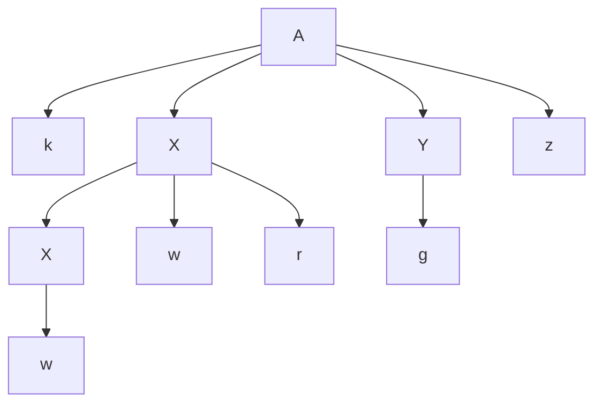

The leaf order is `k w w r g z`. A **rightmost derivation** is
```text
A ⇒ k X Y z ⇒ k X g z ⇒ k X w r g z ⇒ k w w r g z.
```
Reverse this derivation; brackets mark the particular handle occurrence:

| Current right-sentential form | Handle and production | After reduction |
|---|---|---|
| `k [w] w r g z` | first `w`, `X→w` | `k X w r g z` |
| `k [X w r] g z` | `Xwr`, `X→Xwr` | `k X g z` |
| `k X [g] z` | `g`, `Y→g` | `k X Y z` |
| `[k X Y z]` | `kXYz`, `A→kXYz` | `A` |

The handles are **w, Xwr, g, kXYz**, in that order. The first handle is the first w, not the second: matching a production body alone does not identify the correct occurrence.

**Reference basis:** Rumi PDF pp. 507, 512, 513, 514, 516, 517, 518.

**Verification:**

- Verified the tree yield and reversed every step of the displayed rightmost derivation.

### 3(e) - Why each handle reaches the stack top

Topics: LR parsing

#### Question

In shift-reduce parsing, the handle will always eventually appear on top of the stack, never inside — justify this statement for the problem in (d). **(5)**

Grammar: `A→kXYz`, `X→Xwr | w`, `Y→g`. Input: `kwwrgz`.

#### Solution

The parser shifts up to the next handle's right end, then reduces it **before** shifting terminals that follow it:

| Stack (top at right) | Remaining input | Next action |
|---|---|---|
| `$` | `kwwrgz$` | shift k |
| `$k` | `wwrgz$` | shift first w |
| `$kw` | `wrgz$` | reduce top `w→X` |
| `$kX` | `wrgz$` | shift w |
| `$kXw` | `rgz$` | shift r |
| `$kXwr` | `gz$` | reduce top `Xwr→X` |
| `$kX` | `gz$` | shift g |
| `$kXg` | `z$` | reduce top `g→Y` |
| `$kXY` | `z$` | shift z |
| `$kXYz` | `$` | reduce top `kXYz→A` |
| `$A` | `$` | accept |

Every reduced handle is a suffix: **its right end is at the top**, although its left end can be deep in the stack. The final handle spans the whole stack above `$`.

In a right-sentential form `αβw`, β is the next handle and w contains only terminals. The parser holds `αβ` and leaves w unread. Shifting part of w before reducing β would bury that selected handle and stop following the reverse rightmost derivation. This is an invariant of correct parsing decisions, not a claim about arbitrary shift sequences or arbitrary production-body occurrences.

**Reference basis:** Rumi PDF pp. 512, 513, 514, 519, 520, 521, 524.

**Verification:**

- Checked all six shifts and four reductions against the handle sequence of 3(d).

### 4(a) - Removing direct and indirect left recursion

Topics: LL parsing

#### Question

Eliminate left recursion from the grammar. **(12)**
```text
S → SBr | a
B → Cs | b
C → St | c
```

#### Solution

Process the nonterminals in order **S, B, C**. First eliminate S's immediate left recursion `S→S(Br) | a` using a fresh R:

```text
S → a R
R → B r R | ε
```

B starts with C, a later nonterminal, so it remains `B→Cs | b`. For C, substitute the now left-recursion-free `S→aR` into `C→St`:

```text
C → a R t | c
```

A complete equivalent grammar is therefore

```text
S → a R
R → B r R | ε
B → C s | b
C → a R t | c
```

R generates zero or more Br suffixes, so `S⇒a(Br)^m`, exactly the shape obtained by repeatedly using original `S→SBr` and finally `S→a`. Replacing `St` by `aRt` is a substitution of the same S language.

There is **no left recursion**, including through nullable symbols: S starts with terminal a; C starts with a or c; B starts with C or terminal b; R starts with B or is empty. The only nontrivial left-corner chain is `R→B→C→terminal`, never back to its start. The recursive R inside `aRt` or after `Br` is preceded by a terminal-producing prefix, so it is not left recursion. This transformation does not claim that the resulting grammar is LL(1); that is a separate property.

**Reference basis:** Rumi PDF pp. 337, 338, 395, 398, 399, 400.

**Verification:**

- Checked equivalence through the S⇒a(Br)^m expansion and inspected the nullable-aware left-corner graph for cycles.

### 4(b) - All canonical LR(1) item sets

Topics: LR parsing; FIRST and FOLLOW

#### Question

For the grammar shown below, find the LR(1) canonical items. **(10)**
```text
S → aAd | bBd | aBe | bAe
A → c
B → c
```

> **Assumptions and source notes**
> - The supplied Rumi slides explain LR(0)/SLR items and GOTO and mention canonical LR/LALR, but do not provide this LR(1) worked example. The lookahead closure and all 14 states here are explicitly derived, rather than represented as a copied lecture example.

#### Solution

Augment with `S′→S`. An item `[P→α·β, x]` carries one lookahead x. Closure adds `[Q→·γ, y]` for every `y∈FIRST(βx)` when the item is `[P→α·Qβ,x]`. GOTO moves the dot over one symbol and closes the set. The complete collection has **14 states**; the following numbering is used again in 4(c).

```text
I0:
 [S′→·S, $]
 [S→·aAd, $]
 [S→·bBd, $]
 [S→·aBe, $]
 [S→·bAe, $]

I1 = GOTO(I0,a):
 [S→a·Ad, $]
 [S→a·Be, $]
 [A→·c, d]
 [B→·c, e]

I2 = GOTO(I0,b):
 [S→b·Bd, $]
 [S→b·Ae, $]
 [B→·c, d]
 [A→·c, e]

I3 = GOTO(I0,S):
 [S′→S·, $]

I4 = GOTO(I1,c):
 [A→c·, d]
 [B→c·, e]

I5 = GOTO(I1,A):
 [S→aA·d, $]

I6 = GOTO(I1,B):
 [S→aB·e, $]

I7 = GOTO(I2,c):
 [A→c·, e]
 [B→c·, d]

I8 = GOTO(I2,A):
 [S→bA·e, $]

I9 = GOTO(I2,B):
 [S→bB·d, $]

I10 = GOTO(I5,d):
 [S→aAd·, $]

I11 = GOTO(I6,e):
 [S→aBe·, $]

I12 = GOTO(I8,e):
 [S→bAe·, $]

I13 = GOTO(I9,d):
 [S→bBd·, $]
```

These listed GOTO links are all the nonempty transitions. For example, I1's A item gets d because `FIRST(d$)={d}`, while its B item gets e because `FIRST(e$)={e}`.

**Keep I4 and I7 separate:** their LR(0) cores agree, but their lookaheads are reversed. On d, I4 reduces A→c while I7 reduces B→c. Their separation is precisely why the canonical LR(1) parser succeeds on this grammar. Merging them for LALR would create reduce/reduce conflicts on both d and e.

**Reference basis:** Rumi PDF pp. 586, 588, 616, 617, 652, 694, 695, 696.

**Verification:**

- Programmatically computed FIRST, LR(1) closure/GOTO and the 14-state collection; independently checked the exchanged lookaheads in I4 and I7.

### 4(c) - Complete CLR ACTION and GOTO table

Topics: LR parsing

#### Question

From the LR(1) canonical items in Question 4(b) construct the CLR parsing table. **(8)**

Grammar: `S→aAd | bBd | aBe | bAe`, `A→c`, `B→c`.

> **Assumptions and source notes**
> - The table extends the supplied general LR/SLR construction to LR(1): reductions use item lookaheads, not the SLR FOLLOW rule on Rumi p700. State numbering is the one explicitly defined in 4(b).

#### Solution

Use production numbers

```text
(0) S′→S
(1) S→aAd     (2) S→bBd
(3) S→aBe     (4) S→bAe
(5) A→c       (6) B→c
```

Use the I0–I13 numbering listed in 4(b). `sj` means shift and enter Ij, `ri` means reduce using production i, and `—` is an error. In **CLR**, completed items reduce only on their own lookaheads, not on the whole FOLLOW set.

| State | a | b | c | d | e | $ | GOTO S | GOTO A | GOTO B |
|---|---|---|---|---|---|---|---|---|---|
| 0 | s1 | s2 | — | — | — | — | 3 | — | — |
| 1 | — | — | s4 | — | — | — | — | 5 | 6 |
| 2 | — | — | s7 | — | — | — | — | 8 | 9 |
| 3 | — | — | — | — | — | accept | — | — | — |
| 4 | — | — | — | r5 | r6 | — | — | — | — |
| 5 | — | — | — | s10 | — | — | — | — | — |
| 6 | — | — | — | — | s11 | — | — | — | — |
| 7 | — | — | — | r6 | r5 | — | — | — | — |
| 8 | — | — | — | — | s12 | — | — | — | — |
| 9 | — | — | — | s13 | — | — | — | — | — |
| 10 | — | — | — | — | — | r1 | — | — | — |
| 11 | — | — | — | — | — | r3 | — | — | — |
| 12 | — | — | — | — | — | r4 | — | — | — |
| 13 | — | — | — | — | — | r2 | — | — | — |

For example, parsing `acd$` gives:

| State stack | Remaining input | Action |
|---|---|---|
| `0` | `acd$` | s1 |
| `0 1` | `cd$` | s4 |
| `0 1 4` | `d$` | r5: pop 4, push GOTO[1,A]=5 |
| `0 1 5` | `d$` | s10 |
| `0 1 5 10` | `$` | r1: pop 3 states, push GOTO[0,S]=3 |
| `0 3` | `$` | accept |

There are **no conflicts**, hence the grammar is CLR(1). Its language consists exactly of `acd`, `bcd`, `ace`, `bce`. Exhaustively running the constructed table over all strings on {a,b,c,d,e} of length at most four accepts precisely those four.

**Reference basis:** Rumi PDF pp. 655, 656, 660, 667, 668, 669, 694, 695, 700, 701, 702, 703.

**Verification:**

- Programmatically constructed every ACTION/GOTO entry, checked that each cell has at most one action, and tested all 781 strings of length 0–4; exactly acd, ace, bcd, bce were accepted.

### 4(d) - How LR and LALR action sequences compare

Topics: LR parsing

#### Question

Comment on the similarity and dissimilarity between the sequences of shifts and reductions for the LR and LALR parsers. **(5)**

> **Assumptions and source notes**
> - The source mentions the canonical/LALR methods but does not develop merging in detail. The distinction is justified by the explicit computed counterexample in 4(b).

#### Solution

Here **LR** means canonical LR(1). If the same grammar has conflict-free CLR and LALR tables, then on a **valid input** they perform the same shifts and reductions in the same order, hence reconstruct the same rightmost derivation in reverse. Their **state numbers/stacks differ**: LALR merges CLR states having the same LR(0) core and unions their lookahead sets, normally yielding many fewer states.

For **invalid input**, the CLR parser can signal an error where LALR performs additional reductions enabled by lookaheads imported from a merged state; LALR may therefore report the error later. Agreement on valid parses does not imply identical error behavior.

Moreover, not every CLR grammar is LALR. In 4(b), CLR states I4 and I7 have common core `{A→c·, B→c·}` but exchanged d/e lookaheads. LALR merging gives both completed productions lookahead set `{d,e}`, creating reduce/reduce conflicts. Therefore this grammar has no deterministic conflict-free LALR table, and no unconditional claim about identical LR/LALR action sequences is valid for it. Merging CLR cores can introduce reduce/reduce conflicts; it does not introduce a new shift/reduce conflict in an otherwise conflict-free CLR(1) table.

**Reference basis:** Rumi PDF pp. 652, 694, 695, 726.

**Verification:**

- Merged the two computed equal-core CLR states and verified reduce/reduce conflicts on d and e.

## Section B

### 5(a) - Attribute dependency graphs and evaluation order

Topics: Syntax-directed translation

#### Question

What is a dependency graph in the context of Syntax-Directed Definition (SSD)? How is a dependency graph constructed? What is the application of a dependency graph? **(4+4+3=11)**

> **Assumptions and source notes**
> - The question prints SSD; the standard term in the supplied notes is SDD (Syntax-Directed Definition).

#### Solution

A **dependency graph** is a directed graph describing the data dependencies among **attribute instances of one particular parse tree**. Each attribute at each node occurrence is a separate vertex; two occurrences of the same grammar symbol/attribute are not the same vertex. An edge `u→v` means v's value requires u's value.

Construct it as follows:

1. Build the parse tree and create a vertex for every relevant synthesized/inherited attribute at every node.
2. At each production occurrence, instantiate its semantic rules using the actual parent/child occurrences.
3. For each rule `v=f(u1,...,uk)`, add edges `u1→v`, …, `uk→v`. Lexical values are input attributes; constants require no incoming dependency edge. Retain additional sequencing dependencies if side-effecting actions require them.

For example, at an occurrence of `E→T F` with `F.a=E.a+T.b`, add vertices for these attributes and edges `E.a→F.a` and `T.b→F.a`. Both inputs must be available before F.a is computed.

**Application:** Any topological order gives a legal attribute-evaluation schedule; an edge's source is evaluated before its destination. An acyclic finite graph has such an order. A cycle exposes circular dependencies for that parse tree and prevents ordinary one-way topological evaluation. The graph helps check semantic definitions and determine whether a traversal or parser-time evaluation strategy can supply every value when needed. One tree's acyclicity alone does not prove the SDD is acyclic for every possible tree.

**Reference basis:** KMS PDF pp. 23, 24, 25, 28, 30, 31, 32, 33, 34, 35.

**Verification:**

- Checked edge direction and topological-order criterion directly against KMS pp24–28.

### 5(b) - A non-left-recursive binary-value SDT

Topics: Syntax-directed translation; LL parsing

#### Question

The following SDT computes the value of a string of 0's and 1's interpreted as a positive, binary integer. **(10)**
```text
B → B1 0 {B.val = 2 × B1.val}
  | B1 1 {B.val = 2 × B1.val + 1}
  | 1    {B.val = 1}
```
Rewrite this SDT so that the underlying grammar is not left recursive, and yet the same value of B.val is computed for the entire input string.

> **Assumptions and source notes**
> - The original grammar disallows leading zeroes and zero itself; the rewritten grammar deliberately preserves that language.

#### Solution

Carry the value of the already read prefix as an **inherited accumulator**. R.in is that accumulator; R.out returns the final value. A subscript marks a child occurrence, not a different nonterminal.

```text
B → 1 { R.in = 1; }
      R { B.val = R.out; }

R → 0 { R1.in = 2 * R.in; }
      R1 { R.out = R1.out; }

R → 1 { R1.in = 2 * R.in + 1; }
      R1 { R.out = R1.out; }

R → ε { R.out = R.in; }
```

The underlying grammar is simply `B→1R`, `R→0R | 1R | ε`, which has no left recursion and generates the same strings: a leading 1 followed by any number of bits.

**Why the value is preserved:** Once prefix p is read, R.in equals its binary value v. Appending bit b changes it to `2v+b`, exactly the original semantic rule. When no bits remain, the ε action returns the accumulator, which propagates to B.val.

For `10110`, the accumulator after successive bits is `1 → 2 → 5 → 11 → 22`, so B.val=22. For the shortest string `1`, R immediately takes ε and returns 1. Actions setting R1.in occur **before** processing that child; moving all actions to the end would lose this intended evaluation order.

**Reference basis:** KMS PDF pp. 32, 34, 62, 63, 64, 65, 66, 67.

**Verification:**

- Programmatically evaluated all 511 strings starting with 1 of lengths 1–9; the accumulator result equals their integer binary value in every case.

### 5(c) - L-attributed definitions on LR grammars

Topics: Syntax-directed translation; LR parsing; LL parsing

#### Question

Give an example of an L-attributed SDD on an LR grammar. Is it possible to handle every LR grammar and L-attributed SDD bottom up? Give an intuitive argument in support of your answer. **(6+8=14)**

> **Assumptions and source notes**
> - “Handle bottom up” is interpreted as evaluate the translation during the parse; building the entire tree and evaluating afterward is always a distinct general strategy for an acyclic L-attributed SDD.

#### Solution

An example is a declaration grammar with a left-recursive identifier list:

| Production | Semantic rules |
|---|---|
| `D→T L` | `L.in=T.type` |
| `T→int` | `T.type=integer` |
| `T→float` | `T.type=floating` |
| `L→L1 , id` | `L1.in=L.in`; install `id.entry` with type `L.in` |
| `L→id` | install `id.entry` with type `L.in` |

T.type is synthesized and L.in is inherited. Every inherited attribute depends only on its parent's inherited attribute or a left sibling's available attribute, so this SDD is **L-attributed**. For `float x,y`, both identifiers receive floating type. The grammar is LR(1) (indeed the list reductions are decided by comma/end lookahead); its left recursion makes it unsuitable as an LL grammar in this form.

**Not every L-attributed SDD on an LR grammar can be evaluated during an ordinary single bottom-up parse.** L-attributed restrictions guarantee a left-to-right **depth-first tree traversal** can evaluate attributes, but do not guarantee LR reductions know inherited attributes early enough.

Consider an LR production `A→B C` with rule `B.in=f(A.in)`. Before or when B is reduced, the parser has not yet recognized C, so it may not know that this B belongs to this A-production rather than another context with different rules. Delaying until `BC→A` identifies the production may still leave A.in unknown: the enclosing production containing A may not yet be identified. Repeating this deferral can require waiting until the whole tree is known.

Thus a general solution is **parse first, build the tree, then evaluate** in a suitable traversal. This is still compatible with bottom-up syntax parsing, but is not universal on-the-fly attribute evaluation at reductions. In contrast, every S-attributed SDD on an LR grammar can be evaluated bottom up; L-attributed SDDs on LL grammars have the needed top-down context (and can be handled by suitably transformed bottom-up techniques). Special LR/L-attributed cases may also work; the answer is not that none can.

**Reference basis:** KMS PDF pp. 31, 32, 33, 34, 35, 78, 79, 80.

**Verification:**

- Checked all inherited dependencies in the example against the L-attributed restrictions and matched the deferral argument to KMS pp79–80.

### 6(a) - SSA: unique definitions and phi functions

Topics: Intermediate code; Code optimization

#### Question

Illustrate two distinctive aspects that distinguish Static Single-Assignment (SSA) from three-address code. How does SSA facilitate code optimization? Explain with an example. **(8+5=13)**

#### Solution

SSA is a discipline that can be applied **to three-address code**; the two are not mutually exclusive formats. Its distinctive features are:

1. **Every SSA name has exactly one static definition.** Reassigning source variable x creates new versions x1, x2, …, and each use explicitly names its reaching version. A definition inside a loop can execute repeatedly; “single” refers to one static definition site, not one dynamic execution.
2. **Joins use φ-functions.** When different definitions can reach a join, `x3=φ(x1,x2)` selects the value corresponding to the predecessor edge taken. It is not an eager ordinary function evaluating both control paths. Loop headers can similarly merge an initial value and a back-edge value.

Example:

```text
Ordinary TAC                 SSA
x = 10                       x1 = 10
x = 15                       x2 = 15
y = x                        y1 = x2
```

In SSA, x1 has no uses, so its assignment is immediately dead; propagation yields `y1=15` and permits removal of x2 if its value is no longer otherwise needed. The use-definition relation is explicit, simplifying constant/copy propagation, dead-code elimination, and related optimization analyses.

At a branch:

```text
if flag goto L1 else L2
L1: x1 = -1; goto L3
L2: x2 =  1; goto L3
L3: x3 = φ(x1 from L1, x2 from L2)
    y1 = x3 * a0
```

There is no single constant for x3 here, because the incoming values differ. If both branches instead define 7, the φ result is constant 7 and `y1=7*a0` can be propagated/folded as applicable. SSA exposes this reasoning without repeatedly searching which assignment to the same unversioned x reaches each use.

**Reference basis:** KMS PDF pp. 116, 117.

**Verification:**

- Matched the two defining properties and dead-store example to KMS pp116–117; checked that the differing-value phi example is not incorrectly folded.

### 6(b) - Fall-through rules for AND and relational tests

Topics: Intermediate code; Control flow and backpatching; Syntax-directed translation

#### Question

Consider this SDD for generating three-address code using the fall-through technique. **(14)**

Production: `S → if (B) S1`
```text
B.true = fall
B.false = S1.next = S.next
S.code = B.code || S1.code
```
Production: `B → B1 || B2`
```text
B1.true = if B.true ≠ fall then B.true else newLabel()
B1.false = fall
B2.true = B.true
B2.false = B.false
B.code = if B.true ≠ fall then B1.code || B2.code
         else B1.code || B2.code || label(B1.true)
```
Add rules for **(i)** `B→B1 && B2` and **(ii)** `B→E1 rel E2`, using the same fall-through technique. All symbols, attributes, functions, labels and notations have their usual meanings.

> **Assumptions and source notes**
> - The question supplies fall-through conventions; these rules are derived from them and the lecture short-circuit Boolean translation. ifFalse denotes actual Boolean negation, including floating comparison edge cases.

#### Solution

Here `fall` means continue at the instruction immediately after this Boolean expression's code; `||` in code rules means concatenation.

**(i) AND:** If B1 is true, evaluation must continue into B2. If B1 is false, it must skip B2; when the enclosing false target is fall, allocate a label after B2 to preserve that short circuit.

```text
B1.true  = fall
B1.false = if B.false ≠ fall then B.false else newLabel()
B2.true  = B.true
B2.false = B.false

B.code = if B.false ≠ fall
         then B1.code || B2.code
         else B1.code || B2.code || label(B1.false)
```

This is the dual of the supplied OR rule. The new label belongs **after** B2, not before it; a false B1 must not execute B2.

**(ii) Relational test:** First evaluate the operands in their required order:

```text
P = E1.code || E2.code
C = (E1.addr rel E2.addr)
```

Then generate according to the two destinations:

| B.true | B.false | B.code |
|---|---|---|
| explicit T | explicit F | `P || gen(if C goto T) || gen(goto F)` |
| explicit T | fall | `P || gen(if C goto T)` |
| fall | explicit F | `P || gen(ifFalse C goto F)` |
| fall | fall | `P` (no branch needed) |

`ifFalse C` denotes the **logical complement** of the relation's result. On ordinary totally ordered operands it can use the opposite relational operator, e.g. `<` becomes `>=`; with floating NaNs, implement the true logical complement rather than assuming such an operator substitution is always equivalent. Operand evaluation and observable effects must be preserved even if both results fall through.

For example, inside `if (x<y && p<q) S1`, use `B.true=fall`, `B.false=Lnext`. Each relation emits `ifFalse ... goto Lnext`. A false first test skips the second and S1; both true tests fall directly into S1.

**Reference basis:** KMS PDF pp. 165, 166, 167, 168, 169, 171, 173, 174, 175.

**Verification:**

- Checked all four destination combinations for a relation and all four Boolean-value combinations for short-circuit AND; verified the false-fall label is placed after B2.

### 6(c) - One-pass backpatching for a for loop

Topics: Control flow and backpatching; Intermediate code; Syntax-directed translation

#### Question

Write a translation scheme for generating code using backpatching for the flow-of-control statement yielded by the following production. You may add marker symbols as required; specify their semantic actions. Make any other justified assumptions as necessary. **(8)**
```text
S → for (S1; B; S2) S3
```

> **Assumptions and source notes**
> - This scheme assumes conventional for semantics and explicit Boolean truelist/falselist code. Marker-emission order is essential because increment code precedes body code physically.

#### Solution

A for loop executes **S1 once; then repeatedly B, S3, S2**. Source order places S2 before S3, so one-pass emission must jump over the increment on the first true test and jump from the body back to it.

Use this marked production:

```text
S → for ( S1 ; Mt B ; Mi S2 N ) Mb S3
```

All marker names Mt, Mi, Mb are occurrences of the same marker kind:

```text
M → ε { M.instr = nextinstr; }
N → ε {
    N.nextlist = makelist(nextinstr);
    emit("goto _");
}
```

At the end of the S production execute:

```text
backpatch(S1.nextlist, Mt.instr);
backpatch(B.truelist, Mb.instr);
backpatch(S2.nextlist, Mt.instr);
backpatch(N.nextlist, Mt.instr);
backpatch(S3.nextlist, Mi.instr);
emit("goto " + Mi.instr);
S.nextlist = B.falselist;
```

The emitted physical layout is:

```text
             code(S1)
Mt:          code(B)     /* true → Mb; false → loop exit */
Mi:          code(S2)
             goto Mt    /* emitted by N */
Mb:          code(S3)
             goto Mi    /* emitted by final action */
exit:        ...        /* supplied by enclosing construct */
```

S1's natural fall-through already reaches Mt; pending normal-completion jumps are also patched there. B.true jumps over S2 to the body. Body fall-through reaches the final `goto Mi`, and body normal-completion jumps also target Mi. After the increment, N returns to the test. B.false is retained in S.nextlist so the enclosing sequence can patch the actual exit address later.

Assume S1/S2 are the usual initialization/increment statements, B supplies explicit true/false jump lists, and nextlist represents normal completion. If break/continue are allowed in S3, keep separate lists: patch continue to Mi and merge the loop's break list into S.nextlist. An omitted test can be treated as an unconditional true jump. The scheme does not execute S2 before the first body iteration.

**Reference basis:** KMS PDF pp. 184, 185, 186, 187, 189, 190, 194, 195.

**Verification:**

- Executed an interpreter for the init/test/increment/backjump/body/backjump layout with bounds 0, 1, and 3; body traces are respectively [], [0], [0,1,2].

### 7(a) - Why stack allocation needs nested lifetimes

Topics: Runtime environments

#### Question

Which condition must procedure calls or activations of procedure satisfy to enable stack allocation? Explain. Give an example of a programming language feature that violates the condition and thus cannot be implemented with purely a runtime stack. What are calling and return sequences in the context of procedure calls? **(6+6+5=17)**

#### Solution

**The condition is last-in, first-out nesting in time.** If activation `P` calls activation `Q`, `Q` must finish before `P` finishes. At each instant, live ordinary activations form one root-to-current-node path in the activation tree. The most recently entered live activation is therefore the first one whose frame can be removed. Recursion satisfies this condition: different recursive calls have different frames, and they return in reverse order.

For example:

```text
call main → call P → call Q → return Q → return P → return main
stack:          [main,P]  [main,P,Q]     [main,P]     [main]
```

A frame also cannot be popped while data that must remain accessible still resides exclusively in it.

**A feature requiring more than a single ordinary runtime stack:** an escaping closure can retain an outer procedure's local variables after that procedure has returned.

```python
def make_counter():
    n = 0
    def next_value():
        nonlocal n
        n += 1
        return n
    return next_value

f = make_counter()  # make_counter returns
f()                 # still needs its n: returns 1
f()                 # the same retained n: returns 2
```

The `make_counter` activation has ended, yet its environment must survive. Popping its frame and reusing all its storage would destroy `n`. Keep the escaping environment in the heap (or another storage scheme with the required lifetime). Ordinary calls may still use a stack; the claim is that **all required storage cannot be managed by that stack alone**. Coroutines/generators provide the notes' other example: suspended execution states may be resumed or destroyed in an order that a single LIFO control stack cannot represent. An implementation can use separate stacks or heap-allocated continuation frames.

**Calling sequence:** generated caller/callee code that establishes a call. Typically the caller evaluates and passes arguments, records the return address and caller frame/stack state, and transfers control; the callee saves required machine state, allocates/initializes local storage, and begins its body. The exact division depends on the calling convention.

**Return sequence:** generated code that places the result where the caller expects it, restores saved registers/frame/stack state, removes the callee's frame, and branches to the saved return address so execution continues after the call. The caller then obtains the result. These actions make the stack operations implement the nested call/return lifetime discipline.

**Reference basis:** KMS PDF pp. 210, 211, 215, 217, 220, 221, 226, 227, 230.

**Verification:**

- Checked the nested-call condition against KMS pp210–211 and distinguished a closure environment lifetime from the completed call itself.

### 7(b) - Cheney collection: queue order, addresses, and updated pointers

Topics: Garbage collection; Runtime environments

#### Question

Consider the network of objects in the figure below. Assume, X denotes the root set. Suppose at some point in time, the pointer `A → C` is deleted. Then we execute Cheney's copying garbage collection algorithm on the network. Also, suppose that, **(18)**

(i) Each object has size 100 bytes,

(ii) The unscanned list is managed as a queue, and when an object has more than one pointer, the reached objects are added to the queue in alphabetical order,

(iii) The From semispace starts at location 0, and the To semispace starts at location 10,000, and

(iv) Initially, all the objects in the heap are arranged in alphabetical order starting at byte 0.

What is the value of `NewLoction(o)` for each object o that remains after garbage collection? Draw the heaps before and after running garbage collection, showing- (i) locations of the allocated objects, (ii) references running among the objects. What is the time complexity of the algorithm?

> **Transcription note:** The function name in this question is printed `NewLoction(o)`.


**Figure for Question 7(b) - directed object network before the specified deletion**

Root set: `X`. Objects: `A, B, C, D, E, F, G, H, I`.

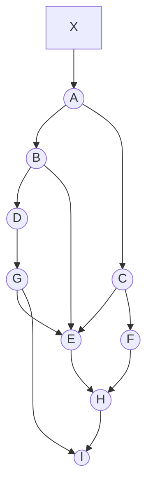

> **Assumptions and source notes**
> - The graph must retain G → E. Treat X as a root slot, not as a tenth 100-byte heap object.

#### Solution

Delete **only `A → C`** before tracing. The root `X` still points to `A`. Follow all remaining edges, including the easily missed **`G → E`** edge:

```text
X → A → B
B → D, E
D → G
E → H
G → E, I
H → I
```

Thus the reachable objects are `{A,B,D,E,G,H,I}`; `C` and `F` are garbage. Their outgoing edges do not make them reachable, because reachability starts at roots and follows pointer directions.

**Heap before collection (after the deletion).** Each object occupies 100 bytes. A row gives its start address and pointer-valued fields; `X` is a root slot outside these nine heap objects.

| Object | From address | Outgoing references before collection |
| --- | --- | --- |
| A | 0 | B at 100 |
| B | 100 | D at 300; E at 400 |
| C | 200 | E at 400; F at 500 (C is unreachable) |
| D | 300 | G at 600 |
| E | 400 | H at 700 |
| F | 500 | H at 700 (F is unreachable) |
| G | 600 | E at 400; I at 800 |
| H | 700 | I at 800 |
| I | 800 | none |

Initially `X=0`, `unscanned=free=10000`. Copying the root target installs `A` at 10000, changes `X` to 10000, and advances `free` to 10100. First discoveries enter the queue in alphabetical order; repeated references use the existing forwarding address.

| Scanned object | Newly copied objects, in order | Queue still unscanned after this step | free |
| --- | --- | --- | --- |
| root initialization | A at 10000 | A | 10100 |
| A | B at 10100 | B | 10200 |
| B | D at 10200; E at 10300 | D, E | 10400 |
| D | G at 10400 | E, G | 10500 |
| E | H at 10500 | G, H | 10600 |
| G | I at 10600 (E already forwarded) | H, I | 10700 |
| H | none (I already forwarded) | I | 10700 |
| I | none | empty | 10700 |

**Final `NewLocation` values and heap.** This is the intended meaning of the exam's printed `NewLoction`.

| Object | NewLocation | Updated outgoing references |
| --- | --- | --- |
| A | 10000 | B = 10100 |
| B | 10100 | D = 10200; E = 10300 |
| D | 10200 | G = 10400 |
| E | 10300 | H = 10500 |
| G | 10400 | E = 10300; I = 10600 |
| H | 10500 | I = 10600 |
| I | 10600 | none |

`C` and `F` have no copied address. `X=10000`; the occupied To-space interval is `[10000,10700)`, and `unscanned=free=10700` at termination. The remaining To space is free. The semispaces exchange roles, so the old From space becomes available for later allocation; its old bytes need not be physically zeroed.

**Cost:** the standard Cheney implementation copies each reachable object once and scans its fields once. Its cost is `Θ(live bytes + root slots + scanned pointer fields)`, conventionally described by these notes as proportional to total reached-object size. With these fixed-size, bounded-field objects it is `Θ(R)` for `R` reachable objects. An equally sized spare semispace is required, but the copied interval between `unscanned` and `free` is itself the queue, avoiding a separate unbounded work-stack. If an implementation first resets forwarding metadata for every allocated From object, add that full-heap initialization cost; it is not necessary in the standard forwarding-pointer formulation.

**Reference basis:** KMS PDF pp. 252, 253, 254, 279, 285, 286, 287, 288, 289, 290, 291, 292, 293.

**Verification:**

- Independently traversed the graph and reproduced FIFO discovery A,B,D,E,G,H,I; checked all 7 forwarding addresses and all rewritten reference fields.

### 8(a) - Dot-product loop: common expressions and induction variables

Topics: Code optimization; Intermediate code

#### Question

Optimize the following three-address code by eliminating common subexpressions, performing reduction in strength on induction variables, and eliminating all the induction variables as possible. **(10)**

```text
dp = 0
i = 0
L: t1 = i * 8
   t2 = A[t1]
   t3 = i * 8
   t4 = B[t3]
   t5 = t2 * t4
   dp = dp + t5
   i = i + 1
   if i < n goto L
```

> **Assumptions and source notes**
> - Assume n is invariant; A/B are valid nonvolatile arrays and scalar bookkeeping does not alias them. Arithmetic for offsets/bounds must not overflow (or must be proven safe). Only dp is assumed live on exit; a live i must be restored as described.

#### Solution

The repeated expression is `i*8`: `t1` and `t3` are equal before any intervening change to `i`. Reuse `t1` for both array offsets:

```text
dp = 0
i = 0
L: t1 = i * 8
   t2 = A[t1]
   t4 = B[t1]
   t5 = t2 * t4
   dp = dp + t5
   i = i + 1
   if i < n goto L
```

This is **common subexpression elimination**, followed by removal of the redundant temporary/copy. Since `i` increases by one, the derived induction expression `8*i` increases by eight. Introduce a running byte offset `p`, initialize it to zero, and update it by addition rather than multiplying inside the loop. The bound `8*n` is loop invariant and can be computed once.

Assuming only `dp` is needed after the loop, a complete result is:

```text
dp = 0
p = 0
limit = 8 * n
L: t2 = A[p]
   t4 = B[p]
   t5 = t2 * t4
   dp = dp + t5
   p = p + 8
   if p < limit goto L
```

The steps are:

1. **Strength reduction:** replace repeated `i*8` with the recurrence `p←p+8`.
2. **Loop-invariant code motion:** compute `limit=8*n` before the loop.
3. **Induction-variable elimination:** replace `i<n` with `p<limit`, then remove `i` and its increment if its final value is dead. At corresponding loop entries the invariant is `p=8*i`; multiplying an integer comparison by positive 8 preserves its direction under the stated arithmetic assumptions.

The remaining `p` is still an induction variable: at least one progressing loop-control/address value is needed. “Eliminate all … as possible” means remove redundant induction variables, not every value that changes with the iteration. If the final `i` is required, restore it once after the loop as `i=p/8` (exact division here), or retain its increment.

**Boundary and semantic details:** the source is a bottom-tested loop. It executes once even when `n≤0`. The result above also enters the body unconditionally and therefore preserves that behavior; replacing it by a conventional pretested `for(i=0;i<n;i++)` would change those cases. With `n>0`, it computes `Σ(k=0..n−1) A[8k]*B[8k]`; with `n≤0`, it computes the single product at offset 0. Array element access and addition/multiplication order are unchanged.

**Reference basis:** KMS PDF pp. 330, 331, 335, 337, 339, 340.

**Verification:**

- Compared original and transformed TAC on 2,400 randomized integer-array cases with n from −2 through 12, preserving dp and the original bottom-tested iteration count.

### 8(b) - Global allocation: liveness, the K6 interference graph, and spills

Topics: Register allocation; Liveness analysis

#### Question

Given the flow graph of a program, formulate the problem of global register allocation as a graph coloring problem. Show detailed formulation steps using the flow graph in the figure below as an example. Subsequently, find a register allocation for the given program using Chaitin's algorithm. Assume that three physical registers are available. Illustrate all steps of the algorithm. **(13+12=25)**

**Figure for Question 8(b) - block contents**

```text
B1:
    a = b + c
    d = d - b
    e = a + f

B2:
    f = a - d

B3:
    b = d + f
    e = a - c

B4:
    b = d + c
```

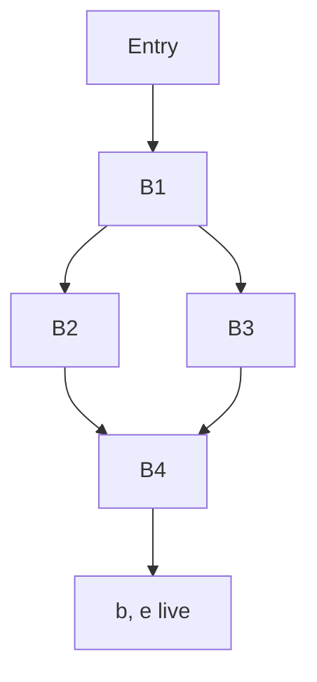

**Directed flow edges:** `Entry → B1`, `B1 → B2`, `B1 → B3`, `B2 → B4`, `B3 → B4`, `B4 → Exit`.

At exit: **b, e live**.

> **Assumptions and source notes**
> - The allocation uses one RIG node per whole unsplit variable and the figure’s exact live-out set {b,e}. SSA/version splitting or prior dead-code elimination changes this graph and may change the spill count. The source graph does not specify its branch condition; retain its original branch.

#### Solution

Use **one vertex for each unsplit source variable** `{a,b,c,d,e,f}`, as in KMS p437. Two vertices interfere when their values must coexist at a program point, so adjacent vertices must receive different register colors. Exactly `b,e` are live at the program exit.

**1. Compute block use/def and solve liveness.** `USE` means read before any definition in that block. Iterate `OUT[B]=⋃ IN[successor]` and `IN[B]=USE[B] ∪ (OUT[B]−DEF[B])` to a fixed point.

| Block | USE | DEF | IN | OUT |
| --- | --- | --- | --- | --- |
| B1 | b,c,d,f | a,d,e | b,c,d,f | a,c,d,e,f |
| B2 | a,d | f | a,c,d,e | c,d,e |
| B3 | a,c,d,f | b,e | a,c,d,f | c,d,e |
| B4 | c,d | b | c,d,e | b,e |

**2. Inspect internal program points as well.** Block boundaries alone miss some edges. Working backward within blocks gives:

| Instruction | Live before | Live after |
| --- | --- | --- |
| B1: a=b+c | b,c,d,f | a,b,c,d,f |
| B1: d=d−b | a,b,c,d,f | a,c,d,f |
| B1: e=a+f | a,c,d,f | a,c,d,e,f |
| B2: f=a−d | a,c,d,e | c,d,e |
| B3: b=d+f | a,c,d,f | a,c,d |
| B3: e=a−c | a,c,d | c,d,e |
| B4: b=d+c | c,d,e | b,e |

For example, immediately after `a=b+c`, `a,b,c,d,f` coexist. Immediately after `e=a+f`, `a,c,d,e,f` coexist. The exit set supplies the remaining `b−e` pair. The resulting RIG is therefore **K6**, with all 15 edges:

```text
ab ac ad ae af
   bc bd be bf
      cd ce cf
         de df
            ef
```

Every initial degree is 5. K6 needs six colors if no variable is split/spilled; with only three colors, at least three of these whole-variable vertices must spill.

**3. A complete optimistic Chaitin run (`K=3`).** Choose `c,e,f` as the troublesome candidates, then simplify the remaining triangle. A star means “potential spill,” not an immediate spill.

| Removal order | Current degree | Action |
| --- | --- | --- |
| c | 5 | mark c*, remove |
| e | 4 | mark e*, remove |
| f | 3 | mark f*, remove |
| a | 2 | simplify |
| b | 1 | simplify |
| d | 0 | simplify |

Reinsert in reverse order:

| Vertex | Result |
| --- | --- |
| d | R1 |
| b | R2 |
| a | R3 |
| f | neighbors a,b,d use all three colors: spill |
| e | neighbors a,b,d use all three colors: spill |
| c | neighbors a,b,d use all three colors: spill |

This produces `d→R1`, `b→R2`, `a→R3`, and memory locations for `c,e,f`. The particular spill choice is not unique; a real cost heuristic weights uses, loop nesting and reload/store cost. After rewriting spills, recompute liveness/RIG for the new short-lived reload temporaries rather than treating a spilled value as permanently occupying a register.

**4. Show that the spills can be executed with three registers.** Here `LD R,x`, `ST x,R` and three-register arithmetic use the lecture's simple-machine style. The original B1 branch decision is retained; its predicate is not specified in the given flow graph.

```text
B1:
    LD  R2, b
    LD  R1, c
    ADD R3, R2, R1       // a = b + c
    LD  R1, d
    SUB R1, R1, R2       // d = old d - old b
    LD  R2, f           // old b is now dead
    ADD R2, R3, R2       // e = a + f
    ST  e, R2
    branch as in original graph to B2 or B3

B2:
    SUB R2, R3, R1       // f = a - d
    ST  f, R2
    goto B4

B3:
    LD  R2, f
    ADD R2, R1, R2       // b = d + f
    LD  R2, c           // that b is dead before B4 redefines it
    SUB R2, R3, R2       // e = a - c
    ST  e, R2
    goto B4

B4:
    LD  R2, c
    ADD R2, R1, R2       // b = d + c
    ST  b, R2
```

At exit, both required values `b,e` are in memory. This explicit code also illustrates why scratch registers may be reused after their current values die even though the global unsplit-name coloring was conservative. The dead B3 assignment to `b` could be removed by a separate dead-code pass, and value splitting can reduce interference further; neither change is silently assumed in the K6 construction.

**Reference basis:** KMS PDF pp. 332, 333, 346, 348, 351, 355, 356, 437, 440, 471, 530, 531.

**Verification:**

- Independent backward-liveness computation confirmed all eight instruction boundaries and K6’s 15 edges. Checked the shown spill code against both paths on 2,000 randomized inputs, preserving required exit b/e.

---

# 2020-2021

## Section A

### 1(a) - SDD: maximum position and value–index count

Topics: Syntax-directed translation

#### Question

The grammar below generates integer lists `{num1, num2, …, numn}`, where terminal `num` represents an integer constant.

```text
L → '{' N '}'
N → N ',' num | num
```

Design an SDD that computes and prints (i) the index of the maximum number and (ii) the count of numbers whose values are greater than their indices. The leftmost index is 0. For `{3, 6, 1, 2, 5}`, the answers are 1 and 3. (12 marks)

> **Assumptions and source notes**
> - The question does not specify how to break ties for the maximum. This solution returns its first occurrence.

#### Solution

Use four synthesized attributes for every `N`:

| Attribute | Meaning |
|---|---|
| `len` | Number of values in this prefix |
| `max` | Largest value in this prefix |
| `arg` | Zero-based index of its first maximum |
| `count` | Number of prefix values `value[k] > k` |

The lexer supplies `num.lexval`. Let `[P]` mean 1 when proposition `P` is true, and 0 otherwise.

| Production | Semantic rules |
|---|---|
| `N → num` | `N.len = 1; N.max = num.lexval; N.arg = 0; N.count = [num.lexval > 0]` |
| `N → N₁ ',' num` | `N.len = N₁.len + 1; N.max = max(N₁.max, num.lexval); N.arg = (num.lexval > N₁.max ? N₁.len : N₁.arg); N.count = N₁.count + [num.lexval > N₁.len]` |
| `L → '{' N '}'` | `print(N.arg); print(N.count)` |

Why `N₁.len`? A prefix of length `k` occupies indices `0…k−1`, so the newly appended number has index `k`. For maximum ties, the strict `>` test retains the first maximum; changing it to `>=` consistently selects the last maximum.

For `{3,6,1,2,5}`, the final tuple `(len,max,arg,count)` is `(5,6,1,3)`. Values 3, 6 and 5 exceed their respective indices 0, 1 and 4. All attributes are synthesized, so the SDD is S-attributed; printing is the final side effect at `L`.

**Reference basis:** KMS PDF pp. 9, 12, 16, 31.

**Verification:**

- Evaluated all five prefix tuples with a Python implementation of these exact recurrences; obtained (5,6,1,3).

### 1(b) - Annotated list parse tree

Topics: Syntax-directed translation

#### Question

For the SDD designed in 1(a), draw the annotated parse tree for `{3, 6, 1, 2, 5}`. The grammar is:

```text
L → '{' N '}'
N → N ',' num | num
```

(6 marks)

#### Solution

Each `N` label contains `(len,max,arg,count)` using the attributes in 1(a). The tree follows the original **left-recursive** grammar; the left subtree always represents the already-read prefix.

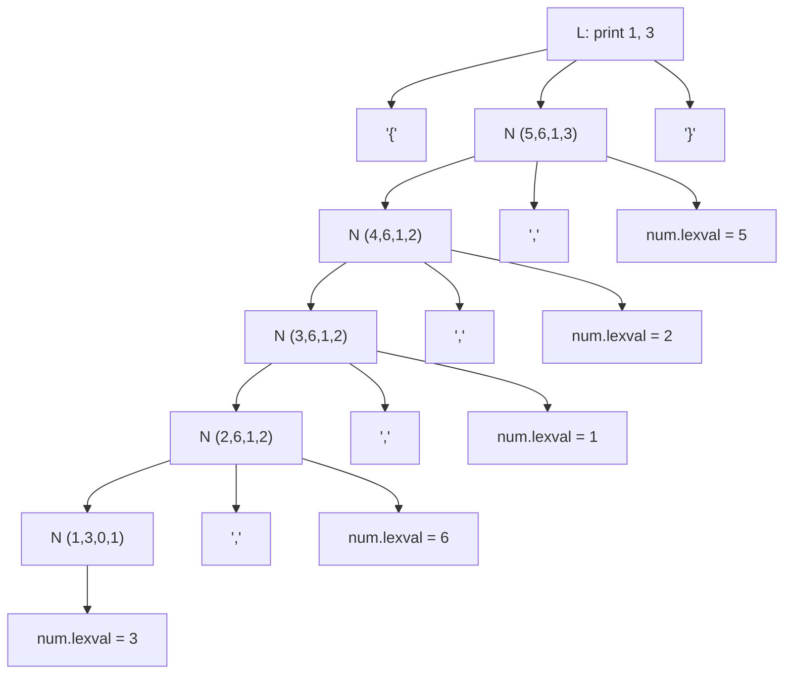

The bottom-up annotations are:

| Prefix | New value’s index | `max` | `arg` | `count` |
|---|---:|---:|---:|---:|
| `3` | 0 | 3 | 0 | 1 |
| `3,6` | 1 | 6 | 1 | 2 |
| `3,6,1` | 2 | 6 | 1 | 2 |
| `3,6,1,2` | 3 | 6 | 1 | 2 |
| `3,6,1,2,5` | 4 | 6 | 1 | 3 |

Thus the root prints **maximum index = 1; count = 3**. The indices in the table explain each comparison; `num` itself needs only its lexical value attribute.

**Reference basis:** KMS PDF pp. 18, 21, 22, 31.

**Verification:**

- Computed the annotations independently by the exact SDD recurrence and compared the final index/count to the exam example.

### 1(c) - Convert the list SDD to a top-down SDT

Topics: Syntax-directed translation; LL parsing

#### Question

Convert the SDD designed in 1(a) for the following grammar to an SDT. Can it be implemented during top-down parsing? If not, transform it so that it can.

```text
L → '{' N '}'
N → N ',' num | num
```

(8 marks)

#### Solution

First put each synthesized computation at the end of its production. Represent the four attributes by a tuple `q = (len,max,arg,count)`, and define

```text
start(v) = (1, v, 0, [v > 0])
extend((k,m,a,c), v) = (k+1, max(m,v),
                         (v > m ? k : a), c + [v > k])
```

A postfix SDT for the original grammar is

```text
L → '{' N '}'       { print(N.q.arg, N.q.count); }
N → N₁ ',' num     { N.q = extend(N₁.q, num.lexval); }
N → num            { N.q = start(num.lexval); }
```

It works on reductions during bottom-up parsing. It cannot be directly implemented by a standard top-down predictive parser: expanding `N → N ',' num` calls `N` again before consuming input.

Eliminate left recursion and carry the accumulated tuple as an inherited attribute of a new tail nonterminal `R`:

```text
L → '{' N '}'       { print(N.q.arg, N.q.count); }
N → num            { R.in = start(num.lexval); }
    R              { N.q = R.out; }
R → ',' num        { R₁.in = extend(R.in, num.lexval); }
    R₁             { R.out = R₁.out; }
R → ε              { R.out = R.in; }
```

The underlying grammar is `N → num R; R → ',' num R | ε`. Each inherited value is set **before** the corresponding `R` is parsed; each synthesized `out` is read afterwards. Lookahead comma chooses the recursive tail and lookahead `}` chooses `ε`. Consequently this is an L-attributed, top-down-implementable SDT.

After consuming 3, the accumulator is `(1,3,0,1)`; the remaining values extend it to `(5,6,1,3)`, preserving the original SDD’s result and first-maximum tie rule.

**Reference basis:** KMS PDF pp. 50, 54, 55, 62, 63, 65, 66, 67; Rumi PDF pp. 367, 368.

**Verification:**

- Checked that every inherited dependency is available before the child is entered; evaluated the accumulator on all five input values.

### 1(d) - Postfix SDT on an LR parser stack

Topics: Syntax-directed translation; LR parsing

#### Question

Define Postfix SDT. Briefly describe how Postfix SDTs can be implemented during LR parsing. (9 marks)

#### Solution

A **postfix SDT** is a syntax-directed translation scheme in which every semantic action occurs at the right end of its production body, for example

```text
E → E₁ '+' T { E.val = E₁.val + T.val; }
```

It is particularly natural for an LR parser with synthesized attributes. The action for `A → X₁…Xₖ {action}` is executed when the parser reduces `X₁…Xₖ` to `A`:

1. On shifting a token, push its LR state and semantic value, such as `num.lexval`.
2. At a reduction, access the right-hand-side attributes at known stack offsets. All children have already been parsed.
3. Execute the action and compute `A`’s attributes **before** discarding the right-hand-side records.
4. Pop the `k` symbol/value records (and their states), use `GOTO` from the exposed state, and push a record for `A`, its attributes and the new state.

For `N → N₁ ',' num`, if the top semantic record is `num`, the old `N₁` record is two symbol positions below it. Compute `extend(N₁.q,num.lexval)` and replace the three records by the resulting `N` record. When `L → '{' N '}'` reduces, print the two answers.

No explicit parse tree is required. The actions execute in the same bottom-up/postorder dependency order that an S-attributed SDD needs. Being postfix describes **action placement**; it does not by itself guarantee that arbitrary inherited-attribute dependencies are evaluable by this simple implementation.

**Reference basis:** KMS PDF pp. 31, 54, 55, 56.

**Verification:**

- Verified the definition and stack-record method directly against KMS PDF pages 55–56; checked the reduction offsets on N → N , num.

### 2(a) - Intermediate representation and its benefits

Topics: Intermediate code; Compiler pipeline

#### Question

What is an Intermediate Representation (IR)? What are the advantages of using an IR? Give two examples. (8 marks)

#### Solution

An **intermediate representation (IR)** is a compiler’s internal representation of the source program between source analysis and final target-code generation. It expresses program operations without committing unnecessarily to a particular source syntax or target machine.

Its main benefits are:

- **Modularity:** the front end handles source-language rules; the back end handles target instructions, registers and calling conventions.
- **Retargeting and reuse:** `n` source languages and `m` machines need `n` front ends and `m` back ends around a common IR, rather than `n×m` independent compilers.
- **Optimization:** explicit operations and control/data dependencies make transformations easier and reusable across languages and targets.
- **Multiple abstraction levels:** a compiler may lower from a source-like IR to a more machine-like IR as it approaches code generation.

Two examples are **abstract syntax trees (ASTs)** and **three-address code (TAC)**. For `x = a + b * c`, TAC can be

```text
t1 = b * c
t2 = a + t1
x = t2
```

The operations are explicit, while physical registers and concrete machine opcodes remain undecided.

**Reference basis:** KMS PDF pp. 83, 85, 86, 89, 90, 91.

**Verification:**

- Read the IR definition, modularity and n+m versus n×m argument in KMS PDF pages 85–86; checked the TAC’s multiplication-before-addition evaluation.

### 2(b) - SDD for a C for-loop

Topics: Control flow and backpatching; Syntax-directed translation

#### Question

Write an SDD for the C-style for-loop production

```text
S → for (S₁; B; S₂) S₃
```

`S.next` is an inherited label for the statement following `S`; `B` is a Boolean expression. (9 marks)

> **Assumptions and source notes**
> - S₁ and S₂ are treated as header statements without a separately emitted trailing semicolon. Code is buffered/synthesized so that S₃.code can precede S₂.code.

#### Solution

A `for` loop executes **initialization → test → body → increment → test**. The increment appears before the body in the grammar but must execute after it, so use synthesized code strings rather than emitting the header in its textual order.

Create fresh labels `test`, `body`, `step`. Use `B.true`, `B.false`, and statement `next` as inherited attributes; each symbol also synthesizes `code`.

| Attribute/rule | Definition |
|---|---|
| Local labels | `test = newlabel(); body = newlabel(); step = newlabel()` |
| Initialization continuation | `S₁.next = test` |
| Boolean destinations | `B.true = body; B.false = S.next` |
| Increment continuation | `S₂.next = test` |
| Body continuation | `S₃.next = step` |

The synthesized code is

```text
S.code = S₁.code
         || label(test) || B.code
         || label(body) || S₃.code
         || label(step) || S₂.code
         || gen('goto', test)
```

Here `||` concatenates code, and `B.code` transfers to `B.true` or `B.false` using short-circuit jumping code. Ordinary straight-line statements fall through to the next physically placed label; explicit exits internal to a child can use its `next` attribute. The enclosing translation places `label(S.next)` after this code.

If `continue` is supported in `S₃`, its inherited continuation target is `step`; a `break` target is `S.next`. A bare loop without such statements needs only the rules above. The increment is skipped when the initial test is false.

**Reference basis:** KMS PDF pp. 159, 160, 161, 162, 163.

**Verification:**

- Manually traced zero iterations and two iterations; verified that the increment executes once after each completed body and never before the first test.

### 2(c) - Backpatching schemes for if–else and while

Topics: Control flow and backpatching; Syntax-directed translation

#### Question

Write a translation scheme using backpatching for both productions below. Add marker symbols and make justified assumptions as necessary.

```text
(i)  S → if (B) S₁ else S₂
(ii) S → while (B) S₁
```

The second production’s left-hand `S` is omitted in the printed paper. (12 marks)

> **Assumptions and source notes**
> - The printed second production omits its left-hand side; it is interpreted as S → while (B) S₁. Three-argument merge means repeated binary merge.

#### Solution

Let `nextinstr` be the next TAC index. Boolean expressions synthesize `truelist` and `falselist`; statements synthesize `nextlist`, the jumps still needing the statement’s continuation. Use the lecture’s `makelist`, `merge`, `backpatch`, and `emit` operations.

Markers:

```text
M → ε { M.instr = nextinstr; }
N → ε { N.nextlist = makelist(nextinstr); emit('goto _'); }
```

**(i) If–else**

```text
S → if (B) M₁ S₁ N else M₂ S₂
    {
      backpatch(B.truelist, M₁.instr);
      backpatch(B.falselist, M₂.instr);
      S.nextlist = merge(S₁.nextlist, N.nextlist, S₂.nextlist);
    }
```

`M₁` records the then-branch’s beginning and `M₂` the else-branch’s beginning. `N` emits the jump that prevents normal completion of the then-branch from falling through into the else-branch. Its destination is patched together with both children’s pending continuations when the code after `S` is known.

**(ii) While**

```text
S → while M₁ (B) M₂ S₁
    {
      backpatch(B.truelist, M₂.instr);
      backpatch(S₁.nextlist, M₁.instr);
      S.nextlist = B.falselist;
      emit('goto', M₁.instr);
    }
```

`M₁` is immediately before the test and `M₂` before the body. A true test enters the body; normal body fallthrough reaches the emitted backward jump; pending body exits in `nextlist` also return to the test. A false test leaves the loop.

For completeness, a relational leaf can generate

```text
B → E₁ rel E₂
    { B.truelist = makelist(nextinstr);
      B.falselist = makelist(nextinstr+1);
      emit('if', E₁.addr, rel, E₂.addr, 'goto _');
      emit('goto _'); }
```

An ordinary assignment has `nextlist = ∅`. When a following statement starts at index `k`, call `backpatch(S.nextlist,k)`. `break`/`continue` require separate lists or enclosing-loop targets and are not assumed here.

**Reference basis:** KMS PDF pp. 185, 186, 187, 189, 190.

**Verification:**

- Visually verified KMS PDF 189’s exact marker productions and backpatching actions, and PDF 190’s assignment/sequence conventions; traced each true/false edge.

### 2(d) - Short-circuit TAC with minimal unconditional branches

Topics: Control flow and backpatching; Intermediate code

#### Question

Translate the following if–else statement to three-address code, avoiding redundant gotos. `&&` and `||` are left associative and `&&` has higher precedence.

```c
if ((x != y || x > 20) && x < 10)
    flag = 0;
else
    flag = 1;
```

(6 marks)

> **Assumptions and source notes**
> - The reversed tests x <= 20 and x >= 10 assume integer/ordinary ordered comparisons, consistent with the exercise. For IEEE NaNs, invert branch destinations rather than replacing logical negation with the complementary ordered relation.

#### Solution

The explicit parentheses make the condition `((x != y) || (x > 20)) && (x < 10)`. Short-circuiting skips `x > 20` when `x != y` is true, and skips `x < 10` when both OR operands are false.

```text
    if x != y goto Lcheck
    if x <= 20 goto Lelse
Lcheck:
    if x >= 10 goto Lelse
    flag = 0
    goto Lend
Lelse:
    flag = 1
Lend:
```

Fallthrough is used for the second OR operand’s true outcome and the final AND operand’s true outcome. The single unconditional `goto Lend` is needed to skip the else assignment after executing the then assignment. There is no jump to an immediately following label.

For integer operands, an additional algebraic simplification is possible: `x > 20` and `x < 10` cannot both hold. The whole condition is therefore equivalent to `(x != y) && (x < 10)`. The code above keeps the original short-circuit structure, as normally requested by this translation exercise.

**Reference basis:** KMS PDF pp. 153, 162, 168, 169, 171, 175.

**Verification:**

- Exhaustively compared the branch logic with the source expression for all 2,601 pairs x,y in −25…25.

### 3(a) - Baker collection after deleting A → D

Topics: Garbage collection; Runtime environments

#### Question

Baker’s mark-and-sweep collector moves objects among `Free`, `Unreached`, `Unscanned` and `Scanned`. Illustrate the algorithm on the following network after pointer `A → D` is deleted. `X` and `Y` belong to the root set. Give time and space complexity. (15 marks)

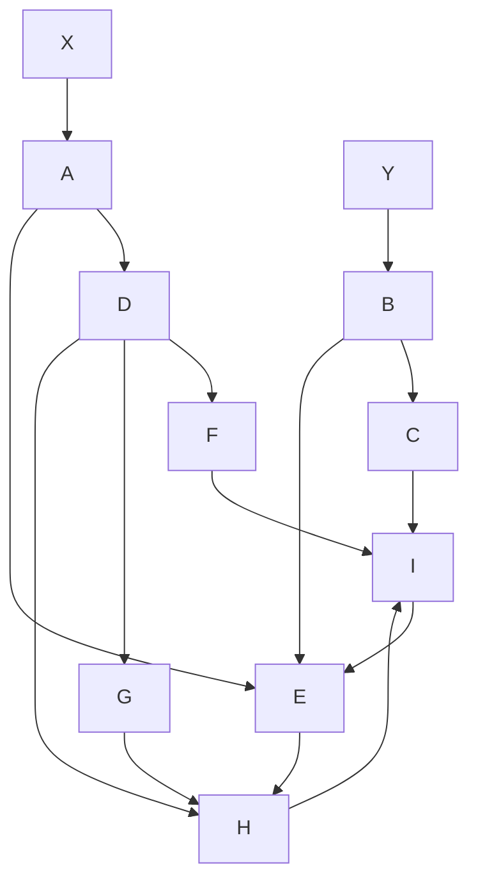

> **Assumptions and source notes**
> - KMS PDF 273 initializes Unscanned to the root-referenced objects without spelling out removal from Unreached. The four lists must be disjoint, so root discovery is interpreted as a move.
> - The O(reached objects) lecture claim assumes bounded pointer fields and O(1) list splicing; explicitly iterating over all reclaimed chunks would add a garbage-size term.

#### Solution

The root variables `X` and `Y` point to heap objects `A` and `B`; the variables themselves are not extra heap chunks in the four lists. After deleting `A → D`, tracing from the roots reaches

From `X`, the traversal is `A→E→H→I`, with `I→E` closing a cycle. From `Y`, it reaches `B`, then `C` and `E`, with `C→I`.

Thus **live = {A,B,C,E,H,I}; garbage = {D,F,G}**. Although `D`, `F` and `G` have edges into live objects, reachability follows outgoing pointers from roots; those edges do not keep their source objects alive.

Initially all allocated objects are `Unreached`. Move the root-referenced `A,B` from `Unreached` into `Unscanned`, and let `Scanned = ∅`. One valid FIFO execution is:

| Just completed | `Unscanned` queue | `Scanned` set | `Unreached` set |
|---|---|---|---|
| Root discovery | A, B | ∅ | C,D,E,F,G,H,I |
| Scan A; discover E | B, E | A | C,D,F,G,H,I |
| Scan B; discover C | E, C | A,B | D,F,G,H,I |
| Scan E; discover H | C, H | A,B,E | D,F,G,I |
| Scan C; discover I | H, I | A,B,E,C | D,F,G |
| Scan H; I already reached | I | A,B,E,C,H | D,F,G |
| Scan I; E already reached | ∅ | A,B,E,C,H,I | D,F,G |

`Free` stays unchanged during tracing. Discovering an object means moving it from `Unreached` to `Unscanned`; scan it once and move it to `Scanned`. The `E→H→I→E` cycle terminates because already reached objects are not added again.

When the queue is empty, the lecture algorithm finishes with

```text
Free      = Free ∪ Unreached     // append/splice D,F,G to the old free list
Unreached = Scanned             // surviving allocated objects for the next cycle
Scanned   = ∅; Unscanned = ∅
```

The objects do not move in memory; only their list membership changes. This is a noncompacting collector.

**Cost under the lecture implementation:** with constant-time intrusive-list moves and whole-list splicing, tracing costs `O(r + R + P_R)`, where `r` is the number of root references, `R` the number of live objects and `P_R` their pointer fields. With bounded-size objects and a fixed/small root set this is `O(R)`, matching the lecture’s “proportional to reached objects”; no sweep of every heap chunk is necessary. If an implementation individually clears/coalesces all `G` garbage objects, that additional work is `O(G)` rather than an O(1) splice.

List/state metadata takes `O(H)` space for `H` heap chunks, typically constant fields per chunk; the pending traversal list can contain `O(R)` objects. With the lists stored inside chunks, no separate O(H) external object array is required; total accounting still remains linear in heap size.

**Reference basis:** KMS PDF pp. 271, 272, 273, 274, 275, 276, 277, 278, 293.

**Verification:**

- Rendered and visually inspected the full algorithm on KMS PDF 273, including its Free union and Unreached = Scanned steps.
- Simulated FIFO scanning of the exact graph after deletion; verified the reachable set and remaining {D,F,G}.
- Rendered original exam PDF page 20 and visually confirmed every graph edge, including D→F and I→E.

### 3(b) - Register allocation and the getReg rules

Topics: Register allocation; Liveness analysis

#### Question

Why are register allocation and assignment critical during code generation? For a basic-block instruction `I: x = y + z`, state the rules used by `getReg(I)` to select registers for `x`, `y` and `z`. (5+15 = 20 marks)

> **Assumptions and source notes**
> - The abstract target is a read-before-write three-operand machine. Actual instruction-set restrictions can further constrain legal register choices.
> - The slide’s dead-variable shortcut is interpreted with current-operand and live-out preservation; it does not authorize destroying an operand before the instruction.

#### Solution

Registers are scarce and much faster than memory. Register operands often permit shorter, faster instructions; poor choices cause repeated loads and **spills** (stores made to free registers). Allocation decides which values reside in registers at each point; assignment chooses the actual registers. Good choices require liveness/next-use information and descriptors, and optimal general assignment is computationally difficult.

Maintain a **register descriptor** (which variables’ current values are in a register) and an **address descriptor** (all current locations of each variable).

**Choosing `Rᵧ` and `R_z`:** apply the following to `y`, and symmetrically to `z`.

1. If `y` is already in a register, reuse that register.
2. Otherwise, if an empty register exists, choose it and load `y`.
3. Otherwise, score candidate registers by the stores required to preserve their contents. For **every** variable `v` represented by a candidate `R`, no store is needed if:
   - another valid copy of `v` exists outside `R` according to its address descriptor;
   - `v` is the destination `x` whose old value is overwritten, provided that old value is not still needed as an operand of this instruction;
   - or `v` is dead after its last required use, including required live-out uses.
4. Every other `v` needs `ST v,R` before `R` is overwritten. Sum these required stores for the register, choose a register with minimum spill score, make those stores, and then load the operand.

A register may represent several variables after copies, so checking only one variable in its descriptor is insufficient. Also preserve registers needed by the **other current operand**: choosing `R_z` must not destroy the only copy of `y` before the ADD reads it.

**Choosing `Rₓ`:** use the same preservation/minimum-spill logic, with these lecture-specific opportunities:

- A register containing only `x` is an acceptable destination even if `x` is also `y` or `z`: a read-before-write arithmetic instruction consumes the old operand before overwriting its destination.
- If `y` has no later use and `Rᵧ` contains only `y` after any necessary load, reuse `Rᵧ` for `x`. The symmetric rule applies to `z` and `R_z`.
- If neither operand register can safely be reused, prefer an empty register; otherwise select/spill a suitable minimum-cost candidate.
- For a copy `x = y`, always choose `Rₓ = Rᵧ`; the copy can share the physical value without an unnecessary move.

After ensuring the operand values are present, emit `ADD Rₓ,Rᵧ,R_z` and update descriptors so `Rₓ` contains the new `x`; remove obsolete copies of old `x`. An operand’s being dead **after** the instruction never permits discarding its value **before** this instruction has read it.

**Reference basis:** KMS PDF pp. 307, 346, 347, 348, 352, 355, 356.

**Verification:**

- Read the complete y/z spill-score rules on KMS PDF 355 and destination/copy exceptions on PDF 356; checked each stated exception against x=y+z.

### 4(a) - Basic blocks, nested loops and optimized swap code

Topics: Code optimization; Intermediate code; Control flow and backpatching

#### Question

For the following TAC: (i) identify basic blocks, construct the flow graph, assign block identifiers, replace label references with those identifiers, and list its loops (14 marks); (ii) optimize using semantics-preserving transformations, naming each transformation (14 marks).

```text
 1  L1:  i = 0
 2  L3:  t1 = n - 1
 3       iffalse i < t1 goto L2
 4  L4:  j = i + 1
 5  L5:  iffalse j < n goto L6
 6  L7:  t2 = i * 8
 7       t3 = a[t2]
 8       t4 = j * 8
 9       t5 = a[t4]
10       iffalse t3 > t5 goto L8
11  L9:  t6 = i * 8
12       p = a[t6]
13  L10: t7 = i * 8
14       t8 = j * 8
15       t9 = a[t8]
16       a[t7] = t9
17  L11: t10 = j * 8
18       a[t10] = p
19  L8:  j = j + 1
20       goto L5
21  L6:  i = i + 1
22       goto L3
23  L2:
```

> **Assumptions and source notes**
> - Standard TAC assumptions: a is an ordinary nonvolatile array of 8-byte elements; n is not modified; source temporaries are dead outside the fragment; index/offset arithmetic does not overflow; scalar variables do not alias array storage.
> - L10 and L11 are unused labels, so the maximal-block algorithm keeps lines 11–18 together. Splitting there is a nonmaximal but behaviorally equivalent partition.
> - Only two natural single-entry loops are listed; enumerating cyclic paths is a different graph question.

#### Solution

**(i) Basic blocks and flow graph.** The leaders are lines **1, 2, 4, 5, 6, 11, 19, 21, 23**: the first instruction, jump targets, and instructions immediately after jumps. An unreferenced label alone does not force a new maximal block; thus `L10` and `L11` are internal to `B6`.

| Block | Original lines | Code, with branch targets rewritten |
|---|---|---|
| B1 | 1 | `i = 0` |
| B2 | 2–3 | `t1 = n−1; iffalse i < t1 goto B9` |
| B3 | 4 | `j = i+1` |
| B4 | 5 | `iffalse j < n goto B8` |
| B5 | 6–10 | `t2=i*8; t3=a[t2]; t4=j*8; t5=a[t4]; iffalse t3 > t5 goto B7` |
| B6 | 11–18 | `t6=i*8; p=a[t6]; t7=i*8; t8=j*8; t9=a[t8]; a[t7]=t9; t10=j*8; a[t10]=p` |
| B7 | 19–20 | `j=j+1; goto B4` |
| B8 | 21–22 | `i=i+1; goto B2` |
| B9 | 23 | Exit label; no executable instruction |

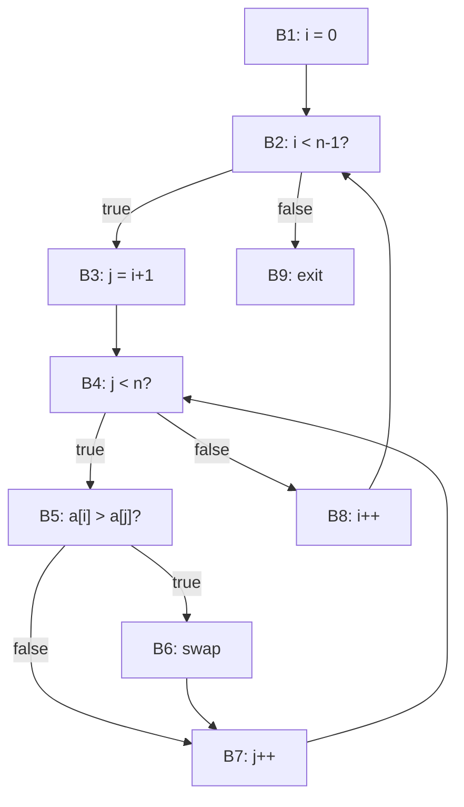

The back edges are `B7 → B4` and `B8 → B2`. Their natural loops are:

| Header / back edge | Loop blocks |
|---|---|
| B4 / B7→B4 | `{B4,B5,B6,B7}` — inner `j` loop |
| B2 / B8→B2 | `{B2,B3,B4,B5,B6,B7,B8}` — outer `i` loop |

The two possible inner paths (swap or no swap) belong to the same loop. A path around a cycle is not automatically a different single-entry loop.

**(ii) Remove redundant work.** On entry to the swap block no store has yet changed the two loaded elements. Therefore replace `t6,t7` by `t2`, `t8,t10` by `t4`, `a[t6]` by `t3`, and `a[t8]` by `t5`. The swap becomes

```text
p = t3
a[t2] = t5
a[t4] = p
```

This uses common-subexpression/load elimination, copy propagation and dead-temporary elimination. Hoist invariant `n−1` outside the outer loop. Replace repeated multiplications by induction offsets `oi=8i`, `oj=8j`, advanced by 8. Finally keep the current `a[i]` value in `vi`, updating it after every swap; it is **not** invariant because swaps can change `a[i]`.

A more optimized complete TAC is:

```text
    i = 0
    limit = n - 1
    oi = 0
Outer:
    if i >= limit goto Exit
    j = i + 1
    oj = oi + 8
    vi = a[oi]
Inner:
    vj = a[oj]
    if vi <= vj goto AdvanceJ
    p = vi
    vi = vj
    a[oi] = vi
    a[oj] = p
AdvanceJ:
    j = j + 1
    oj = oj + 8
    if j < n goto Inner
    i = i + 1
    oi = oi + 8
    goto Outer
Exit:
```

| Transformation | Concrete effect |
|---|---|
| Global common-subexpression elimination | Reuse identical `i*8`, `j*8` computations across B5/B6 |
| Redundant-load elimination | Use the already loaded array values in the swap |
| Copy propagation + dead-code elimination | Remove `t6…t10` and temporary-to-temporary copies |
| Loop-invariant code motion | Compute `limit=n−1` once; initialize `oi` once per outer position |
| Strength reduction / induction-variable optimization | Maintain byte offsets by `+8` instead of multiplying on every comparison |
| Scalar replacement / value forwarding | Retain `vi`, the current `a[i]`, through inner iterations and refresh it on each swap |
| Loop rotation + control-flow simplification | The outer test implies `j=i+1<n`, so the first inner iteration is guaranteed; use one bottom test instead of an initial inner test and an unconditional back jump |

This preserves the final array, `i`, `j`, and the last assigned `p`. It also preserves the ordering of element stores. It does not hoist an old array value across a modifying store. “All possible” has no unique finite optimum; these are the applicable standard transformations justified by this fragment.

**Reference basis:** KMS PDF pp. 324, 325, 327, 330, 331, 335, 339, 340, 342, 343, 536, 541, 552, 555, 558, 559.

**Verification:**

- Used the lecture leader rules to check every jump target and fallthrough edge.
- Compared executable models of the original code and this rotated, cached-value, offset-based version on 2,100 cases for n=−3…17, with random negative/duplicate/positive elements; arrays and final i,j,p matched.

### 4(b) - Factorial optimization visible in assembly

Topics: Code optimization; Compiler pipeline

#### Question

The C program and `gcc -O2` assembly below are given. Identify the optimizations and write equivalent optimized C. (7 marks)

```c
#include <stdio.h>
int fact(int n) {
    if (n == 0) return 1;
    return n * fact(n-1);
}
int main() {
    int i = fact(5);
    printf("%d", i);
}
```

```asm
fact(int):
    mov eax, 1
    test edi, edi
    je .L1
.L2:
    imul eax, edi
    sub edi, 1
    jne .L2
.L1:
    ret
.LC0:
    .string "%d"
main:
    sub rsp, 8
    mov esi, 120
    mov edi, OFFSET FLAT:.LC0
    xor eax, eax
    call printf
    xor eax, eax
    add rsp, 8
    ret
```

> **Assumptions and source notes**
> - The meaningful factorial domain is nonnegative n for which the C int result is defined (e.g. 0…12 for 32-bit signed int). Negative inputs and signed overflow are not claimed to have well-defined mathematical factorial behavior.
> - The assembly proves constant result substitution, not whether a particular inlining pass was responsible.

#### Solution

The assembly proves two major transformations:

1. **Recursion elimination with an accumulator.** `eax` starts at 1, is multiplied by `edi` (`n`), and `edi` is decremented until zero. No recursive call remains in `fact`. The original expression is not directly tail recursive—the multiplication waits for the recursive result—but it can be transformed into an accumulator loop, eliminating call/activation-record overhead.
2. **Compile-time evaluation and constant propagation at `fact(5)`.** `main` passes immediate constant 120 to `printf`; it never calls `fact`. `5! = 5·4·3·2·1 = 120`. The local `i` needs no memory storage. This is consistent with inlining/specialization followed by constant folding and dead-code elimination, but the assembly alone does not reveal the compiler’s exact internal sequence.

Equivalent C for the displayed behavior is

```c
#include <stdio.h>

int fact(int n) {
    int result = 1;
    while (n != 0) {
        result = result * n;
        n = n - 1;
    }
    return result;
}

int main(void) {
    printf("%d", 120);
    return 0;
}
```

The `n==0` path returns the initial 1 without entering the loop. Register use (`eax` for the result, `edi` for `n`) avoids a stack frame in `fact`. The stack adjustment in `main` serves the calling convention and is not evidence of a factorial algorithm optimization.

**Reference basis:** KMS PDF pp. 307, 335, 340, 536, 555; Rumi PDF pp. 103, 104, 105, 106.

**Verification:**

- Manually traced eax/edi for n=0 and n=5 and checked the product 120 against main’s immediate argument.

## Section B

### 5(a) - Java’s hybrid language processor

Topics: Compiler pipeline; Intermediate code

#### Question

Describe the working principle of the language processor used by the Java programming language. (10 marks)

#### Solution

Java uses a **hybrid of compilation and interpretation**, with just-in-time compilation improving execution speed.

| Stage | Result / role |
|---|---|
| Java source (`.java`) | Programmer’s high-level program |
| Java compiler | Checks/analyzes the source and translates it to JVM bytecode in class files (`.class`) |
| JVM loading and execution | A JVM for the host machine loads the classes and executes their bytecode; a bytecode interpreter can execute instructions directly |
| JIT compilation | Frequently executed methods or regions can be compiled into the host’s native machine code, optimized and reused |

The bytecode is an intermediate instruction language for a **virtual machine**, rather than machine code for one physical processor. A class file produced on one host can run on another host that supplies a compatible JVM: the lecture’s “write once, run anywhere” idea. The JVM implementation itself is platform dependent because it must interact with the host operating system and processor.

Pure interpretation pays dispatch overhead on every instruction. The JIT spends compilation effort on code that will benefit from repeated native execution, combining portability with better runtime performance. Java source compilation therefore does not by itself produce a directly executable native binary for every machine.

**Reference basis:** Rumi PDF pp. 20, 23, 24, 25, 26, 27, 28, 29, 30.

**Verification:**

- Verified the bytecode/JVM portability description on Rumi PDF 23–26 and the JIT section on PDF 27–30.

### 5(b) - Efficient compiler family through a shared IR

Topics: Compiler pipeline; Intermediate code

#### Question

A company will produce compilers for 10 different programming languages. Which efficient front-end/back-end approach should it follow? Give a high-level design. (15 marks)

> **Assumptions and source notes**
> - The question gives 10 source languages but no target-machine count; m is kept explicit rather than silently assuming 10 targets.

#### Solution

Build **one front end per source language around a shared IR**, and reuse target-specific back ends.

| Component | Responsibility | Number required |
|---|---|---:|
| Language front end | Lexing, parsing, name/type checking, source-specific semantics, lowering to the common IR | 10 |
| Common IR and optimizer | Shared program representation and reusable machine-independent analysis/optimization | One common infrastructure |
| Machine back end | Instruction selection, register allocation, scheduling, target ABI and object-code generation | `m`, for `m` target machines |

The paths are `Languageᵢ → FrontEndᵢ → common IR → shared optimizer → BackEndⱼ → Machineⱼ`. Thus supporting every language on every target needs **10 + m major translation components**, instead of **10m independent language–machine compilers**. If the company initially targets only one machine, it builds 10 front ends and one back end; if it targets 10 machines, the corresponding count is 20 rather than 100.

Design the IR to express all required behaviors, including types, calls, control flow, exceptions or runtime operations where needed. Lower language-specific constructs into this common vocabulary, possibly using a high-level IR followed by a lower-level IR. Keep language runtime support behind agreed interfaces. Optimizations can then be developed once, and adding an eleventh language or another processor does not require rebuilding every existing compiler path.

**Reference basis:** Rumi PDF pp. 57, 58, 59, 60; KMS PDF pp. 83, 85, 86, 87, 89.

**Verification:**

- Checked the component-count formula against KMS PDF 86 and evaluated the one-target and ten-target cases.

### 5(c) - How a lexer distinguishes keywords from identifiers

Topics: Lexical analysis

#### Question

In C, special keywords match the identifier pattern. Explain how a lexical analyzer distinguishes keywords from ordinary identifiers. (10 marks)

> **Assumptions and source notes**
> - The paper’s phrase “keywords fall under identifiers” is interpreted as overlapping lexical patterns. C reserved keywords are distinct tokens, not ordinary identifiers.

#### Solution

A word such as `while` has the same character shape as an identifier, but it must be returned as a reserved keyword token, not as an ordinary `id`. The lecture gives two standard implementations.

**1. Recognize a word, then consult a keyword table.** Initially install all reserved words in a table with their specific token kinds. Scan the longest identifier-shaped lexeme; look it up. If its entry says keyword, return that keyword token. Otherwise insert/find an ordinary identifier entry and return `(ID, entry)`.

```text
lexeme = scan_identifier_shape()
if lexeme in keyword_table:
    return keyword_table[lexeme]
else:
    return (ID, installID(lexeme))
```

**2. Give keywords separate recognition rules.** In Lex, place keyword rules before the general identifier rule. Lex first chooses the **longest match**, and only then uses rule order to break an equal-length tie.

```lex
"while"                 { return WHILE; }
"int"                   { return INT; }
[A-Za-z_][A-Za-z0-9_]*    { return ID; }
```

For `while`, both rules match five characters, so the earlier keyword rule wins. For `whileCount`, the general identifier rule matches a longer lexeme, so it returns a single `ID`; it must not return `WHILE` followed by `ID`. A hand-built keyword transition diagram likewise checks that the next character cannot continue an identifier.

Precisely stated, keywords **match the identifier pattern**, but reserved keywords are not members of the ordinary identifier token category.

**Reference basis:** Rumi PDF pp. 188, 209, 210, 211, 212, 213, 214, 215, 269, 270, 271, 279.

**Verification:**

- Read both reserved-word recognition strategies on Rumi PDF 211–215 and longest-match/first-rule precedence on PDF 279; checked while versus whileCount.

### 6(a) - Left-factor the ab-prefixed grammar

Topics: LL parsing

#### Question

Perform left factoring:

```text
S → abA | abcS
A → aA | ε
```

(5 marks)

#### Solution

The two `S` alternatives share their longest common prefix `ab`. Introduce a fresh nonterminal `R` for the remaining choice:

```text
S → abR
R → A | cS
A → aA | ε
```

Equivalently, substitute the `A` alternatives into `R`:

```text
S → abR
R → aA | cS | ε
A → aA | ε
```

Both are left factored. The first preserves the original `A` nonterminal directly. Expanding `R→A` recovers `S→abA`, and expanding `R→cS` recovers `S→abcS`; no generated string changes. The choice that originally had to be made before seeing `ab` is postponed until after that prefix.

**Reference basis:** Rumi PDF pp. 401, 403, 405, 406, 407.

**Verification:**

- Compared each factored alternative by substitution with the two original S productions.

### 6(b) - Scanner separation, buffer pairs and lexical panic mode

Topics: Lexical analysis

#### Question

Briefly answer: (i) Is it possible to eliminate the lexical-analyzer step from compilation? Write just Yes or No. (ii) Why does a lexical analyzer use a buffer pair rather than a single buffer? (iii) What is “panic mode” in a lexical analyzer? (5+8+7 = 20 marks)

> **Assumptions and source notes**
> - Part (i) asks only Yes/No, so no explanatory qualification is inserted into that answer. The remaining discussion concerns the conventional separated lexer.

#### Solution

**(i) Yes.**

**(ii) Buffer pairs.** Token recognition often needs lookahead and retraction: `<` might become `<=`, and an identifier is known to have ended only after seeing a nonidentifier character. With two buffers of `N` characters, the scanner fills one block at a time and reloads the halves alternately. `lexemeBegin` marks the current lexeme’s start and `forward` searches ahead.

If a lexeme crosses the end of one half, scanning can continue in the other without immediately overwriting the unfinished lexeme. Block reads reduce I/O overhead, and the preserved half supports limited retraction. A sentinel at each half’s end combines the ordinary character test with the buffer-boundary test, reducing per-character checks. A single-buffer implementation is possible, but requires copying/preserving boundary-spanning text or other extra machinery. Two buffers are an efficiency/design choice rather than a logical requirement.

Under the lecture’s simple scheme, lexeme length plus required lookahead is bounded by `N`, so reloading does not overwrite text still needed. Longer tokens need special handling, such as growing storage or copying the active lexeme.

**(iii) Lexical panic mode.** If no token pattern matches a prefix of the remaining input, report a lexical error and delete successive input characters until a well-formed token can be recognized. Then resume scanning. For example, if `@` is invalid in the language, skip it and scan the following valid identifier. This is a local lexical recovery rule; it is distinct from a parser’s discarding whole tokens to a syntactic synchronization point.

**Reference basis:** Rumi PDF pp. 141, 142, 143, 144, 158, 160, 166, 167, 168, 169, 171, 172, 173, 174, 175, 176.

**Verification:**

- Read the lexical panic-mode definition on Rumi PDF 160 and buffer-pair bounds/pointers on PDF 166–176; checked that no claim of compulsory two-buffer use is made.

### 6(c) - Lexical errors versus undeclared names

Topics: Lexical analysis; Compiler pipeline

#### Question

Will the lexical analyzer find errors in this code? If so, explain them. (10 marks)

```c
int arr[] = {1, 2, 3, 5};
int i = 0;
do {
    if (arr[i] % 2 == 0)
        print("EVEN\n");
    else
        print("ODD\n");
    i++;
} while (index < 4);
```

> **Assumptions and source notes**
> - Whether index or print is declared depends on omitted surrounding code. Neither is automatically a lexical error.
> - The snippet is treated as a function-body fragment rather than a complete C translation unit.

#### Solution

**No lexical error is present in the shown text.** Every character sequence can be tokenized as a valid C keyword, identifier, integer constant, string literal, operator or punctuation symbol.

| Fragment | Lexer’s classification | What may be wrong later |
|---|---|---|
| `int`, `do`, `if`, `else`, `while` | Keyword tokens | Nothing lexical |
| `arr`, `i`, `index`, `print` | Identifier tokens | Declaration/name checking is required |
| `"EVEN\n"`, `"ODD\n"` | Valid string literals | `\n` is a valid escape |
| `%`, `==`, `++`, `<`, brackets and braces | Valid operator/delimiter tokens | Nothing lexical |

The likely intended defect is `index` instead of `i`. **`index` is a perfectly valid identifier lexeme**. If it has not been declared in the surrounding program, semantic/name analysis reports an undeclared identifier; the lexer cannot infer the programmer meant `i`.

Likewise, `print` is a valid identifier. If no suitable function is declared/defined, the program can fail during declaration/type checking or linking; its spelling is not a lexical error. If ordinary standard C output was intended, use `printf` with `<stdio.h>` and change the condition to `while (i < 4)`.

The code is assumed to be a fragment inside a function. Placing a `do` statement at file scope would create a syntactic problem, still not a lexical one.

**Reference basis:** Rumi PDF pp. 130, 133, 146, 147, 148, 150, 151, 158, 159.

**Verification:**

- Manually tokenized every construct and compared the undeclared-name issue to the fi/id example on Rumi PDF 158–159.

### 7(a) - Seven Lex patterns and a whitespace trap

Topics: Lexical analysis

#### Question

Explain the differences among these regular expressions in the Lex lexical-analyzer generator. (14 marks)

```text
(i)   {mytoken}
(ii)  [mytoken]
(iii) mytoken
(iv)  (mytoken)+
(v)   mytoken +
(vi)  (mytoken)*
(vii) mytoken*
```

> **Assumptions and source notes**
> - Item (v) contains an unescaped space. The answer preserves the printed text and gives both actual Lex rule syntax and the plausible intended no-space pattern.
> - The slides explain named definitions and grouping/metasymbols but do not explicitly discuss the malformed whitespace example; the rule/action interpretation follows Lex specification syntax.

#### Solution

Letters are literal characters unless a Lex operator changes their interpretation. Curly braces refer to a named regular definition, square brackets make a one-character class, and parentheses group an entire expression.

| Item | Meaning | Examples of complete matches |
|---|---|---|
| `(i) {mytoken}` | Expand the regular definition named `mytoken` from the definitions section. Its language depends on that definition; it is not the literal word by default. | If `mytoken [0-9]+`, matches `7`, `42`, etc. |
| `(ii) [mytoken]` | One character chosen from `{m,y,t,o,k,e,n}`. | `m`, `k`, `n`; not the whole word |
| `(iii) mytoken` | The exact seven-character string. | `mytoken` only |
| `(iv) (mytoken)+` | One or more repetitions of the entire grouped word. | `mytoken`, `mytokenmytoken` |
| `(v) mytoken +` | **As written in an ordinary Lex rule, the unescaped blank terminates the pattern.** The pattern is `mytoken`; `+` starts its action text and is not a repetition operator attached to `n`. | The pattern portion matches `mytoken`; `+` alone is not a valid complete C action. |
| `(vi) (mytoken)*` | Zero or more repetitions of the entire grouped word. | `ε`, `mytoken`, `mytokenmytoken` |
| `(vii) mytoken*` | `mytoke` followed by zero or more `n` characters; `*` applies only to its immediately preceding atom. | `mytoke`, `mytoken`, `mytokenn` |

If the blank in item (v) is merely typesetting and the examiner intended **`mytoken+`**, say so explicitly: that pattern means `mytoke` followed by **one or more `n` characters**, e.g. `mytoken`, `mytokenn`, and differs from `(mytoken)+`. It does not repeat the whole word.

A literal plus sign needs escaping/quoting, e.g. `mytoken\+`. An undefined `{mytoken}` is a specification error, rather than a match for braces and letters. Although a `*` expression includes `ε` as a regular language, empty-string token rules are generally unsuitable for a lexer because tokenization must make progress.

**Reference basis:** Rumi PDF pp. 250, 251, 252, 259, 260, 262, 263, 279.

**Verification:**

- Read the regular-definition expansion and grouping/escaping conventions on Rumi PDF 260 and 262–263; manually checked minimal examples for each repetition scope.

### 7(b) - Remove direct and indirect left recursion in S,T,U

Topics: LL parsing

#### Question

Eliminate left recursion from the grammar. (21 marks)

```text
S → Sa | Tb | Uc | a
T → Sc | Ta | Ub | b
U → Sb | Tc | Ua | c
```

#### Solution

Use the lecture algorithm in the order **S, T, U**: substitute earlier nonterminals at the left edge, then eliminate immediate left recursion. Fresh nonterminals are `S′,T′,U′`.

**1. Process S.** Remove `S→Sa`:

```text
S  → TbS′ | UcS′ | aS′
S′ → aS′ | ε
```

**2. Process T.** Substitute the new `S` alternatives into `T→Sc`:

```text
T → TbS′c | UcS′c | aS′c | Ta | Ub | b
```

The immediate recursive suffixes are `bS′c` and `a`. Hence

```text
T  → UcS′cT′ | aS′cT′ | UbT′ | bT′
T′ → bS′cT′ | aT′ | ε
```

**3. Process U.** First substitute `S` in `U→Sb`:

```text
U → TbS′b | UcS′b | aS′b | Tc | Ua | c
```

Now substitute the four current `T` alternatives into both leading `T` productions. Group the result as `U→Uα | β`:

| Recursive suffixes `α` | Nonrecursive alternatives `β` |
|---|---|
| `cS′cT′bS′b` | `aS′cT′bS′b` |
| `bT′bS′b` | `bT′bS′b` |
| `cS′b` | `aS′b` |
| `cS′cT′c` | `aS′cT′c` |
| `bT′c` | `bT′c` |
| `a` | `c` |

For clarity, the identical-looking entries in a row are suffixes after removing the leading `U` on the left and standalone alternatives on the right; neither column contains a leading `U`.

The **complete final grammar** is:

```text
S  → TbS′ | UcS′ | aS′
S′ → aS′ | ε

T  → UcS′cT′ | aS′cT′ | UbT′ | bT′
T′ → bS′cT′ | aT′ | ε

U  → aS′cT′bS′bU′
   | bT′bS′bU′
   | aS′bU′
   | aS′cT′cU′
   | bT′cU′
   | cU′

U′ → cS′cT′bS′bU′
   | bT′bS′bU′
   | cS′bU′
   | cS′cT′cU′
   | bT′cU′
   | aU′
   | ε
```

Every `U` alternative now begins with a terminal. Leading dependencies of the remaining original nonterminals go only `S→T/U` and `T→U`, never back to an earlier one. The primed nonterminals also begin their nonempty alternatives with terminals. Therefore no direct or indirect left recursion remains. This transformation does not claim to remove all ambiguity or make the grammar LL(1).

**Reference basis:** Rumi PDF pp. 367, 368, 370, 371, 372, 374, 375, 376, 377.

**Verification:**

- Implemented a fixed-point bounded-language comparison: the original and transformed grammars generate identical sets of all terminal strings of length ≤6 from each of S,T,U (364 strings per nonterminal).
- Computed nullable-aware left-corner transitive closure for the transformed grammar; no nonterminal reaches itself.

### 8(a) - FIRST and FOLLOW with an explicit end marker

Topics: FIRST and FOLLOW; LL parsing

#### Question

Compute FIRST and FOLLOW for the grammar. (5+10 = 15 marks)

```text
T → S$
S → DbE
D → VD | ε
V → cdE | acdE
E → c | ε
```

> **Assumptions and source notes**
> - The source explicitly writes T→S$. Dollar is treated as the end marker throughout; an external formal boundary is distinguished as ⊣ when needed, rather than silently replacing the production by T→S.

#### Solution

Treat `$` in `T→S$` as the **input end marker**, not epsilon and not a nonterminal. The conventional exam answer uses the same `$` notation for end-of-input in `FOLLOW(T)`.

| Nonterminal | FIRST | FOLLOW, conventional exam notation |
|---|---|---|
| T | `{a,b,c}` | `{$}` |
| S | `{a,b,c}` | `{$}` |
| D | `{a,c,ε}` | `{b}` |
| V | `{a,c}` | `{a,b,c}` |
| E | `{c,ε}` | `{a,b,c,$}` |

**FIRST derivation.** `E→c|ε`, so `FIRST(E)={c,ε}`. `V` begins with `c` or `a`, and is not nullable. `D→VD|ε` can begin with `a/c` or vanish. In `S→DbE`, nullable `D` exposes terminal `b`; therefore `FIRST(S)={a,b,c}`. `S` cannot vanish because of that `b`, so `FIRST(T)=FIRST(S)` and `$` is not in `FIRST(T)`.

**FOLLOW propagation.**

- `T→S$` puts `$` immediately after `S`, so `$∈FOLLOW(S)`.
- `S→DbE` puts `b` after `D`, so `FOLLOW(D)={b}`. It also makes `FOLLOW(S)⊆FOLLOW(E)`.
- `D→VD` puts `FIRST(D)−{ε}={a,c}` in `FOLLOW(V)`. Since the final `D` is nullable, it also puts `FOLLOW(D)={b}` in `FOLLOW(V)`.
- Both `V→cdE` and `V→acdE` end in `E`, so `FOLLOW(V)={a,b,c}` is added to `FOLLOW(E)`.

The last step is why `E` has **all four** following symbols, not just `$`.

**Formal end-marker distinction.** If one insists on treating the displayed `$` as an actual terminal of an ordinary CFG and separately appends an external boundary marker `⊣` after the start symbol `T`, then the mathematically distinct set is `FOLLOW(T)={⊣}`; every other row is unchanged. The conventional table above identifies these boundary notations for the parser interface. It does **not** mean the user must supply two dollar signs.

This grammar is not LL(1): `FIRST(c)={c}` for `E→c`, while `c∈FOLLOW(E)` also selects `E→ε`. FIRST/FOLLOW can still be computed for a grammar with a predictive-table conflict.

**Reference basis:** Rumi PDF pp. 419, 421, 422, 423, 424, 425, 426, 445, 451, 452.

**Verification:**

- Computed FIRST and FOLLOW to fixed point with a script using literal $ plus a distinct external ⊣; verified every set in the formal/conventional correspondence.

### 8(b) - Predictive parsing trace for id + id * id

Topics: LL parsing; FIRST and FOLLOW

#### Question

For the grammar below, show the moves of a nonrecursive predictive parser on input `id + id * id`. (20 marks; the right edge of the mark is clipped in the scan.)

```text
E  → TE′
E′ → +TE′ | ε
T  → FT′
T′ → *FT′ | ε
F  → (E) | id
```

> **Assumptions and source notes**
> - The source slide displays the stack top at the left. This answer explicitly uses top at the right; no push order is changed semantically.

#### Solution

Append the end marker `$`. In the trace below, **the stack top is on the right**, so expanding a production pushes its right-hand side in reverse order.

The nonerror predictive-table entries are:

| Nonterminal | `id` | `+` | `*` | `(` | `)` | `$` |
|---|---|---|---|---|---|---|
| E | `E→TE′` | — | — | `E→TE′` | — | — |
| E′ | — | `E′→+TE′` | — | — | `E′→ε` | `E′→ε` |
| T | `T→FT′` | — | — | `T→FT′` | — | — |
| T′ | — | `T′→ε` | `T′→*FT′` | — | `T′→ε` | `T′→ε` |
| F | `F→id` | — | — | `F→(E)` | — | — |

A dash is an error entry. For example, lookahead `+` makes `T′` vanish because `+∈FOLLOW(T′)`, while lookahead `*` continues the product.

| Step | Stack before move (top at right) | Remaining input | Move |
|---:|---|---|---|
| 1 | `$ E` | `id + id * id $` | Expand `E→TE′` |
| 2 | `$ E′ T` | `id + id * id $` | Expand `T→FT′` |
| 3 | `$ E′ T′ F` | `id + id * id $` | Expand `F→id` |
| 4 | `$ E′ T′ id` | `id + id * id $` | Match `id` |
| 5 | `$ E′ T′` | `+ id * id $` | Expand `T′→ε` |
| 6 | `$ E′` | `+ id * id $` | Expand `E′→+TE′` |
| 7 | `$ E′ T +` | `+ id * id $` | Match `+` |
| 8 | `$ E′ T` | `id * id $` | Expand `T→FT′` |
| 9 | `$ E′ T′ F` | `id * id $` | Expand `F→id` |
| 10 | `$ E′ T′ id` | `id * id $` | Match `id` |
| 11 | `$ E′ T′` | `* id $` | Expand `T′→*FT′` |
| 12 | `$ E′ T′ F *` | `* id $` | Match `*` |
| 13 | `$ E′ T′ F` | `id $` | Expand `F→id` |
| 14 | `$ E′ T′ id` | `id $` | Match `id` |
| 15 | `$ E′ T′` | `$` | Expand `T′→ε` |
| 16 | `$ E′` | `$` | Expand `E′→ε` |
| 17 | `$` | `$` | Accept |

Every ε expansion pops its nonterminal without consuming input. Every terminal match pops the terminal and advances the input. Acceptance occurs only when both stack and input are at `$`.

The implied grouping is `id + (id * id)`: the multiplication is completed inside the second `T` before `E′` finishes the sum. The lecture’s printed trace uses the opposite stack display orientation (top at left); the moves are equivalent when the orientation is read consistently.

**Reference basis:** Rumi PDF pp. 369, 428, 429, 430, 451, 452, 453, 464, 466, 467, 468, 469, 471, 473, 474, 475, 477.

**Verification:**

- Ran a table-driven stack parser for the exact token stream; verified all 17 configurations and acceptance.
- Rendered and visually inspected Rumi PDF 474; matched its production/match sequence after reversing the displayed stack orientation.

---

# 2019-2020

## Section A

### 1 - Line control and source locations

Topics: Compiler pipeline

#### Question

Explain the concept of “Line Control Directive” in compilation with necessary examples. **(15)**

#### Solution

A line control directive tells later translation stages which **logical file name and line number** to associate with subsequent source text. This matters after a preprocessor inserts headers, expands macros, or a source generator emits another language: diagnostics should refer to the programmer's original source location.

In C/C++ the usual form is:

```c
#line 200 "original.c"
int x = missing_name;   // logically original.c:200
```

The directive itself is not a runtime instruction. The following line is numbered 200; later lines increase normally. `#line 50` changes the line number while retaining the current logical file name. It also affects the values supplied by `__LINE__` and `__FILE__`.

For example, a translator from a template language can emit:

```c
#line 18 "invoice.template"
render(customer);
#line 230 "generated.c"
cleanup();
```

An error on the first statement can then be reported against template line 18, and later generated code resumes its own numbering. A preprocessor also emits line markers on entering and leaving included files. Thus preprocessing can rearrange the physical text while line control preserves useful source provenance for compilation and debugging.

The supplied notes list line control among the C preprocessor's responsibilities (Rumi PDF p32); the directive syntax and worked examples here elaborate that listed concept.

**Reference basis:** Rumi PDF pp. 31, 32, 33.

**Verification:**

- Checked that #line applies to the following line and distinguishes logical source location from runtime execution.

### 2 - Linking relocatable object modules

Topics: Linking and loading; Compiler pipeline

#### Question

Elaborate the role of a linker in compilation with reference to the relocatable machine code. **(15)**

#### Solution

The assembler usually produces **relocatable object code**, whose final placement and some external symbol addresses are still unknown. An object file therefore contains code/data sections, symbol definitions and unresolved references, and relocation records identifying address-dependent fields.

The linker combines object modules and selected library members into an executable (or another relocatable output). It:

1. Lays out and combines the input code/data sections, accounting for alignment.
2. Builds a global symbol map: a reference to `f` in one module is matched with the definition of `f` in another module/library. Missing or multiply defined symbols are diagnosed as appropriate.
3. Relocates address-dependent instructions and data by applying the recorded fixups using the chosen section bases and resolved symbol addresses.
4. Writes the linked program with its entry point and the information needed by the loader or dynamic linker.

Example: module P contains a call to external `f`; module Q defines `f` at offset 24 in Q's text section. If Q's text is placed at address 1000, the linker resolves `f` to 1024 and patches P's call according to the machine's relocation rule. For an absolute local address at offset 12, placing that module at 2000 changes the reference to 2012. PC-relative relocations instead use the distance from the referring instruction; not every numeric constant or every instruction is changed.

The notes' example relocates a reference to local statement ST from location 5 to location 125 when the module is placed at 120 (Rumi PDF pp49–51). If loading later places the module at 300, the same target becomes 305 (pp52–53). A loader maps the executable into memory, and may apply the remaining load-time relocations. The linker resolves and combines modules; loading creates the process's memory image.

**Reference basis:** Rumi PDF pp. 43, 45, 47, 48, 49, 50, 51, 52, 53.

**Verification:**

- Checked the notes’ ST offsets: 120+5=125 and 300+5=305; distinguished relocation fields from ordinary constants.

### 3 - Operator tokens and attributes

Topics: Lexical analysis; LL parsing; LR parsing

#### Question

Explain clearly, the relative merits and demerits of using: **(7+8)**

i. The same token with appropriate attributes for the comparison operators `<`, `≤`, `>`, `≥`, `≠`, and `==`.

ii. The same token with appropriate attributes for the arithmetic operators `+`, `-`, `×`, and `÷`.

> **Assumptions and source notes**
> - A common relop token assumes the comparison operators share a syntactic role; the six listed comparisons do not all have the same precedence in every programming language.

#### Solution

A token is a pair `⟨token-name, attribute⟩`. The parser normally branches on the **token name**; the attribute carries additional information for semantic analysis/code generation.

**(i) Comparison operators.** Returning `⟨relop, LT⟩`, `⟨relop, LE⟩`, …, `⟨relop, EQ⟩` is convenient if the language treats these operators as one syntactic class. A rule such as `B → E relop E` needs only one terminal and one family of parser actions. The semantic action reads the attribute to emit `<`, `<=`, `>`, `>=`, `!=`, or `==`, and error reporting can recover the actual operator.

This simplifies the token interface, grammar, and often the parsing table. The cost is that semantic routines must inspect the attribute, and syntactic differences cannot be expressed by ordinary token-name-based parser decisions. In a language such as C where equality and ordered comparisons have different precedence, putting all six in one token would hide information required by a conventional precedence grammar. In that case split them into appropriate syntactic classes or use a parser explicitly designed to inspect attributes.

**(ii) Arithmetic operators.** A single token `⟨arithop, PLUS|MINUS|TIMES|DIVIDE⟩` also reduces the number of token names and permits common semantic routines. However, `+`/`-` and `*`/`/` normally have **different precedence**. A grammar `E → E arithop E | id` cannot use the token name to enforce that `a+b*c` means `a+(b*c)`. Operator attributes do not automatically fix that ambiguity in an LL/LR table.

A practical compromise is:

```text
E → E addop T | T      addop attributes: PLUS, MINUS
T → T mulop F | F      mulop attributes: TIMES, DIVIDE
F → (E) | id
```

Operators of a common precedence/associativity share a token; the attribute identifies the operation. Separate token names are preferable whenever syntax, precedence declarations, associativity, or diagnostics need to distinguish them directly. Unary operators also require their syntactic role to be represented correctly.

**Reference basis:** Rumi PDF pp. 146, 156, 157, 184, 185, 187, 192, 369.

**Verification:**

- Used a+b*c as the concrete precedence counterexample and checked that addop/mulop separation restores the standard two precedence levels.

### 4(a) - Why predictive parsing needs no backtracking

Topics: LL parsing; FIRST and FOLLOW

#### Question

Elucidate how predictive parsers ensure that backtracking is avoided. **(10)**

#### Solution

For an LL(1) grammar, the current nonterminal `A` and one lookahead token `a` determine **at most one** production. The predictive table `M[A,a]` therefore contains either the unique rule or an error. The parser selects that rule directly; it never tries an alternative and later rewinds the input.

For alternatives `A → α | β`, their nonempty FIRST sets must not overlap. If an alternative can derive ε, its choice is controlled by FOLLOW(A); its SELECT set must not overlap another alternative's SELECT set. In table form:

```text
SELECT(A → α) = FIRST(α) − {ε}
               ∪ FOLLOW(A), if ε ∈ FIRST(α)
```

The SELECT sets for distinct productions of the same head must be disjoint. For example, `stmt → if … | while … | { … }` is selected immediately by `if`, `while`, or `{`. After selection, terminals are matched and nonterminals expanded from left to right. A mismatch is an error rather than an invitation to retry another rule. Left recursion and conflicting common prefixes must be removed where a suitable LL grammar can be obtained; an arbitrary context-free grammar is not automatically predictive.

**Reference basis:** Rumi PDF pp. 304, 305, 316, 319, 443, 445, 446, 449, 450, 451, 452, 457.

**Verification:**

- Verified that the selection rule covers both FIRST/FIRST and FIRST/FOLLOW conflicts.

### 4(b) - When to select an epsilon production

Topics: LL parsing; FIRST and FOLLOW

#### Question

Write down the rule for using the “ε-productions” in predictive parsing. **(5)**

#### Solution

Use `A → ε` when the lookahead belongs to **FOLLOW(A)** (including `$` when `$ ∈ FOLLOW(A)`), so that the next token can legally follow A without A consuming input. More generally, if `A → α` can derive ε, put that rule in `M[A,b]` for each `b ∈ FOLLOW(A)`.

For example:

```text
E′ → + T E′ | ε       FOLLOW(E′) = { ), $ }
```

On `+`, choose the nonempty rule. On `)` or `$`, choose ε, pop E′, and leave the input unchanged. On an unrelated token, report an error.

Rumi PDF pp320/325 describe ε as the default when no other alternative applies. The precise table-construction rule in pp451–452 restricts this default to FOLLOW(A); “no other FIRST match” alone must not cause every invalid token to be accepted. If ε and a nonempty alternative compete for the same table entry, the grammar is not LL(1).

**Reference basis:** Rumi PDF pp. 320, 325, 451, 452, 456.

**Verification:**

- Cross-checked the informal default rule against the formal FOLLOW-based predictive-table construction.

### 5 - Remove direct and indirect left recursion

Topics: LL parsing

#### Question

Eliminate left recursion from the following grammar: **(15)**

```text
X → XSb | Sa | b
S → Sb | Xa | a
```

You need to show the steps.

#### Solution

Choose the nonterminal order **X, S**. First remove the immediate left recursion from X:

```text
X  → X S b | S a | b

X  → S a X′ | b X′
X′ → S b X′ | ε
```

Now substitute these X alternatives in `S → S b | X a | a`:

```text
S → S b | (S a X′ | b X′) a | a
  → S b | S a X′ a | b X′ a | a
```

The left-recursive suffixes are `b` and `a X′ a`, while the non-left-recursive alternatives are `b X′ a` and `a`. Eliminating this immediate recursion gives the final grammar:

```text
X  → S a X′ | b X′
X′ → S b X′ | ε
S  → b X′ a S′ | a S′
S′ → b S′ | a X′ a S′ | ε
```

Both original nonterminals retain their languages. There is no remaining left recursion: every nonempty S-production and every nonempty S′-production starts with a terminal; X and X′ can begin with S, but S cannot return to them without first consuming a terminal. Only removing the original direct recursions would have left the indirect cycle `X ⇒ S a ⇒ X a a` unresolved.

**Reference basis:** Rumi PDF pp. 367, 368, 370, 371, 372, 400.

**Verification:**

- A fixed-point bounded-language computation compared the original and transformed languages of both X and S for every terminal string of length at most 8; the sets agree.
- Checked the nullable-aware left-corner relation of the transformed grammar for cycles; none remain.

### 6(a) - Single input buffer versus buffer pairs

Topics: Lexical analysis

#### Question

Discuss the relative advantages and disadvantages of using single buffer instead of using buffer pairs in lexical analysis. **(6)**

#### Solution

A **single block buffer** uses less memory (about N bytes rather than 2N), is simpler to manage, and is adequate when lexemes/lookahead are small or the environment already provides buffering. It can still read a whole block per system call; a single buffer does not inherently imply one read call per character.

Its main difficulty is a token crossing the refill boundary. Reloading the same buffer can overwrite the beginning of the unfinished lexeme or characters needed for retraction. The scanner must copy the unfinished part aside, shift it before refilling, or use another preservation mechanism. This adds copying, bookkeeping, and often extra boundary checks. Arbitrarily long lexemes require additional handling in either design.

With **buffer pairs**, each half has N characters and the halves are reloaded alternately. `lexemeBegin` can stay in one half while `forward` continues into the other. This naturally accommodates a boundary-crossing lexeme and limited retraction, reducing copying and allowing block reads. The cost is extra memory and refill/sentinel management.

The notes' guarantee is bounded: the lexeme length plus the lookahead distance must not exceed N, otherwise even a pair may overwrite needed characters. Sentinels can combine the common end-of-buffer and input-character tests, reducing scanning overhead; a real EOF must still be distinguished from an internal buffer boundary.

**Reference basis:** Rumi PDF pp. 167, 168, 169, 170, 171, 172, 173, 174.

**Verification:**

- Preserved the N-character lookahead/lexeme bound from p174 and avoided equating single-buffer input with unbuffered character reads.

### 6(b) - LL(1) conflicts are local to one nonterminal

Topics: LL parsing; FIRST and FOLLOW

#### Question

Consider the two grammars given below. **(9)**

**Grammar 1**

```text
A → aA | bd
B → aB | cc
```

**Grammar 2**

```text
A → aA | ad
B → bB | cc
```

Both of the above mentioned grammars have at least two bodies of the production rules beginning with an a. Explain in detail with proper justifications why one of the grammars is LL(1) while the other is not.

> **Assumptions and source notes**
> - The question supplies no start production. The LL(1) comparison concerns the alternatives for A and B as written; no extra S→A|B is assumed.

#### Solution

LL(1) compares alternatives **of the same head**, not every pair of productions in the grammar.

For Grammar 1:

| Head | Alternative | FIRST |
|---|---|---|
| A | aA | {a} |
| A | bd | {b} |
| B | aB | {a} |
| B | cc | {c} |

There are no ε-productions. In row A, lookahead `a` chooses `A → aA`, and `b` chooses `A → bd`. In row B, `a` chooses `B → aB`, and `c` chooses `B → cc`. Thus each row has no conflict. Seeing `a` is harmless because the stack already tells the parser whether it is expanding A or B. The languages are `L(A) = {aⁿbd : n ≥ 0}` and `L(B) = {aⁿcc : n ≥ 0}`.

For Grammar 2:

| Head | Alternative | FIRST |
|---|---|---|
| A | aA | {a} |
| A | ad | {a} |
| B | bB | {b} |
| B | cc | {c} |

`M[A,a]` would contain **both** A-productions. At A, a single `a` cannot say whether another A follows or whether this is the final `ad`. Hence the given Grammar 2 is not LL(1), even though its language can be described by a factored LL(1) grammar, e.g. `A → aR; R → A | d`.

No start symbol is supplied. The comparison treats the displayed nonterminals as parsing contexts (or each as a possible entry nonterminal). Adding an unstated `S → A | B` would introduce another decision and could change LL(1) status; it must not be silently assumed.

**Reference basis:** Rumi PDF pp. 319, 443, 445, 446, 451, 452, 457.

**Verification:**

- Computed the four FIRST sets in each grammar and located the sole displayed-table conflict at Grammar 2, M[A,a].

### 7 - Stack expansion realizes leftmost derivation

Topics: LL parsing

#### Question

In carrying out nonrecursive predictive parsing for an input string w and a parsing table M, if X is the top stack symbol, a is the current input symbol, and `M[X, a] = X → Y1Y2...Yk`, the following actions are carried out, **(15)**

(i) output the production `X → Y1Y2...Yk`,

(ii) pop the stack,

(iii) push `Yk, Y(k-1), ..., Y2, Y1` onto the stack, with Y1 on top.

Explain with necessary figures and justifications, how the actions above correspond to top-down left-most derivation.

#### Solution

Write the stack **from top to bottom** as `X γ` (omitting the bottom `$`), and let `u` be the already matched input prefix. The parser maintains the invariant:

```text
S ⇒*lm u X γ
```

The matched part u consists only of terminals. When `M[X,a] = X → Y1 Y2 … Yk`, X is the next unexpanded symbol and therefore the **leftmost nonterminal** of this sentential form. Applying the rule produces:

```text
u X γ ⇒lm u Y1 Y2 … Yk γ
```

Popping X and pushing the body in reverse order makes the new top-to-bottom stack `Y1 Y2 … Yk γ`, exactly the unprocessed suffix of that new sentential form. Reverse pushing is essential: Y1 must be processed before Y2. Outputting the rule records this leftmost-derivation step. If the body is ε, nothing is pushed.

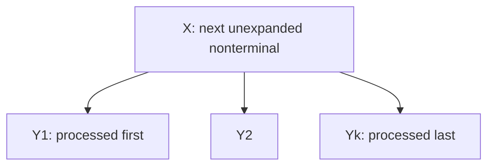

The diagram shows one top-down tree expansion. A terminal on top is matched and removed; that advances the boundary between matched u and the pending stack without adding a derivation step.

Example, for `S → A B`, `A → a`, `B → b` and input `ab$`:

| Stack, top at left | Input | Action | Derivation recorded |
|---|---|---|---|
| S $ | ab$ | Expand S→AB; physically push B then A | S⇒AB |
| A B $ | ab$ | Expand A→a | S⇒AB⇒aB |
| a B $ | ab$ | Match a | unchanged |
| B $ | b$ | Expand B→b | S⇒AB⇒aB⇒ab |
| b $ | b$ | Match b | unchanged |
| $ | $ | Accept | complete |

At every expansion the stack selects the leftmost outstanding tree node, so the result is a top-down, leftmost derivation rather than a rightmost derivation.

**Reference basis:** Rumi PDF pp. 464, 465, 466, 467, 468, 469, 471, 472, 474, 475.

**Verification:**

- Checked the stack invariant before and after expansion and terminal matching, including the epsilon case.

### 8 - Handle pruning for abbcde

Topics: LR parsing

#### Question

Define a “handle” in LR parsing. For the grammar, **(15)**

```text
S → aAcBe
A → Ab | b
B → d
```

and the input string `abbcde`, identify the handles and show how these are being pruned for a case of LR parsing. You need to construct a table with the columns Stack, Input, and Action as a part of your answer.

#### Solution

A **handle** is a production `A → β` together with an occurrence of β in a right-sentential form such that replacing that occurrence by A reverses one step of a rightmost derivation. It is an occurrence at a particular position, not merely any substring matching a production body.

The rightmost derivation is:

```text
S ⇒ a A c B e ⇒ a A c d e ⇒ a A b c d e ⇒ a b b c d e
```

Consequently the successive handles and prunings are:

```text
a [b] b c d e  → a A b c d e       A → b
a [A b] c d e  → a A c d e         A → A b
a A c [d] e    → a A c B e         B → d
[a A c B e]    → S                 S → a A c B e
```

In the first line, the handle is the **first b**, not the second b. A symbol-stack trace (top at right) is:

| Stack | Input | Action |
|---|---|---|
| $ | abbcde$ | shift a |
| $ a | bbcde$ | shift b |
| $ a b | bcde$ | reduce A→b |
| $ a A | bcde$ | shift b |
| $ a A b | cde$ | reduce A→Ab |
| $ a A | cde$ | shift c |
| $ a A c | de$ | shift d |
| $ a A c d | e$ | reduce B→d |
| $ a A c B | e$ | shift e |
| $ a A c B e | $ | reduce S→aAcBe |
| $ S | $ | accept |

Each handle is on top of the stack immediately before its reduction. Reversing the reduction sequence reproduces the rightmost derivation above. Numerical LR states are unnecessary for this handle-pruning trace.

**Reference basis:** Rumi PDF pp. 513, 514, 515, 516, 517, 518, 519.

**Verification:**

- Reversed the four reductions and reconstructed exactly S⇒aAcBe⇒aAcde⇒aAbcde⇒abbcde.

### 9 - Augmentation and initial LR(1) closure

Topics: LR parsing; FIRST and FOLLOW

#### Question

Augment the modified expression grammar given below and hence construct the initial set (often indicated as I0) of LR(1) items. **(15)**

```text
E → E + T | T
T → T * F | F
F → id
```

> **Assumptions and source notes**
> - The supplied notes pages demonstrate LR(0)/SLR closure; the FIRST(βa) lookahead propagation above is the explicitly derived canonical LR(1) extension.

#### Solution

Introduce a fresh start symbol E′:

```text
E′ → E
E  → E + T | T
T  → T * F | F
F  → id
```

Start with `[E′ → ·E, $]`. The LR(1) closure rule is: from `[A → α·Bβ, a]`, add `[B → ·γ, b]` for every production `B → γ` and every `b ∈ FIRST(βa)`, repeating to a fixed point.

The resulting I₀ is shown compactly below. A lookahead set denotes one separate LR(1) item for **each** element in that set.

| Dotted production | Lookaheads |
|---|---|
| E′ → ·E | {$} |
| E → ·E + T | {$, +} |
| E → ·T | {$, +} |
| T → ·T * F | {$, +, *} |
| T → ·F | {$, +, *} |
| F → ·id | {$, +, *} |

This is **14 individual LR(1) items**: 1+2+2+3+3+3.

Why the extra lookaheads appear:

1. The seed adds both E-productions with `$`.
2. In `E → ·E + T`, `FIRST(+T a)={+}`, so both E-productions also get `+`.
3. `E → ·T` passes `$` and `+` to both T-productions.
4. In `T → ·T * F`, `FIRST(*F a)={*}`, so the T-productions also get `*`.
5. `T → ·F` passes all three lookaheads to `F → ·id`.

No item for `(E)` is added because this modified grammar has no such production. No completed item occurs in I₀.

The supplied Rumi notes establish augmentation and the fixed-point LR(0) closure construction (PDF pp589–594). The table here is the worked **LR(1) extension**, using FIRST of the suffix plus lookahead rather than dropping lookaheads as in LR(0).

**Reference basis:** Rumi PDF pp. 543, 589, 591, 592, 593, 594.

**Verification:**

- Computed canonical LR(1) closure programmatically to a fixed point: 14 items with exactly the six dotted productions and lookahead sets displayed.

## Section B

### 10(a) - Declaration SDT for scalar and array types

Topics: Syntax-directed translation; Types and arrays

#### Question

Below is a grammar for variable declarations of the forms such as `int i, k[2], j[2][3];` Now write an SDT to save the type and width information of all the declared identifiers in the symbol table. Assume that (i) types are represented as type expressions and (ii) widths of an integer and a float are 4 and 8 bytes, respectively. Make other justified assumptions as required. **(12)**

```text
V → T D ;
T → int | float
D → D1 , id C | id C
C → [ num ] C1 | ε
```

> **Assumptions and source notes**
> - KMS PDF pp126–130 contain swapped base-type names in parts of their rule tables (int shown as float and float as int). The question and the annotated int-array tree establish int/4 and float/8, which this answer uses.

#### Solution

Let `array(n,t)` denote an n-element array of type t. Assume dimensions are positive integer constants; there is no alignment padding in an array; and the current symbol table has `install(name,type,width)`. Each declaration has one common base type, so two declaration-local variables `baseType` and `baseWidth` can carry that type through D and C. They are set before D is processed.

```text
V → T { baseType = T.type; baseWidth = T.width; } D ;

T → int   { T.type = int;   T.width = 4; }
T → float { T.type = float; T.width = 8; }

D → D1 , id C
    { install(id.lexeme, C.type, C.width); }
D → id C
    { install(id.lexeme, C.type, C.width); }

C → [ num ] C1
    { C.type = array(num.val, C1.type);
      C.width = num.val * C1.width; }
C → ε
    { C.type = baseType;
      C.width = baseWidth; }
```

The action after T initializes the shared base information. The ε suffix starts with the scalar type; each surrounding pair of brackets wraps the completed inner type and multiplies its width. The D-action then installs the identifier with the **whole** C type, so the first dimension stays outermost.

For `int i, k[2], j[2][3];`:

| Identifier | Type expression | Width in bytes |
|---|---|---:|
| i | int | 4 |
| k | array(2,int) | 2×4 = 8 |
| j | array(2,array(3,int)) | 2×(3×4) = 24 |

If relative storage locations are also wanted, an offset initially 0 may be stored with each entry and increased by that entry's width: i at 0, k at 4, j at 12, next free byte 36. Offsets are optional here; the requested fields are type and width.

The declaration-local base variables are safe because this grammar does not nest V declarations inside a C suffix. A reentrant implementation can instead pass the same information as inherited attributes. The left-recursive D grammar is retained as requested; this is an SDT, not a claim that the original grammar can be parsed directly by predictive recursive descent.

**Reference basis:** KMS PDF pp. 118, 119, 125, 126, 127, 128, 130, 131.

**Verification:**

- Visually checked KMS p126 against its extracted text; confirmed the base-type typo and the correct array(2,array(3,int)) width 24 in the tree.
- Calculated example widths 4,8,24 and cumulative offsets 0,4,12,36.

### 10(b) - Three-address code for a[b[i]][c[j]]

Topics: Syntax-directed translation; Types and arrays; Intermediate code

#### Question

Below is an SDT for generating three-address code for array references. What will be the three-address code for the expression `a[b[i]][c[j]]` generated by the given SDT? Assume that the arrays a, b and c are declared as, `int a[5][5], b[3], c[3]` and types and widths of the arrays have correctly been saved in the symbol table. The attributes associated with the terminals and nonterminals have their usual meanings. Make other justified assumptions as required. **(11)**

```text
L → id [ E ]
    { L.array = top.get(id.lexeme);
      L.type = L.array.type.elem;
      L.addr = new Temp();
      gen(L.addr '=' E.addr '*' L.type.width); }

  | L1 [ E ]
    { L.array = L1.array;
      L.type = L1.type.elem;
      t = new Temp();
      L.addr = new Temp();
      gen(t '=' E.addr '*' L.type.width);
      gen(L.addr '=' L1.addr '+' t); }

E → id
    { E.addr = top.get(id.lexeme); }

  | L
    { E.addr = new Temp();
      gen(E.addr '=' L.array.base '[' L.addr ']'); }
```

> **Assumptions and source notes**
> - Uses zero-based row-major layout and byte-offset array instructions, matching the supplied SDT. The SDT does not emit bounds checks.

#### Solution

Assume zero-based, row-major arrays and that an array reference `base[offset]` uses a **byte offset**. An `int` has width 4.

| Array | Type | Full width | Element/subarray width used by first index |
|---|---|---:|---:|
| a | array(5,array(5,int)) | 100 | 20 |
| b | array(3,int) | 12 | 4 |
| c | array(3,int) | 12 | 4 |

Executing the given SDT left-to-right generates:

```text
t1 = i * 4
t2 = b[t1]
t3 = t2 * 20
t4 = j * 4
t5 = c[t4]
t6 = t5 * 4
t7 = t3 + t6
t8 = a[t7]
```

For `b[i]`, the L-production computes byte offset t1 and `E → L` loads its value into t2. The first a index therefore computes `20*b[i]`; after this index `L.type=array(5,int)`, width 20. The `c[j]` reference similarly loads its integer value into t5. The second a index selects an int, so its stride is 4; the outer `L → L1[E]` adds the offsets, and the final `E → L` loads a's scalar element.

The final offset is `20*b[i] + 4*c[j] = 4*(5*b[i]+c[j])`, and the expression's value is t8. The SDT supplies no bounds checks; valid execution assumes i,j index b,c and the loaded b[i],c[j] values lie in 0…4.

**Reference basis:** KMS PDF pp. 147, 148, 149, 150, 151.

**Verification:**

- Symbolically evaluated the generated offset as 4*(5*b[i]+c[j]); verified all strides against the declared int-array widths.

### 10(c) - Implement prefix SDT after building a parse tree

Topics: Syntax-directed translation; LL parsing; LR parsing

#### Question

The following SDT prints the prefix form of an expression, i.e., performs infix to prefix translation. Explain why it is not possible to implement the SDT during either top-down or bottom-up parsing. Describe, then, how such an SDT can be implemented. **(6+6)**

```text
L → E n
E → {print('+');} E1 + T
E → T
T → {print('*');} T1 * F
T → F
F → (E)
F → digit {print(digit.level);}
```

> **Assumptions and source notes**
> - Original prompt says digit.level; KMS p59 prints digit.lexval. A literal undefined level attribute would not define the intended prefix translation.
> - Original L→E n does not define n; interpreted as an end delimiter, with the literal-terminal alternative stated.

#### Solution

The printed action for `E → E1 + T` must output `+` **before** output for E1, although the parser has not yet seen the `+` that confirms this production when it begins E1. The same problem occurs for `T → T1 * F`.

**Top-down:** the grammar is left-recursive, so direct predictive recursive descent already fails. More fundamentally, executing the leading print action requires deciding the full operator structure before the left operand is parsed. The action cannot simply be copied into an LL parser to preserve the specified output order.

**Bottom-up:** a normal reduction recognizes `E1 + T` only after E1 and T have been read. Their operand output would already have happened if actions were executed immediately, so printing `+` at reduction gives postfix order instead. Treating the leading action as an ε marker would demand that same premature decision before the operator has been recognized. Thus the given action placements do not admit the ordinary direct parsing-time implementation described in the notes.

A general implementation is:

1. Parse the input **ignoring actions**, constructing the complete parse tree.
2. Insert an action child at each action's precise position in the corresponding production body: `print('+')` before E1, `print('*')` before T1, and digit printing after the digit leaf.
3. Traverse the augmented tree in preorder, visiting children left to right, and execute an action when its node is visited.

For `3*5+4`, the resulting tree visits the action for the root `+`, then `*` in the left subtree, then digits 3,5,4. The output is `+ * 3 5 4`. Equivalently, construct an AST and print every operator before its operands; or synthesize strings and emit the final string after parsing. These defer irreversible output until the expression's structure is known.

**Transcription details.** The question prints `digit.level`. The reference example on KMS PDF p59 visibly uses `digit.lexval`; prefix translation requires the digit's lexical value. This answer treats `level` as that typo, rather than silently assigning it a new meaning. `L → E n` is preserved: n is treated as the line/end delimiter (often newline); if it is instead a literal terminal `n`, the translation still just consumes that delimiter without printing it.

**Reference basis:** KMS PDF pp. 59, 60, 61, 63.

**Verification:**

- Rendered and visually read KMS p59 to verify digit.lexval and the action positions.
- Traced the action-node preorder for 3*5+4 and obtained + * 3 5 4.

### 11(a) - Basic blocks and flow graph for matrix transpose

Topics: Code optimization; Control flow and backpatching

#### Question

Consider the three-address code below and answer the following questions.

```text
 1  L1:  i = 0
 2  L3:  d = 4
 3  L4:  iffalse i < d goto L2
 4  L5:  j = i + 1
 5  L6:  iffalse j < d goto L7
 6  L8:  t1 = i * 16
 7       t2 = j * 4
 8       t3 = t1 + t2
 9       temp = a[t3]
10  L9:  t4 = i * 16
11       t5 = j * 4
12       t6 = t4 + t5
13       t7 = j * 16
14       t8 = i * 4
15       t9 = t7 + t8
16       t10 = a[t9]
17       a[t6] = t10
18  L10: t11 = j * 16
19       t12 = i * 4
20       t13 = t11 + t12
21       a[t13] = temp
22  L11: j = j + 1
23       goto L6
24  L7:  i = i + 1
25       goto L4
26  L2:
```


Identify the basic blocks and construct the flow graph for the given code. **(17)**

#### Solution

Leaders are **1,3,4,5,6,24,26**: instruction 1 starts the program; 3,5,24,26 are jump targets; and 4,6 follow conditional branches. Merely having a label does not force a new block when that label is never a branch target.

| Block | Instructions | Meaning / ending |
|---|---|---|
| B1 | 1–2 | Initialize i=0 and d=4 |
| B2 | 3 | Test i<d; false→B7 |
| B3 | 4 | Initialize j=i+1 |
| B4 | 5 | Test j<d; false→B6 |
| B5 | 6–23 | Compute offsets, exchange a[i][j]/a[j][i], increment j; goto B4 |
| B6 | 24–25 | Increment i; goto B2 |
| B7 | 26 | Exit label L2 |

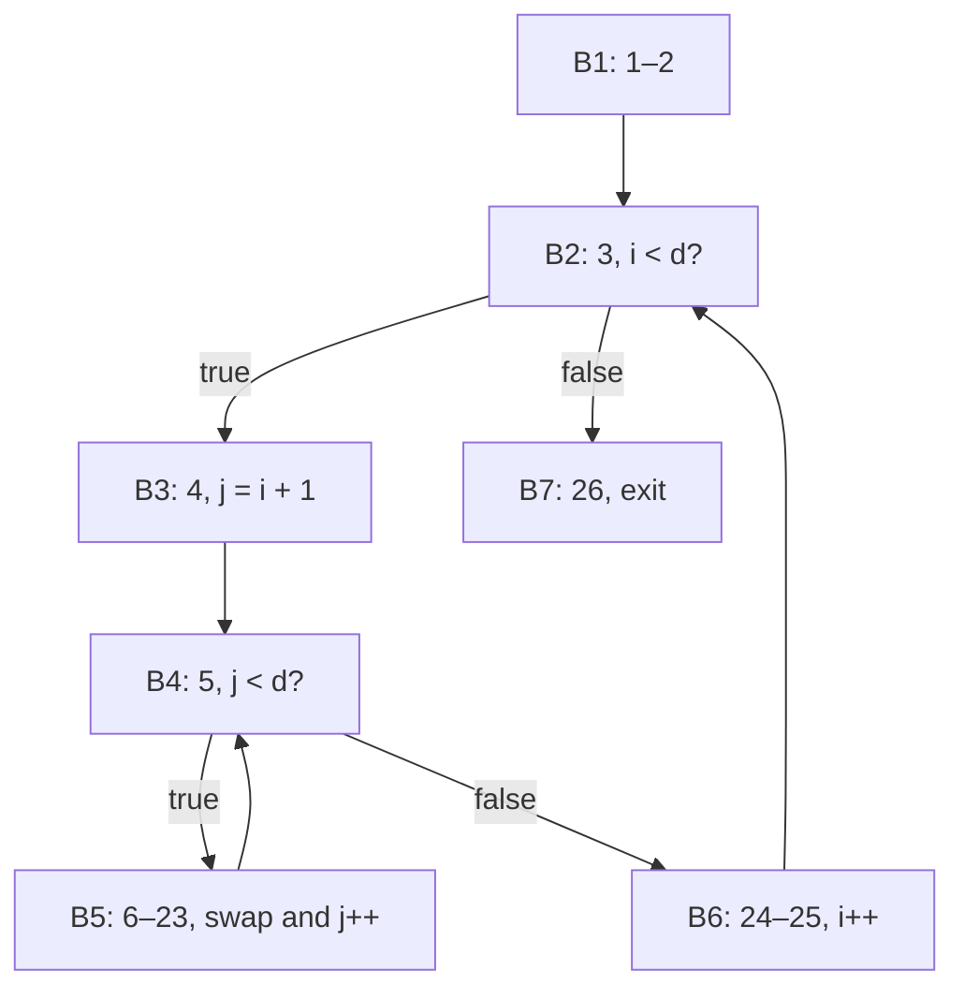

The inner natural loop is B4–B5; the outer loop comprises B2,B3,B4,B5,B6. B1 is a preheader. Labels L3,L5,L8,L9,L10,L11 are not independently targeted by the given branches, so they need no extra block split.

**Reference basis:** KMS PDF pp. 322, 324, 325, 326, 327, 329, 330.

**Verification:**

- Applied all three leader rules to the exact 26-line listing and checked each branch/fall-through edge against the seven-block graph.

### 11(b) - Optimize the transpose loop and remove induction variables

Topics: Code optimization; Types and arrays; Intermediate code

#### Question

Consider the three-address code below and answer the following questions.

```text
 1  L1:  i = 0
 2  L3:  d = 4
 3  L4:  iffalse i < d goto L2
 4  L5:  j = i + 1
 5  L6:  iffalse j < d goto L7
 6  L8:  t1 = i * 16
 7       t2 = j * 4
 8       t3 = t1 + t2
 9       temp = a[t3]
10  L9:  t4 = i * 16
11       t5 = j * 4
12       t6 = t4 + t5
13       t7 = j * 16
14       t8 = i * 4
15       t9 = t7 + t8
16       t10 = a[t9]
17       a[t6] = t10
18  L10: t11 = j * 16
19       t12 = i * 4
20       t13 = t11 + t12
21       a[t13] = temp
22  L11: j = j + 1
23       goto L6
24  L7:  i = i + 1
25       goto L4
26  L2:
```


Optimize the code by using applicable transformations from the following list. (i) common subexpression elimination, (ii) copy propagation, (iii) dead code elimination, (iv) reduction in strength on induction variables, (v) elimination of induction variables. **(18)**

> **Assumptions and source notes**
> - Assumes ordinary nonvolatile array storage, no aliasing of scalar variables with array elements, and compiler temporaries dead on exit. Final i=4,j=4,d=4 are explicitly preserved.
> - The bounds and strides are specific to the exact 4×4/4-byte listing; this code must be rederived for other dimensions.

#### Solution

With 4-byte elements and 16-byte rows, the two addresses are `16*i+4*j` and `16*j+4*i`. The loop swaps each off-diagonal pair once, for `0 ≤ i < j < 4`, so its effect is to transpose a 4×4 matrix.

**Common subexpressions, copies, and dead computations.** Within the inner body, replace `t4` by t1, `t5` by t2, and `t6` by t3. Similarly replace t11 by t7, t12 by t8, and t13 by t9. Propagate these copies into the stores and remove the unused copies/computations. The body becomes:

```text
t1 = i * 16
t2 = j * 4
t3 = t1 + t2
temp = a[t3]
t7 = j * 16
t8 = i * 4
t9 = t7 + t8
t10 = a[t9]
a[t3] = t10
a[t9] = temp
j = j + 1
goto L6
```

Do not remove either array load or reorder a load past a store: the two original values must be saved before the exchange.

**Strength reduction.** At fixed i, define `p=16*i+4*j` and `q=16*j+4*i`. Incrementing j increases p by 4 and q by 16. At the start of each row, j=i+1 gives `p=20*i+4` and `q=20*i+16`. Put `diag=20*i` and `rowEnd=16*i+16`; p<rowEnd is equivalent to j<4. Across outer iterations, diag increases by 20 and rowEnd by 16. The outer test i<4 becomes diag<80.

A final optimized version is:

```text
    d = 4
    diag = 0
    rowEnd = 16
Outer:
    iffalse diag < 80 goto Done
    p = diag + 4
    q = diag + 16
Inner:
    iffalse p < rowEnd goto NextRow
    temp = a[p]
    value = a[q]
    a[p] = value
    a[q] = temp
    p = p + 4
    q = q + 16
    goto Inner
NextRow:
    diag = diag + 20
    rowEnd = rowEnd + 16
    goto Outer
Done:
    i = 4
    j = 4
```

The final assignments preserve the original loop counters if they are observable after exit; they can be deleted when i,j are dead. Retaining d=4 also preserves d. Compiler temporaries and the new induction variables are assumed dead on exit. There are no multiplications in the transformed loop, and the original induction variables i and j no longer control it.

The actual swap offsets are:

| (i,j) | p | q |
|---|---:|---:|
| (0,1) | 4 | 16 |
| (0,2) | 8 | 32 |
| (0,3) | 12 | 48 |
| (1,2) | 24 | 36 |
| (1,3) | 28 | 52 |
| (2,3) | 44 | 56 |

For i=3 the inner loop is empty, as in the original; the final counters are i=j=4. Strength reduction is based on the listed induction-variable rules, and CSE/copy propagation remove the repeated offset arithmetic rather than assuming array values remain invariant across stores.

**Reference basis:** KMS PDF pp. 337, 338, 344, 345, 540, 541, 552, 554, 555, 559, 560, 561, 563, 565.

**Verification:**

- Executed original and optimized loops on 100 randomized 4×4 matrices; complete final arrays and i,j,d agree.
- Verified exactly six swaps with the offset pairs shown; diagonal elements remain unchanged and every off-diagonal pair is exchanged once.

### 12(a) - Short-circuit boolean code with backpatching

Topics: Control flow and backpatching; Syntax-directed translation; Intermediate code

#### Question

What is backpatching? Write down a translation scheme (semantic actions) for generating code using backpatching for boolean expressions yielded by the following productions. You may add marker symbols in the productions as required. **(3+9)**

```text
B → B1 || B2
B → B1 && B2
B → E1 rel E2
```

#### Solution

**Backpatching** emits a jump before its destination is known, records the jump's instruction number in a list, and fills the destination later. It enables one-pass construction of short-circuit boolean code.

Use synthesized lists `B.truelist` and `B.falselist`; `nextinstr` is the next instruction number. `makelist(i)` creates a singleton list, `merge(p,q)` joins lists, and `backpatch(p,k)` writes target k into every jump in p. Add a marker M at the beginning of the second operand:

```text
B → B1 || M B2
    { backpatch(B1.falselist, M.instr);
      B.truelist = merge(B1.truelist, B2.truelist);
      B.falselist = B2.falselist; }

B → B1 && M B2
    { backpatch(B1.truelist, M.instr);
      B.truelist = B2.truelist;
      B.falselist = merge(B1.falselist, B2.falselist); }

B → E1 rel E2
    { B.truelist = makelist(nextinstr);
      B.falselist = makelist(nextinstr + 1);
      gen('if ' E1.addr rel.op E2.addr ' goto __');
      gen('goto __'); }

M → ε
    { M.instr = nextinstr; }
```

`gen` appends one instruction and increments nextinstr. The marker captures the second operand's start **before** that operand emits code. For OR, only a false first operand needs to evaluate B2; for AND, only a true first operand does. The result lists remain unresolved until an enclosing boolean/statement supplies their destinations. Expression evaluation, if needed, occurs before the relational test; rel.op identifies the actual comparison.

**Reference basis:** KMS PDF pp. 184, 185, 186, 187, 188, 191, 192.

**Verification:**

- Checked OR patches only the first falselist and AND only the first truelist; both preserve the required short-circuit behavior.

### 12(b) - Annotated backpatch tree beginning at instruction 200

Topics: Control flow and backpatching; Syntax-directed translation; Intermediate code

#### Question

Based on the SDT in Question 12(a) above, draw the annotated parse tree for the expression: `x != y && x > 20 || x < 100`. Assume that the operators `||` and `&&` are left-associative and `&&` has higher precedence than `||`. Assume that the starting instruction number is 200. **(10)**

Referenced productions from 12(a):

```text
B → B1 || B2
B → B1 && B2
B → E1 rel E2
```

> **Assumptions and source notes**
> - No enclosing statement gives final true/false target addresses. The final truelist/falselist are retained as the correct unresolved interface; all internal branches have numeric targets.
> - Constants 20 and 100 are taken as immediate operands, so no extra constant-load TAC instructions alter the requested start numbering.

#### Solution

The stipulated precedence gives **`((x != y) && (x > 20)) || (x < 100)`**. Treat identifiers and constants as directly available operands, so each comparison emits two instructions.

The annotated parse tree is shown below. `T` and `F` mean truelist and falselist; each marker derives ε.

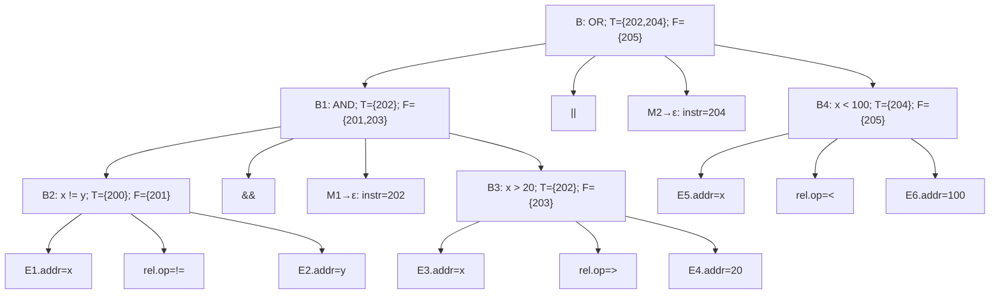

Emitting left to right gives leaf lists `{200}/{201}`, `{202}/{203}`, `{204}/{205}`. At AND, backpatch `{200}` to 202, yielding `T={202}, F={201,203}`. At OR, backpatch `{201,203}` to 204, yielding `T={202,204}, F={205}`. The code after all **internal** backpatching is:

```text
200: if x != y goto 202
201: goto 204
202: if x > 20 goto __true__
203: goto 204
204: if x < 100 goto __true__
205: goto __false__
```

The remaining lists are the final expression's result: backpatch instructions 202 and 204 to the enclosing true destination, and instruction 205 to its false destination. Neither destination is specified by this question, so inventing numeric continuation addresses would hide necessary context. `nextinstr=206` after emitting the expression.

If x=y, control skips `x>20` and evaluates `x<100`. If x≠y and x>20, control takes the true continuation without evaluating `x<100`. These paths match the requested short-circuit expression.

**Reference basis:** KMS PDF pp. 185, 186, 187, 188, 191, 192.

**Verification:**

- Simulated the six-instruction control flow over a grid of x,y values and matched ((x!=y) and (x>20)) or (x<100) in every case.
- Checked instruction range 200–205, marker addresses 202/204, final lists {202,204}/{205}, and nextinstr 206.

### 12(c) - Stable mark-and-compact locations after deleting A to C

Topics: Garbage collection; Runtime environments

#### Question

Consider the network of objects below. Suppose at some point in time, the pointer `A → C` is deleted. Then we perform a mark-and-compact garbage collector on the network. Also, suppose that, **(13)**

i. Each object has size 50 bytes, and

ii. Initially, all the nine objects in the heap are arranged in alphabetical order, starting at byte 0 of the heap.

What is the address of each object after garbage collection? Draw the heap showing locations of the allocated objects before and after running garbage collection.

**Figure for Question 12(c) - directed object network before the specified deletion**


> **Assumptions and source notes**
> - Assumes X is the sole external root and compaction preserves old address order, as in the notes’ low-to-high NewLocation scan. Other roots or a different placement policy could change reachability or addresses.

#### Solution

Treat X as a root outside the nine-object heap. After deleting A→C, trace from X→A:

```text
A → B
B → D, E
D → G
G → E, I
E → H
H → I
```

Thus the reachable set is **{A,B,D,E,G,H,I}**. C and F are unreachable, even though their outgoing edges lead to live objects; outgoing pointers from unreachable objects do not keep their source objects alive. The G→E edge remains present.

Use the notes' mark-and-compact order: mark reachable objects, scan the old heap from low to high and assign packed addresses, then move objects and update all root/object pointers.

| Object | Before: byte interval | Reachable? | After: byte interval |
|---|---|---|---|
| A | 0–49 | yes | 0–49 |
| B | 50–99 | yes | 50–99 |
| C | 100–149 | no | reclaimed |
| D | 150–199 | yes | 100–149 |
| E | 200–249 | yes | 150–199 |
| F | 250–299 | no | reclaimed |
| G | 300–349 | yes | 200–249 |
| H | 350–399 | yes | 250–299 |
| I | 400–449 | yes | 300–349 |

The heap layout before collection is `A | B | C | D | E | F | G | H | I`, one 50-byte slot each. After collection it is `A | B | D | E | G | H | I | free 350–449`. The new allocation pointer is **350**, with 100 bytes reclaimed.

Updated pointers, shown as object:start-address, are:

```text
X → A:0
A:0   → B:50
B:50  → D:100, E:150
D:100 → G:200
E:150 → H:250
G:200 → E:150, I:300
H:250 → I:300
```

In particular, G's reference to E must be rewritten from old address 200 to new address 150. Moving bytes without fixing references would not be a correct compacting collector.

**Reference basis:** KMS PDF pp. 266, 280, 281, 282, 283, 284.

**Verification:**

- Ran graph reachability after removing only A→C: exactly seven live objects and C,F dead.
- Computed packed offsets with 50-byte objects and checked all remaining edges, including G→E, against the new address map.

### 13(a) - Backward liveness and next-use table

Topics: Liveness analysis; Code optimization; Register allocation

#### Question

Determine the liveness and next-use information for each statement in the following basic block. Also show the state of the symbol table at each of the steps of your algorithm. How does next-use information facilitate code optimization? Illustrate using the example of the given basic block. **(12+6)**

```text
t = a + b
u = c + d
t = d - b
v = a + c
d = t + v
```

> **Assumptions and source notes**
> - Exit liveness is not specified in the question. This table uses the notes’ convention: a,b,c,d live out and t,u,v temporary/dead out. The consequences of another boundary are stated.
> - Dead arithmetic can be removed only when its evaluation has no observable side effects or required trap behavior.

#### Solution

Number the statements 1…5. Following KMS PDF p333, initialize non-temporary a,b,c,d as live on exit. Treat t,u,v as compiler temporaries dead on exit. `Lk` means live with next local use at statement k; `L–` means live beyond the block with no next use inside it; `N` means dead with no next use.

Scan backward. For `i: x=y op z`, first attach the current table states of x,y,z (the state **after** i); then set x to N and set y,z to Li. The attached information is:

| Statement | Defined variable after statement | First operand after statement | Second operand after statement |
|---|---|---|---|
| 1: t=a+b | t: N | a: L4 | b: L3 |
| 2: u=c+d | u: N | c: L4 | d: L3 |
| 3: t=d-b | t: L5 | d: N | b: L– |
| 4: v=a+c | v: L5 | a: L– | c: L– |
| 5: d=t+v | d: L– | t: N | v: N |

The complete symbol-table state after each backward processing step (therefore **immediately before** that instruction in forward execution) is:

| Backward step / program point | a | b | c | d | t | u | v |
|---|---|---|---|---|---|---|---|
| Initialize: after 5 / exit | L– | L– | L– | L– | N | N | N |
| Process 5: before 5 | L– | L– | L– | N | L5 | N | L5 |
| Process 4: before 4 | L4 | L– | L4 | N | L5 | N | N |
| Process 3: before 3 | L4 | L3 | L4 | L3 | N | N | N |
| Process 2: before 2 | L4 | L3 | L2 | L2 | N | N | N |
| Process 1: before 1 / entry | L1 | L1 | L2 | L2 | N | N | N |

This information enables:

- **Dead-code elimination:** line 1's t is killed by line 3 before any use, and u from line 2 is never used. Both computations can be removed if these ordinary arithmetic operations have no observable traps/side effects. The useful block becomes `t=d-b; v=a+c; d=t+v`.
- **Register reuse:** after line 5, t and v are dead and need no stores. A register holding the old d can be reused after line 3 because that value has no subsequent use; line 5 defines a new d. A dead temporary is a better eviction choice than a live value; among live candidates, a more distant next use can guide spilling.
- **Preserving live values:** `L–` does not mean dead. a,b,c must remain available at exit (their memory copies are already valid), and the final d must be preserved.

The question does not state the exit live set. If t,u,v are intended as ordinary live-out variables instead, initialize them `L–`; in particular u then makes line 2 necessary. If all variables are dead on exit, the same backward algorithm applies but the final d computation is itself removable. Liveness is a property of a program point and a stated boundary, so that assumption cannot be hidden.

**Reference basis:** KMS PDF pp. 332, 333, 334, 344, 352, 355, 356.

**Verification:**

- Computed backward live/next-use states programmatically and matched all six full-table rows and all attached operand states.
- Verified that the t definition at line 1 reaches no use before line 3 and that u has no use in the block.

### 13(b) - Efficient two-register code and descriptors

Topics: Register allocation; Liveness analysis; Intermediate code

#### Question

Translate the following basic block consisting of three-address statements into machine-code instructions for the simple machine model of your text. Assume that **two** registers are available. Make sure the registers are allocated and assigned efficiently to avoid unnecessary loads and stores. Show the register and address descriptors after each step. Assume p and q are temporary variables and the remaining variables are live on exit from the block. **(17)**

```text
p = a + b
q = c - p
c = d
d = q - c
exit
```

#### Solution

Use the notes' machine model: `LD R,x` loads memory x; `ST x,R` stores a register; `ADD/SUB Rd,Rs1,Rs2` use two register operands and may overwrite an operand register. There are only R1 and R2. p,q are dead at exit; a,b,c,d are live. Initially the memory copy of each source variable is current.

An efficient instruction sequence is:

```text
LD  R1, a
LD  R2, b
ADD R1, R1, R2       // p = a+b
LD  R2, c
SUB R1, R2, R1       // q = old_c-p
LD  R2, d            // c=d: R2 now represents both c and old d
SUB R1, R1, R2       // d = q-c
ST  c, R2
ST  d, R1
```

No machine move is needed for `c=d`: the descriptor records that c and d share the value in R2 until d is redefined. Overwriting the old p or q is safe after its final use. a,b retain their unchanged memory values; p,q never need to be stored.

Let `Mx` mean the memory home of x. Descriptors below list locations of each **current** variable value; an omitted/stale memory location must not be used. Dead temporary names are removed once consumed, which is safe because they have no future uses.

| After instruction | R1 descriptor | R2 descriptor | a | b | c | d | p | q |
|---|---|---|---|---|---|---|---|---|
| initial | ∅ | ∅ | {Ma} | {Mb} | {Mc} | {Md} | ∅ | ∅ |
| LD R1,a | {a} | ∅ | {Ma,R1} | {Mb} | {Mc} | {Md} | ∅ | ∅ |
| LD R2,b | {a} | {b} | {Ma,R1} | {Mb,R2} | {Mc} | {Md} | ∅ | ∅ |
| ADD R1,R1,R2 | {p} | {b} | {Ma} | {Mb,R2} | {Mc} | {Md} | {R1} | ∅ |
| LD R2,c | {p} | {c} | {Ma} | {Mb} | {Mc,R2} | {Md} | {R1} | ∅ |
| SUB R1,R2,R1 | {q} | {c} | {Ma} | {Mb} | {Mc,R2} | {Md} | ∅ | {R1} |
| LD R2,d; bind c=d | {q} | {c,d} | {Ma} | {Mb} | {R2} | {Md,R2} | ∅ | {R1} |
| SUB R1,R1,R2 | {d} | {c} | {Ma} | {Mb} | {R2} | {R1} | ∅ | ∅ |
| ST c,R2 | {d} | {c} | {Ma} | {Mb} | {Mc,R2} | {R1} | ∅ | ∅ |
| ST d,R1 | {d} | {c} | {Ma} | {Mb} | {Mc,R2} | {Md,R1} | ∅ | ∅ |

When `c=d` occurs, old Mc becomes stale and is removed from c's descriptor. When the final subtraction redefines d, old Md becomes stale and d is removed from R2's descriptor, while c remains in R2. The two stores at exit make both changed live variables' memory homes current.

This uses **4 loads, 3 arithmetic instructions, and 2 stores**, with no spills or register-to-register copies. Under this model those counts are minimal: the four independent initial inputs a,b,c,d must be loaded, three arithmetic operations implement the TAC, and the two changed live-out values must be stored. Final values are `c=old_d` and `d=old_c-(a+b)-old_d`.

**Reference basis:** KMS PDF pp. 346, 348, 351, 352, 353, 354, 355, 356.

**Verification:**

- Simulated all nine instructions on 100 randomized initial values; final a,b,c,d match the TAC.
- Audited every load, overwrite, copy binding, and exit store against the displayed register/address descriptors; only R1,R2 are used.
